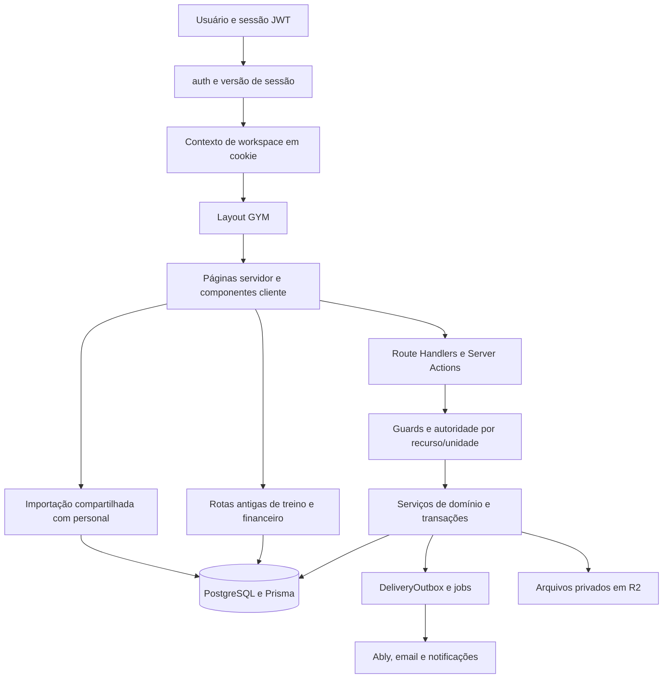

# AtlasFit — diagnóstico técnico e de produto da área de academias

Data: 01/11/2026. Base: checkout local, inclusive alterações ainda não commitadas. Este diagnóstico representa esse estado do workspace, não necessariamente a versão publicada.

**Atualização de implementação em 04/11/2026:** este documento conserva o diagnóstico original. Consulte [correcoes.md](correcoes.md) para mudanças, validação e pendências. As reproduções foram convertidas para regressões; as descrições de falhas abaixo são evidências históricas.

**Parecer:** há uma fundação relevante para gestão de academias, mas a versão atual precisa de uma rodada de consolidação antes de ser usada como sistema principal de uma operação física. Os maiores riscos são caminhos paralelos que aplicam regras diferentes ao mesmo aluno, treino, contrato e pagamento. O investimento inicial deve fechar essas divergências e validar uma jornada real de balcão. Em seguida, cobrança integrada e controle de entrada têm maior valor comercial para uma academia convencional; agenda de turmas tem prioridade maior para estúdios e boxes.

Documentos desta revisão:

- [Inventário de páginas, endpoints, serviços e modelos](inventario.md).
- [Consulta de dependências e triagem de aplicabilidade](dependencias.md).
- [Regressões locais após as correções](reproducoes.test.ts), com [configuração de execução](vitest.repro.config.mts), e [regressões HTTP/econômicas em PostgreSQL](../../../tests/gym/audit-remediation.integration.ts).

## 1. Alcance, método e limites

O inventário encontrou 21 páginas no grupo `(gym)`, 113 arquivos de rotas sob `/api/gym`, 169 handlers HTTP, 107 arquivos na camada de aplicação de workspaces e 143 modelos Prisma, dos quais 42 começam com `Gym`. Foram considerados também os caminhos compartilhados de autenticação, contexto, aluno, responsável, chat, realtime, armazenamento, migração, cron e cobrança da plataforma.

A leitura aprofundada acompanhou as cadeias tela → endpoint → autoridade → serviço → modelo nos fluxos de maior impacto. O inventário de todos os arquivos não equivale a homologar todas as combinações de tela, papel, unidade e estado. Esta é uma revisão de arquitetura e implementação com reproduções locais selecionadas, não um pentest externo nem uma certificação de segurança.

Não foram consultados registros pessoais do banco publicado, executadas migrations em produção, enviados emails/mensagens, realizadas cobranças ou acionados equipamentos. A revisão de UX é baseada no código e nas jornadas implementadas. Não houve navegação em uma sessão autenticada da academia: a integração de navegador disponível não apresentou superfícies acessíveis. Contraste, comportamento em dispositivos reais, acessibilidade com leitor de tela e tempos de produção continuam a exigir observação direta.

O checkout já tinha muitas alterações em andamento ao começar. Nenhum arquivo de produto foi alterado nesta análise. Foram criados apenas documentos e evidências de auditoria; arquivos auxiliares ficaram em `.tmp/gym-audit-20261101`.

Classificação adotada:

| Prioridade | Significado |
|---|---|
| P0 | Resolver antes de ampliar acesso ou usar como fonte principal de dados reais |
| P1 | Necessário para um piloto operacional confiável ou para monetização consistente |
| P2 | Evolução de escala, eficiência, cobertura de mercado ou redução de risco residual |

“Confirmado” indica comportamento diretamente demonstrado pelo código ou pelas reproduções controladas. “Risco” e “inferência” identificam consequências ou gargalos que ainda dependem de volume, configuração ou operação real. Prioridade de produto não é pontuação CVSS.

## 2. O que a arquitetura oferece hoje

### 2.1 Estrutura principal

O sistema é uma aplicação Next.js 16.2.6 com App Router, React 19.2.4 e TypeScript. O banco é PostgreSQL com Prisma 7.8.0 e adapter `pg`. NextAuth v5 usa Credentials e sessões JWT, complementadas por versão de sessão persistida no usuário. Tailwind 4 e componentes locais shadcn/Radix/Base UI compõem a interface; Valtio guarda contexto e estado cliente.



As duas últimas cadeias explicam uma parte importante dos achados: existem serviços específicos e mais defensivos, mas eles não são o único caminho de entrada para os dados.

### 2.2 Identidade e autorização

`User` é a identidade global. `Workspace` representa a organização; `WorkspaceMember` representa o vínculo. Uma pessoa pode participar de mais de um workspace. `WorkspaceRoleGrant` permite múltiplos papéis e concessões por unidade. A autorização usa capacidades como `students.manage`, `health.read.assigned`, `payments.record` e `refunds.approve`.

Pontos positivos observados:

- O servidor valida vínculo ativo, tipo de workspace, licença, capacidade e, em vários serviços, unidade e atribuição do aluno.
- Papéis revogados não voltam automaticamente a valer pelo campo legado quando já existem grants.
- Há revalidação dentro de transações de comandos importantes, proteção de titularidade e transferência auditada.
- Versão de sessão permite invalidar sessões existentes após mudanças relevantes; suporte por impersonação registra ator original e usuário efetivo.
- Existem MFA por email/TOTP, proteção contra reutilização de fator e política configurável para gestores/financeiro.

Referências: [guard](../../../src/modules/workspaces/application/guard.ts), [autoridade de comandos](../../../src/modules/workspaces/application/actor-authority.ts), [autoridade por aluno](../../../src/modules/workspaces/application/student-authority.ts), [papéis e capacidades](../../../src/modules/workspaces/domain/roles.ts), [autenticação](../../../src/auth.ts).

O modelo é uma boa base. A fragilidade é a aplicação desigual dessas regras nas rotas alternativas, especialmente em treinos, importação e financeiro legado.

### 2.3 Dados e domínios

| Domínio | Entidades e responsabilidades principais |
|---|---|
| Organização | Workspace, GymSettings, GymUnit, WorkspaceSubscription |
| Equipe | WorkspaceMember, WorkspaceRoleGrant, WorkspaceInvitation, GymStaffProfile |
| Alunos | GymStudentProfile, vínculo, profissional atribuído e identificação administrativa |
| Responsáveis | GymGuardian, identidade verificada e poderes independentes para representação, finanças e saúde |
| Contratos | GymPlan, GymPlanVersion, GymEnrollment, GymContractAcceptance, eventos, pausas e revisões |
| Financeiro atual | GymInvoice, itens, GymPayment, GymPaymentAllocation, contas, despesas, fornecedores, caixa e transferências |
| Financeiro legado ainda alcançável | WorkspacePayment e campos billing de WorkspaceMember |
| Treino e saúde | Workout, grupos/exercícios, WorkoutLog, PhysicalEvaluation, StudentProgress, fotos, arquivos e healthData local |
| Comunicação | Conversation, participantes, Message, Notification, GymCommunicationDispatch e DeliveryOutbox |
| Privacidade e encerramento | DataSubjectRequest, aceite legal, restrição de tratamento, retenção, encerramento e GymPurgeJob |
| Estrutura histórica sem operação atual | Modelos de turmas, reservas, dispositivos, concessões e logs de acesso físico |

O financeiro novo usa valores em centavos com `BigInt`, alocações explícitas, idempotência e reversões. Há índices e triggers SQL que reforçam identidade e relações no mesmo tenant. Isso é substancialmente melhor que relacionar pagamentos apenas por nome. Entretanto, os dois modelos ainda estão simultaneamente expostos na interface.

Esses triggers não autorizam leitura por usuário. Não foram encontradas políticas RLS nos históricos SQL pesquisados; o isolamento de leitura depende dos guards e predicados da aplicação. A extensão do singleton Prisma não aplica um filtro universal de tenant a todos os modelos. Portanto, uma FK ou trigger de relação não corrige uma consulta autorizada no workspace errado, como A01. RLS pode ser considerada como defesa adicional, depois de corrigir os caminhos de aplicação e definir como propagar identidade de forma segura nas conexões do pool.

### 2.4 Escopo efetivamente disponível

| Recurso | Situação observada |
|---|---|
| Cadastro de alunos/equipe, responsáveis e atribuições | Implementado, com diferenças entre cadastro dedicado e importação compartilhada |
| Catálogo, aceite, pausas, cancelamento, renovação e troca de plano | Implementados; edição genérica contorna parte das garantias |
| Financeiro local, caixa, contas, despesas e recibos | Implementados no caminho novo; ficha do aluno usa caminho legado |
| Treinos, avaliações, evolução e arquivos | Implementados; rotas e interface precisam de uniformização |
| Extrato e contrato no portal do aluno/responsável | Há caminhos específicos de academia |
| Cobrança automática dos alunos pela academia | Retirada do escopo atual; rotas externas retornam operação retirada |
| Pagamento da academia ao AtlasFit | Nova integração SaaS existe, com problemas de correlação e ciclo de vida |
| Catraca, leitor biométrico/facial e agente local | Não há operação atual demonstrável no código de aplicação |
| Turmas, vagas, reservas e fila de espera | Modelos históricos permanecem; não há jornada operacional atual de academia |
| Mensagens entre funcionários | Backend compartilhado permite contatos elegíveis; falta jornada acessível no shell GYM |
| CRM de leads e automações de retenção da academia | Não há módulo operacional GYM atual equivalente ao de plataformas completas |

O [backlog](../../gym/backlog.md) informa que CRM, aulas, equipamentos e gateway GYM foram retirados. Já [checklist do piloto](../../gym/piloto-checklist.md) e [runbooks](../../gym/runbooks.md) ainda descrevem instalação de agente, catraca e Asaas como operação. Esse conflito precisa ser resolvido antes de treinamento ou venda.

## 3. Achados que devem orientar a próxima etapa

### A01 — P0 · Autorização de um workspace aplicada a um treino de outro

**Evidência confirmada e reproduzida com mocks de infraestrutura.** Em [workouts/[id]/route.ts](../../../src/app/api/gym/workouts/[id]/route.ts), linhas 16–47, o GET busca o treino somente por `id` e valida acesso usando `workspaceIdParam || workout.workspaceId`. Não compara o workspace solicitado com o workspace do treino. PUT e DELETE repetem o padrão nas linhas 82–94 e 221–243. A [duplicação](../../../src/app/api/gym/workouts/[id]/duplicate/route.ts), linha 35, também permite escolher o workspace usado para autorizar sem validar a origem.

Consequência: um operador autorizado na academia A, conhecendo um ID de treino de B, pode indicar A na requisição e alcançar conteúdo de B. O caminho de alteração/exclusão também não exige que o treino seja um modelo sem aluno nem valida autoria ou carteira. O DELETE faz exclusão física; registros dependentes podem impedir algumas exclusões no banco, mas isso não corrige o erro de autorização.

Os testes controlados demonstraram GET retornando um recurso estrangeiro, DELETE alcançando a exclusão por ID estrangeiro e duplicação copiando conteúdo estrangeiro. Nenhum banco real foi usado. A classificação corresponde ao problema de autorização por objeto descrito pela [OWASP](https://api-security.owasp.org/editions/2023/en/0xa1-broken-object-level-authorization/).

**Correção:** autorizar o recurso carregado no tenant selecionado, com igualdade obrigatória de escopo; conduzir todas as mutações pelos serviços específicos de treino. Para fichas de aluno, exigir atribuição e capacidade no mesmo comando. Transformar essas reproduções em regressões que esperam recusa, incluindo duas academias, duas unidades, autor diferente e treino individual.

### A02 — P0 · A ficha do aluno mantém um segundo financeiro

**Confirmado no encadeamento tela/API/modelo.** A [ficha compartilhada](../../../src/components/students/student-profile-view.tsx) consulta `/api/gym/students/[id]/finance`. Esse [endpoint](../../../src/app/api/gym/students/[id]/finance/route.ts), linhas 42–49, busca `WorkspacePayment` por `workspaceId` e `studentName`. O POST, linhas 143–153, cria nesse mesmo modelo com `parseFloat(amount)` e status enviado pelo cliente. O PUT grava recorrência nos campos billing do membro.

O financeiro principal usa `GymInvoice`, `GymPayment` e alocações, pelo [ManualFinanceService](../../../src/modules/workspaces/application/manual-finance-service.ts). O [extrato do aluno](../../../src/modules/workspaces/application/gym-student-finance.ts) também usa as faturas novas.

Exemplo: a recepção registra R$ 150 como pago na ficha; esse lançamento não liquida a fatura nova, não movimenta a conta/caixa e não aparece como pagamento alocado no extrato novo. Dois alunos com o mesmo nome consultam o mesmo conjunto legado; uma alteração de nome também muda o resultado. Isso pode gerar cobrança duplicada ou discussão de saldo mesmo com cada tela aparentemente funcionando.

Além disso, [finance/payments/[id]](../../../src/app/api/gym/finance/payments/[id]/route.ts) altera e exclui fisicamente `WorkspacePayment`, aceitando `payments.record` ou `invoices.issue`, sem usar a alçada de reversão do financeiro novo. A proteção correta do caixa novo não protege esse caminho alternativo.

**Correção:** usar um único extrato por aluno com IDs estáveis e os mesmos comandos financeiros em todas as telas. Tratar registros legados como histórico identificado/reconciliado, sem novas baixas paralelas. Mudanças financeiras devem gerar reversão ou ajuste rastreável. Provar um recebimento e uma reversão nas telas de ficha, caixa, contas, relatório, aluno e responsável.

### A03 — P0 · Condições de um contrato aceito podem ser editadas diretamente

**Confirmado e reproduzido.** [enrollment-update.ts](../../../src/modules/workspaces/application/enrollment-update.ts), linha 62, exige apenas `enrollments.manage`. Nas linhas 66–73, altera preço diretamente; também permite mudar vencimento, fim e renovação. Não impede alteração conforme status/aceite, nem exige a revisão comercial e novo aceite para condições já contratadas.

O papel RECEPTIONIST possui essa capacidade. Na criação, mudar o preço de catálogo exige `workspace.manage`; a edição não aplica a mesma alçada. O teste isolado demonstrou mudança de um contrato ACTIVE com aceite de 10.000 centavos para 1 centavo usando somente a capacidade de gestão de matrículas. O snapshot de aceite anterior permanece com as condições anteriores, enquanto a geração futura usa o preço alterado.

**Correção:** separar correção administrativa de alteração comercial. Limitar edição de rascunhos; após aceite, usar revisão, justificativa, alçada e aceite adequado. Proteger inclusive contratos cancelados/expirados e não permitir que atualização genérica reative ou desloque cobranças sem uma operação de domínio correspondente.

### A04 — P1 · Dados de saúde continuam na resposta de papéis sem acesso à saúde

**Confirmado por inspeção de DTO.** [gym-student-queries.ts](../../../src/modules/workspaces/application/gym-student-queries.ts), linha 66, inclui `height`, `weight` e `objective` de `User` independentemente de `health`. A flag `canReadHealth` restringe atestado/notas, mas não esses campos. Os mesmos dados são retornados quando a flag é falsa.

Há também um problema de fonte: [gym-health-profile.ts](../../../src/modules/workspaces/application/gym-health-profile.ts) guarda anamnese no perfil local e medidas no progresso do workspace, enquanto a ficha consulta medidas globais de `User`. A tela pode apresentar dados de outro contexto ou dados antigos, além da exposição excessiva.

**Correção:** DTO operacional mínimo por papel, com saúde ausente quando não autorizada; obter informações clínicas da academia correta, sob autoridade do recurso. Verificar recepção, financeiro, assistente, profissional não atribuído, profissional atribuído e restrição de privacidade.

### A05 — P1 · A importação exibida na academia não usa o cadastro de academia

**Confirmado.** `/gym/import`, `/new` e `/[id]` usam os componentes compartilhados de migração e `/api/gym/migration`. O [commit](../../../src/app/api/gym/migration/[id]/commit/route.ts) chama [commitImportJob](../../../src/lib/migration/commit.service.ts).

Esse serviço cria `User` e `WorkspaceMember` genéricos nas linhas 539–580. Não cria `GymStudentProfile`, não seleciona unidade nem responsável, e não passa por `assertGymStudentCapacity`. Novos alunos com nascimento informado são tratados pela regra 18+, incompatível com a jornada de menores da academia. Aluno sem perfil local pode aparecer em uma listagem e desaparecer da recepção e das opções de prescrição, que exigem o perfil.

No update de aluno já identificado, linhas 179–190, nome, nascimento e medidas são gravados no `User` global. O job exige `students.manage`, inclusive para importar avaliações/medidas, sem aplicar a mesma autoridade clínica do cadastro dedicado. A autorização do job é verificada antes do commit; o serviço não recebe o ator para reaplicar todas as regras no comando.

Há um caminho dedicado mais defensivo em [gym-import-commands.ts](../../../src/modules/workspaces/application/gym-import-commands.ts): unidade explícita, capacidade, responsáveis, plano, saldos, limite de lote, reanálise e proteção contra dados de equipamentos. Ele não é o fluxo atualmente apresentado pela página principal.

**Correção:** a extração de IA pode continuar compartilhada, mas o commit GYM precisa usar os comandos e invariantes de academia. Incluir validação de capacidade, unidade, dados locais, representação, saúde e vínculo com identidade existente. Revalidar permissão no momento da gravação. Conferir o aluno importado em todas as jornadas seguintes.

### A06 — P1 · Assinatura SaaS da academia precisa de uma cadeia de confirmação própria

**Inconsistências confirmadas no código; integração real não homologada.** [gym/subscription/route.ts](../../../src/app/api/gym/subscription/route.ts) cria uma transação local e checkout com `externalId`, mas não envia os `userId`/`planId` em metadata que o [webhook](../../../src/app/api/webhooks/abacatepay/route.ts), linhas 241–267, exige para a ativação. A transação também não guarda o plano escolhido como vínculo estruturado que permita resolver essa informação independentemente do metadata.

Mesmo no ramo que chega à ativação de GYM, o webhook executa primeiro um upsert de `Subscription` por usuário e depois o de `WorkspaceSubscription`. Assim, a compra da academia interfere na assinatura pessoal do pagador. Os ramos de renovação/falha/cancelamento operam na assinatura por usuário; não possuem atualização equivalente completa da licença da academia. Há risco de pagar e não ativar, renovar apenas o contexto pessoal ou manter a academia com estado comercial incorreto.

Outras inconsistências do mesmo fluxo:

- Se a chave não existir ou a criação do checkout não chegar a uma URL, o endpoint devolve uma URL local com `status=success`, embora a transação esteja pendente. Essa resposta não comprova pagamento.
- A listagem de transações usa `workspaceId OU userId`, misturando o histórico do pagador em outros contextos com o da academia.
- Os defaults de catálogo anunciam módulo de catraca embora o escopo atual o tenha retirado.
- A licença expirada bloqueia o próprio layout/API de assinatura. A regularização fica dependente da administração, com impacto em suporte e recuperação de receita.

**Correção:** pedido SaaS persistido com workspace, plano, valor e checkout vinculados; roteamento explícito entre assinatura individual e licença organizacional; eventos completos e idempotentes; reconciliação. Disponibilizar recuperação comercial autorizada fora do bloqueio operacional. Validar pagamento, renovação, falha, atraso, cancelamento e retorno do usuário sem confirmação ainda recebida. A [documentação de webhooks AbacatePay](https://docs.abacatepay.com/pages/webhooks) distingue eventos de checkout e assinatura; o retorno de navegação não substitui esses fatos.

### A07 — P1 · Uma compra de créditos aumenta dois saldos independentes

**Confirmado e reproduzido.** [confirmCreditPurchase](../../../src/modules/payments/abacate-confirmation.ts), linhas 8–17, incrementa `User.importCredits` e, quando existe workspace, também `Workspace.importCredits`.

O [serviço de quota](../../../src/lib/migration/quota.service.ts) usa o saldo do workspace para GYM; em PERSONAL pode usar o saldo do usuário. O consumo da academia não reduz o saldo pessoal creditado na mesma compra. Logo, a mesma compra cria capacidade de consumo em dois contextos independentes. O colaborador pagador pode levar um saldo pessoal sem que isso tenha sido uma decisão comercial explícita.

**Correção:** definir o titular da carteira no pedido e creditar exclusivamente essa carteira. Se ambos os campos precisarem existir por compatibilidade, evitar que sejam consumíveis de forma independente e prever migração reconciliada. O problema é a duplicação econômica, não repetição de webhook: o claim de transição PENDING → PAID já protege contra parte dos replays.

### A08 — P1 · Compra de créditos usa identificação fictícia quando falta cadastro

**Confirmado.** [credits/purchase](../../../src/app/api/gym/credits/purchase/route.ts) substitui CPF e celular ausentes/inválidos por valores fixos. Também deriva URL de retorno de Origin/Referer sem a mesma validação da rota de assinatura. A operação não tem uma tentativa idempotente persistida por intenção do comprador; tentativas podem criar pedidos/checkout adicionais.

**Correção:** coletar e validar dados reais do pagador antes de criar a cobrança, usar origem configurada/confiável e uma chave de tentativa estável. Não enviar documentos fictícios para o provedor. Reaproveitar o checkout cadastral já existente para a assinatura da plataforma, adaptado à compra de créditos.

### A09 — P0 antes de publicação · Dependências com avisos de segurança atuais

O npm reportou 50 entradas de pacotes com avisos, incluindo cinco marcadas como críticas. A contagem inclui dependências afetadas por outras e ferramentas declaradas em dependencies; não equivale a cinquenta falhas exploráveis no produto. O [levantamento completo](dependencias.md) registra versões, links e triagem.

Next instalado é 16.2.6. O aviso do mantenedor sobre [DoS em App Router com Server Actions](https://github.com/vercel/next.js/security/advisories/GHSA-m99w-x7hq-7vfj) tem condições presentes no projeto. O aviso de [RCE em servidor Windows](https://github.com/vercel/next.js/security/advisories/GHSA-p293-qw3h-jr36) exige verificar o ambiente de hospedagem; o Windows do desenvolvimento não prova que a produção atende a essa condição.

Auth.js tem avisos no intervalo instalado, mas a falha de normalização de email exige provider passwordless e o checkout usa Credentials. Os guards também verificam `session.user.id`, o que diferencia o código do padrão truthy descrito em outro aviso. Essas distinções evitam transformar um alerta de pacote em alegação incorreta de invasão demonstrada.

**Correção:** atualizar de forma dirigida, com regressão de autenticação, sessões, contexto e jornadas centrais. O relatório do npm sugeriu Next 16.4.3 no momento da consulta; revalidar a versão alvo ao executar o trabalho. Não aplicar correções forçadas indiscriminadamente: algumas sugestões automáticas envolvem major ou downgrade de ferramentas.

### A10 — P1 · O histórico padrão não reconstitui sozinho o banco atual

**Evidência estática.** O diretório padrão contém 55 SQLs e 59 nomes de tabela em CREATE TABLE, enquanto o schema tem 143 modelos; 84 não possuem criação nesse histórico. Existe um baseline alternativo em `prisma/baseline-migrations` e configuração separada. `npm run db:migrate` usa `prisma.config.ts`, que aponta para o histórico padrão.

A migration inicial cria poucas tabelas e uma forma de `Subscription` diferente da atual; migrations seguintes alteram tabelas que não foram criadas ali. Isso não prova problema no banco existente, mas torna inseguro presumir que o comando documentado monta um banco novo ou reproduz corretamente um ambiente.

**Correção:** escolher e documentar o caminho oficial para banco vazio e para upgrade de banco já existente; ensaiar ambos em cópias descartáveis, incluindo índices parciais e triggers que não aparecem integralmente no schema Prisma. Evitar substituir por `db push` como solução do histórico. As migrations de integridade usam locks amplos; ensaiar tempo e janela de execução com volume próximo do real.

### A11 — P1 · Busca da recepção consulta apenas a página atual

**Confirmado.** [gym-reception-query](../../../src/modules/workspaces/application/gym-reception-query.ts) retorna 30 alunos. O [cliente](../../../src/app/(gym)/gym/reception/reception-client.tsx), linhas 235–258, filtra esse array localmente e não envia o termo ao servidor.

Com 500 alunos, quem não estiver entre os 30 da página corrente parece não existir. O operador precisa paginar manualmente, justamente na tela de atendimento rápido. O filtro de inativos ainda enfrenta o fato de a consulta base exigir `isActive: true`, excluindo vínculos desativados antes do filtro visual.

**Correção:** pesquisa global no escopo autorizado por nome, matrícula e documentos/contato permitidos, com debounce e resultado compacto; termo e filtro entram na consulta antes da paginação. Exibir seleção focada com ações de balcão, em vez de obrigar navegação até ficha e financeiro para cada atendimento.

### A12 — P1 · Indicadores da recepção e “liberado” têm semântica frágil

**Confirmado.** `activeCount` conta matrículas, `overdueCount` conta faturas e `settledCount` subtrai um do outro. Um aluno ativo com três mensalidades vencidas pode reduzir o indicador de alunos em dia em três unidades. Matrículas ativas sem fatura também podem entrar implicitamente em “em dia”.

O cliente calcula entrada liberada com `status === ACTIVE && financialStatus !== OVERDUE`. Para um perfil sem leitura financeira, o servidor retorna `financialStatus: null`; a comparação ainda resulta em liberado. A tela também não considera carência configurada nem é um motor de decisão de equipamento.

O último contrato escolhido é o mais recente por criação; uma proposta pendente pode ocultar a matrícula ainda ativa que deveria reger a situação atual. O vencimento financeiro compara um timestamp diretamente a agora, enquanto o extrato usa fronteira do dia na timezone configurada.

**Correção:** criar um resumo operacional no servidor, com fontes e motivos explícitos: vínculo, contrato efetivo, pendência financeira, avaliação indisponível e necessidade de conferência. Não derivar permissão física a partir da visibilidade de dados financeiros. Contar pessoas distintas em indicadores de pessoas. Diferenciar contrato vigente de proposta futura e padronizar vencimento civil.

### A13 — P1 · Chat da academia tem backend, mas o acesso da interface termina em rota ausente

**Confirmado.** A [ficha GYM](../../../src/app/(gym)/gym/students/[id]/page.tsx) passa `chatBasePath=/gym/chat`, e o botão “Chat Interno” usa esse destino. Não há página `/gym/chat` no inventário. O shell de academia não oferece o botão de chat presente no personal.

Há [contatos GYM](../../../src/modules/workspaces/application/gym-chat-contacts.ts), [autoridade da conversa](../../../src/modules/workspaces/application/chat-authority.ts), APIs de mensagens e realtime. `/personal/chat` atende alguns profissionais afiliados sob regras próprias; isso não cobre a recepção e o financeiro como jornada de equipe.

**Correção:** disponibilizar `/gym/chat` com contexto e contatos corretos, indicador de mensagens e links da ficha. Começar por conversa direta entre equipe e atendimento do aluno, sem presumir que todos os recursos do chat pessoal funcionam na academia. Depois considerar canais por unidade, comunicados, passagem de turno, tarefas e histórico de leitura. A classificação de contato também precisa tratar pessoa com papel simultâneo de aluno e funcionário: o booleano de vínculo estudantil não deve eliminar sua função operacional.

### A14 — P1 · A ficha compartilhada não incorpora completamente o contrato de API GYM

**Confirmado.** [StudentProfileView](../../../src/components/students/student-profile-view.tsx) tem parâmetro `variant`, mas não o utiliza para adaptar a experiência aos papéis da academia. Abas e ações de saúde/financeiro são apresentadas sem derivação das capacidades retornadas. Em vários loaders, resposta não OK não gera estado de erro específico; um 403 pode parecer ausência de registros.

Dois defeitos verificáveis:

- Linha 671: `fetch("${workoutsApiBase}/muscle-groups")` é string literal, não interpolação, e não atinge o endpoint esperado.
- Linhas 561–565: a preferência de dia de treino envia apenas `canDoAnyWorkoutDay` no corpo. A API GYM valida `workspaceId` obrigatório no corpo, portanto essa alteração não satisfaz o schema.

A ficha também mostra o nome do plano e atividade vindos de campos legados do membro, que podem divergir da matrícula contratual efetiva. Há estados de upload, confirmação e skeleton que merecem ser preservados; o problema principal é adequação funcional e de permissão.

**Correção:** manter componentes reutilizáveis, com adaptadores explícitos de DTO e capacidades para cada contexto. Incluir contrato, responsável, pendências e linha do tempo operacional do aluno. Uma pessoa autorizada apenas a atendimento deve receber uma ficha de atendimento utilizável, com ausência clara das operações clínicas.

### A15 — P1 · Renovação automática e indicadores discordam sobre o fim de vigência

**Confirmado no código.** [enrollment-closure-job](../../../src/modules/workspaces/application/enrollment-closure-job.ts) expira por fim de vigência somente quando `autoRenew=false`. A recorrência local admite continuar após `endDate` quando a renovação automática está ativa.

Já [contractStateAt](../../../src/modules/workspaces/domain/gym-report-metrics.ts) e os [agregados contratuais SQL](../../../src/modules/workspaces/application/gym-report-contract-aggregates.ts) tratam `endDate` passado como expirado, sem a mesma regra de renovação. Os agregados podem excluir o contrato de alunos ativos e MRR enquanto ele segue ACTIVE e gerando mensalidades. A ativação também verifica o fim original, criando diferenças entre transições.

**Correção:** estabelecer a diferença entre prazo contratual, ciclo de faturamento e vigência renovada. Aplicar a mesma regra em status, relatórios, recepção, cron e renovação. Testar um plano mensal com renovação automática após 30, 60 e 90 dias, pausa no meio e cancelamento programado.

### A16 — P2 · Dashboard usa fontes e calendários diferentes dos relatórios

**Confirmado; impacto depende de dados e hospedagem.** [gym-dashboard-metrics](../../../src/modules/workspaces/application/gym-dashboard-metrics.ts) lê timezone, mas constrói vários períodos com timezone local do processo. A consulta de acesso agrupa `createdAt`, sem restringir passagem autorizada de entrada; `GymAccessLog` possui fatos separados de decisão, direção e momento de acesso. Saídas, recusas ou sincronizações tardias podem compor métricas chamadas check-in/frequência.

A seleção de inatividade limita 120 membros antes de filtrar quem está inativo, sem uma ordenação de risco global. Isso pode omitir os casos mais relevantes fora do recorte. O fallback para `lastActive` mistura uso do aplicativo com presença física. Como não há ingestão atual de catraca, ausência de log não deve ser tratada como evidência de ausência na academia.

**Correção:** catálogo único de métricas, timezone civil consistente e indicação da cobertura dos dados. “Presença”, “treino concluído” e “atividade no app” devem ter nomes e fontes distintos. Filtrar/ordenar risco no banco e expor incerteza quando a origem de presença estiver desativada.

### A17 — P2 · Treinos têm paginação nova no servidor e carregamento antigo no cliente

**Confirmado.** A [página de treinos](../../../src/app/(gym)/gym/workouts/page.tsx) carrega modelos paginados por serviço. Ao montar, o [cliente](../../../src/app/(gym)/gym/workouts/workouts-client.tsx), linhas 160–183, busca novamente `/api/gym/workouts`, cujo GET carrega todos os modelos, exercícios e grupos sem paginação. O `meta` recebido não é utilizado para controlar a listagem.

Há carregamentos de opções limitados à primeira página em alguns modais, busca de exercícios sem cancelamento/debounce nesse componente e chaves novas a cada tentativa em parte das prescrições. As telas de criação/edição ainda usam as rotas antigas em vez de convergir para a API de templates.

**Correção:** manter um único caminho de catálogo paginado, usar opções buscáveis com paginação e reaproveitar o padrão defensivo já existente em `GymCatalogSearch`. Uma tentativa repetida após falha de rede deve reutilizar a chave da intenção original.

### A18 — P2 · Importação GYM não recebe o canal de progresso que tenta assinar

**Confirmado por comparação estática de publicação e permissão; sem teste contra conta Ably real.** A [revisão de importação](../../../src/components/migration/migration-review-view.tsx), linha 280, assina `migration:workspaceId`; a extração publica ali. O [resolvedor de capabilities](../../../src/modules/workspaces/application/realtime-capabilities.ts) concede esse canal no ramo PERSONAL, sem concessão equivalente para GYM.

Há polling de fallback a cada três segundos durante PROCESSING/UPLOADED; logo, isso não prova que a tela fique totalmente parada, mas o realtime prometido não está coerente e cria chamadas adicionais. A [página de revisão GYM](../../../src/app/(gym)/gym/import/[id]/page.tsx) ainda aponta o catálogo de exercícios para `/api/personal/workouts/exercises`, que tem bloqueio de contexto comercial pessoal.

**Correção:** uma vez corrigido o commit GYM, alinhar recurso, canal, capacidade, assinatura e catálogo. Conceder somente o escopo necessário ao importador autorizado; não resolver com wildcard global. Homologar permissão e renovação de token com conta de teste e conferir fallback.

### A19 — P2 · Capacidade de matrícula também administra catálogo e termos

**Confirmado; a política comercial desejada deve ser ratificada.** [plan-service](../../../src/modules/workspaces/application/plan-service.ts) usa `enrollments.manage` para criar plano, publicar preço/termos e ativar/desativar catálogo. A recepção global possui essa capacidade. Portanto, a alçada que limita desconto na fatura ou preço customizado não representa, sozinha, uma restrição completa de negociação: o mesmo perfil pode criar condições de catálogo diferentes.

**Correção:** separar vender/matricular, negociar dentro da alçada, administrar catálogo, publicar termos e aprovar exceção. Preservar uma matriz pequena e compreensível, baseada nas funções reais da primeira academia. Não é necessário introduzir um editor genérico de permissões para corrigir essa fronteira.

### A20 — P1 · Testes de serviços não fecham as jornadas que as telas realmente usam

**Confirmado.** `vitest.config.ts` inclui apenas `src/**/*.test.ts`: a execução padrão passou 37 arquivos e 316 casos. Os 51 arquivos `tests/gym/*.integration.ts` estão fora desse comando. Scripts fazem referência a `vitest.gym.config.ts`, que não está presente no checkout. Não há pipeline `.github` neste repositório; isso não exclui um CI externo.

Os testes de serviços específicos podem passar enquanto uma tela usa a API antiga. Os achados A01–A05 são exemplos práticos. Há fixtures HTTP/browser e testes de integração valiosos para aproveitar, mas é preciso tornar a execução reproduzível e obrigatória para os caminhos atuais.

**Correção:** comando oficial de unitários, integração PostgreSQL descartável, testes HTTP reais e jornadas mínimas de browser. Tornar obrigatório o percurso vindo da página, e não apenas chamar o service defensivo diretamente. Incluir contratos de request/response nos adaptadores compartilhados.

### A21 — P2 · Gargalos prováveis estão nas consultas e nos jobs

**Riscos de escala identificados, sem benchmark de produção.**

| Ponto | Evidência | Efeito provável | Primeiro investimento |
|---|---|---|---|
| Entitlements | Carrega todos os membros ativos e grants para contar uso | Payload e trabalho proporcionais à base em páginas centrais | Contagens agregadas, projeções menores, medir consultas por página |
| Dashboard | Grande sequência de consultas e sete agregações mensais em laço dentro de snapshot | Tempo de resposta e conexão de banco ocupada | Agregar por período em SQL, dividir widgets e instrumentar p95 |
| Treinos antigos | Listagem completa e exercícios/grupos por modelo | Transferência e hidratação crescem com o catálogo | API paginada única, detalhes sob demanda |
| Contatos/realtime | Consulta de candidatos, grants e conversas na emissão de token com TTL de 60 s | Trabalho e tamanho de capabilities crescem com usuários/contatos | Medir custo de autorização; reduzir dados e evitar consultas repetidas sem enfraquecer revogação |
| Recorrência | Até 500 candidatos globais e um ciclo por contrato por passagem | Backlog em múltiplas academias ou após indisponibilidade | Executor que drena hasMore com orçamento, justiça por tenant e alertas |
| Agenda individual | Revalida autoridade do aluno em laço por tarefa | Muitas consultas num dia cheio | Buscar fatos necessários em lote mantendo a autoridade correta |
| Relatórios/integrações | Transações com janela de até 30 s e tarefas de lote em requisições HTTP | Contenção/timeouts conforme ambiente e volume | Separar leitura de relatório e tarefas longas com orçamento e recuperação |
| Limites de abuso | Rate limit por Map em memória | Limites não são compartilhados entre instâncias | Armazenamento de limite coordenado e chaves por conta/IP/operação |

Referências: [entitlements](../../../src/modules/workspaces/application/entitlements-service.ts), [dashboard](../../../src/modules/workspaces/application/gym-dashboard-metrics.ts), [recorrência](../../../src/modules/workspaces/application/manual-subscription-service.ts), [transações](../../../src/modules/workspaces/application/transaction.ts), [rate limit](../../../src/lib/rate-limit.ts).

Não há medição que justifique trocar PostgreSQL, Prisma, Next ou distribuir o produto em microserviços neste momento. A estrutura atual permite corrigir os maiores gargalos com consultas, limites, componentes e operação de jobs.

### A22 — P2 · Segurança transversal precisa de consistência e evidência operacional

Há boas proteções de arquivos privados, autorização por conversa, tokens scoped e minimização de logs. Ainda assim, os limites de corpo, origem de requisição e rate limit variam muito entre rotas. `withAuditedRequest` acrescenta contexto de auditoria; não autentica obrigatoriamente, não limita payload e não faz verificação universal de origem.

Recomendações: wrapper de mutação com parsing limitado, sessão, contexto, origem e erro consistente; proteção coordenada de login, setup, lookup de identidade, importação e checkout; CSP da aplicação compatível com as integrações; segredos TOTP criptografados com controle de chave e códigos de recuperação protegidos. Os campos atuais permitem recuperar esses segredos no banco pela aplicação; isso é um item de defesa em profundidade, não uma demonstração de acesso externo ao banco.

Nenhum bypass CSRF foi reproduzido nesta auditoria. SameSite e as condições de hospedagem também influenciam esse risco; a recomendação é padronizar proteção, não alegar exploração não verificada.

### A23 — P1 operacional · Jobs, recuperação e retenção precisam de homologação publicada

O cron fecha corretamente quando `CRON_SECRET` está ausente; há recibos de saúde e outbox com lease/retry. Isso é positivo. A agenda é externa e não foi validada nesta revisão. Ter endpoint e documentação não demonstra execução periódica, alertas ou drenagem quando `hasMore=true`.

A política atual de encerramento solicita expurgo em até um mês civil e preserva identidades de outros workspaces. O código a descreve como decisão de produto, não prazo legal. É necessário conciliar essa política com obrigações reais da academia e praticar exportação/restauração. O prazo antigo de “cinco anos” em documentos históricos não deve ser apresentado como regra vigente sem conferência.

Antes do piloto: demonstrar jobs rodando após reinício, falha temporária de entrega, retomada sem duplicar efeitos, recuperação de backup e uso dos direitos de privacidade depois de suspensão comercial. As APIs de privacidade têm autoridade específica que sobrevive à licença; a navegação administrativa não deve esconder essa possibilidade.

### A24 — P2 · Privacidade da entrada de IA exige uma decisão específica para academias

A [sanitização textual](../../../src/lib/privacy/gemini-sanitizer.ts) remove alguns documentos formatados e tokens. O [extrator](../../../src/lib/gemini/extractor.ts) envia também imagens/arquivos inline e remotos, que não passam por essa mesma transformação textual. A regra 18+ aparece no commit, depois da etapa de extração; não comprova que dados de menores tenham sido barrados antes de sair da aplicação.

**Risco, sem demonstração de envio real nesta auditoria:** documentos de academia podem conter saúde, responsáveis e menores. Separar processamento determinístico local de planilhas da extração por IA, minimizar o que sai, informar finalidade/consumo, definir retenção e registrar a decisão sobre fornecedor e dados permitidos. A política precisa corresponder à jornada de menores que o produto pretende atender.

### A25 — P0 · Excluir um aluno contorna o desligamento e pode apagar identidade e histórico

**Confirmado no código e no caminho de execução controlado.** O DELETE de [students/[id]/route.ts](../../../src/app/api/gym/students/[id]/route.ts), linhas 113–168, exige apenas `students.manage`, busca qualquer membro por ID/workspace e executa `workspaceMember.delete`. Não valida que o alvo tenha papel estudantil, não protege funcionário/titularidade e não reaplica autoridade da unidade do alvo dentro do comando. Se não restarem vínculos, tenta apagar o `User` global.

A [listagem de alunos](../../../src/app/(gym)/gym/students/students-client.tsx) chama esse endpoint no botão de excluir. No schema, o vínculo é pai de perfil, responsáveis, contratos e faturas com exclusões em cascata; alocações também podem desaparecer com as faturas. Algumas relações Restrict podem fazer a operação falhar e reverter a transação, conforme o histórico do usuário. Isso não é uma política de retenção nem uma garantia de preservação: para combinações sem bloqueio, o caminho permite apagar dados que o desligamento dedicado deveria preservar.

O teste com infraestrutura simulada demonstrou que um membro com formato de funcionário pode chegar à exclusão do vínculo e da identidade usando a capacidade de recepção. Não foi executada exclusão em PostgreSQL real. Existe [cancelGymStudent](../../../src/modules/workspaces/application/gym-student-offboarding.ts), que cancela vínculos estudantis, preserva identidade/obrigações e considera coexistência de papéis; o DELETE não o utiliza.

**Correção:** substituir a exclusão operacional por desligamento/cancelamento explícito, com motivo, autoridade da unidade, preservação dos outros papéis e retenção apropriada. Exclusão/anonimização global deve passar por fluxo próprio. O teste de regressão deve incluir aluno com faturas/recibos, funcionário que também é aluno, alvo sem papel estudantil e usuário com outros vínculos. Revisar as cascatas no banco e o tratamento dos arquivos para evitar perda parcial de evidências ou objetos órfãos.

## 4. Revisão de todas as páginas e componentes centrais

| Página ou conjunto | Avaliação e investimento de UX |
|---|---|
| `/gym/dashboard` | Layout com indicadores, gráficos e ações úteis. Expor fonte/cobertura e priorizar pendências do dia por papel. Resolver vigência, calendário e presença antes de ampliar gráficos. |
| `/gym/reception` | Bom destino inicial para recepcionista, com unidade e opções de lista. Busca global, foco de teclado, apresentação compacta e resolver pendência numa única jornada são as maiores melhorias. |
| `/gym/students` | Busca servidor, filtros, prevenção de resposta antiga, duplicidade e vínculo autorizado são boas bases. Distinguir cadastro administrativo de contrato e de acesso ao app. |
| `/gym/students/[id]` | Deveria ser o centro operacional; hoje reutiliza ficha pessoal com divergência de finanças, plano, saúde e chat. Reestruturar primeiro dados e ações, preservando componentes visuais. |
| `/gym/enrollments` | Cobre bastante do ciclo de vida. Reduzir esforço para entender próximo passo: aguardando aceite, aguardando recebimento, pronta para ativar. Separar proposta, contrato vigente e histórico; corrigir edição. |
| `/gym/plans` | Versionamento é um acerto. Separar permissão de venda e administração do catálogo; defaults claros para periodicidade versus duração e resumo legível de termos. |
| `/gym/finance` | Núcleo novo tem contas, caixa, despesas, recibos e métricas. O atendimento deve chegar diretamente ao aluno/fatura selecionados e retornar com o saldo atualizado. Evitar iniciar recebimento com seleção extensa de dados não relacionados. |
| `/gym/reconciliation` | Útil para administração e legado, com prévia/digest/bloqueadores. É uma tarefa especializada; apresentá-la como fila de exceções com motivo, responsável e ação sugerida. |
| `/gym/settings` | Marca, perfil, governança, titularidade e encerramento estão reunidos. Dar contexto claro de “minha conta” versus “academia”; tornar configurações operacionais necessárias encontráveis. O seletor de titulares de privacidade fica limitado aos primeiros 100 na página servidor. |
| `/gym/staff` | Convite, status, capacidade e desligamento com redistribuição são importantes. Acrescentar visão clara das permissões, unidade/carteira, pendências de convite e entrada no chat; mensagens não devem exigir compartilhar login. |
| `/gym/workouts` | Biblioteca existe e reutiliza boa estrutura de métodos/grupos. Convergir APIs, paginação, autoria e busca; a página servidor correta é sobrescrita por consulta antiga no cliente. |
| `/gym/workouts/new` | Editor detalhado com grupos e métodos. Falta convergir validação/limites e garantir prevenção de perda do trabalho. Validar atalho de prescrição da biblioteca até a ficha real do aluno. |
| `/gym/workouts/[id]` | Detalhes e ações precisam da mesma autoridade do modelo/aluno; corrigir o endpoint é bloqueador de segurança. |
| `/gym/workouts/[id]/edit` | Duplica grande parte do editor de criação. Extrair editor comum e manter adaptadores explícitos para criação/edição e revisão de método. |
| `/gym/import` | Painel e progresso são úteis, mas hoje conduzem ao commit genérico incompatível. Mostrar o que será importado: pessoas, contratos, saldos, responsáveis e histórico. |
| `/gym/import/new` | Antes do upload, mostrar formatos aceitos, limites, uso de IA, dados permitidos e consumo previsível de créditos; oferecer caminho determinístico de planilha. |
| `/gym/import/[id]` | Revisão assistida deve incluir unidade, representação e reconciliação; corrigir catálogo PERSONAL e autorização de realtime. Preview final deve refletir exatamente o commit GYM. |
| `/gym/credits` | Útil para monetização da importação. Corrigir titularidade do saldo, cadastro do pagador e proteção da intenção de compra antes de ampliar ofertas. |
| `/gym/coins` | Duplica a página de créditos; adotar URL canônica/redirect para evitar suporte e navegação duplicados. |
| `/gym/subscription` | Tornar checkout, confirmação, recuperação de licença e separação do personal consistentes. Recursos anunciados precisam corresponder ao produto disponível. |
| `/gym/analytics` | Redirect para métricas do financeiro; a consolidação é coerente, desde que links e nomenclatura indiquem o mesmo destino. |

Componentes transversais que merecem atenção: `GymSidebar`, `GymMobileNavbar`, `WorkspaceSwitcher`, `WorkspaceInitializer`, `StudentProfileView`, `WorkspaceSettingsView`, componentes de migração, `SubscriptionView`, `ChatContainer`, loaders, catálogos e formulários financeiros. A arquitetura de estado deve limpar dados de um contexto antes de exibir o próximo, cancelar respostas antigas e impedir que uma operação iniciada num workspace seja concluída silenciosamente em outro.

A interface tem consistência visual, dark mode, componentes de confirmação e estados de carregamento em vários caminhos. Isso deve ser preservado. O retorno de investimento de UX agora está em reduzir passos, corrigir estados e tornar a informação confiável. Auditoria de teclado, leitura de tela, redução de movimento, zoom e mobile deve acompanhar os fluxos de balcão; não há evidência visual suficiente aqui para declarar a conformidade desses pontos.

## 5. Comparação com plataformas de maior cobertura

As fontes são páginas oficiais e manuais públicos consultados em 01/11/2026. São capacidades declaradas/documentadas, não um teste comparativo de velocidade, facilidade ou satisfação dos usuários dessas plataformas.

| Capacidade esperada | AtlasFit atual | Referência de mercado | Implicação |
|---|---|---|---|
| Cobrança automática de mensalidade | Controle local/manual; gateway GYM retirado | EVO divulga recorrência; Tecnofit divulga automação financeira | Maior trabalho de baixa e cobrança para a academia |
| Controle físico de entrada | Estrutura histórica no banco, sem operação atual | EVO documenta programas de catraca/biometria; Tecnofit descreve marcas compatíveis | Barreira para substituir sistema central de academia convencional |
| CRM, agenda comercial e recuperação | Sem módulo GYM operacional equivalente | Pacto apresenta jornadas, carteira, metas e integração WhatsApp | Gestão de crescimento e retenção ainda depende de ferramentas externas |
| Aulas e reservas | Modelos históricos, sem jornada atual | Tecnofit descreve vagas fixas/avulsas, presença, reposição e espera | Limita adoção em estúdios, boxes e modalidades coletivas |
| App/portal do aluno | Há área web de treino, financeiro, contratos e evolução | Plataformas maduras anunciam apps e autoatendimento | A base permite evoluir; medir uso real antes de investir em app nativo |
| Agregadores | Não identifiquei fluxo GYM para esses provedores | Pacto tem manuais separados de Wellhub e TotalPass | Pode ser critério eliminatório em clientes com receita relevante desses canais |
| Financeiro e gestão | Núcleo local relativamente amplo; duplicação na ficha é bloqueadora | Mercado divulga DRE, automação, vendas e relatórios | Unificar fatos e qualificar relatórios antes de competir em BI |
| Equipe e operação | Papéis, atribuição e desligamento; chat GYM incompleto | Mercado combina permissões, comunicação e gestão comercial | Há um ganho relativamente pequeno de implementação em concluir o chat existente |

Fontes para cobrança, acesso e integrações: [ABC Evo](https://w12.com.br/), [instalação dos programas EVO](https://evohelp.w12app.com.br/pt-BR/articles/2114346-instalar-programas-do-evo), [compatibilidade declarada Tecnofit](https://www.tecnofit.com.br/contato/). Para agenda, finanças e experiência do aluno: [Tecnofit](https://www.tecnofit.com.br/). Para CRM e jornadas comerciais: [Pacto](https://sistemapacto.com.br/). Para agregadores: [manual Wellhub](https://sistemapacto.zendesk.com/hc/pt-br/articles/49274613610899-Como-trabalhar-com-a-Wellhub-no-sistema-Pacto) e [manual TotalPass](https://sistemapacto.zendesk.com/hc/pt-br/articles/49276519586835-Integra%C3%A7%C3%A3o-sistema-Pacto-e-TotalPass).

**Inferência de produto:** a vantagem dessas plataformas está na continuidade entre os acontecimentos do negócio: vender, aceitar, cobrar, receber, permitir entrada, acompanhar presença e recuperar o aluno. A quantidade de telas do AtlasFit já é considerável; o próximo avanço deve reduzir as interrupções nessa cadeia.

### 5.1 Catracas: o que falta para constituir um produto de acesso

Não basta reativar os modelos existentes ou apresentar “liberado” na recepção. Para uma primeira integração confiável:

1. Escolher um fabricante, modelo e versão de firmware a partir de uma academia piloto real; levantar protocolo, instalação, licença e manutenção.
2. Criar uma regra central de elegibilidade com contrato efetivo, carência, unidade, restrições e exceção auditada. Visibilidade financeira e direito de entrada devem ser coisas independentes.
3. Entregar adaptador/serviço local, pareamento seguro, rotação/revogação de credencial e painel de saúde do equipamento.
4. Definir comportamento em queda de internet, validade máxima de autorizações offline, revogação e sincronização idempotente dos eventos.
5. Diferenciar decisão, comando enviado, confirmação do equipamento e passagem observada. Guardar direção e instante do fato, não apenas data de ingestão.
6. Homologar saída/emergência com o integrador físico e procedimentos locais; nenhuma dívida deve virar obstáculo de evacuação.
7. Testar aluno sem obrigação inicial, inadimplente dentro/fora da carência, menor, cancelado, pausa futura, firmware reiniciado e serviço local parado.

Começar com um equipamento homologado e uma unidade. A estrutura histórica deve passar por revisão antes de reutilização. Nenhum prazo de integração é confiável sem essa descoberta e acesso ao hardware.

### 5.2 Mensagens entre funcionários: concluir a fatia simples

Prioridade inicial: chat acessível em `/gym/chat`, contatos autorizados por unidade/carteira, busca, não lidas e histórico contextual. Depois: canal da unidade, comunicado com leitura, nota interna vinculada ao aluno e passagem de turno com responsável e status. Tarefa operacional tem execução e dono; uma mensagem solta não substitui esse controle.

WhatsApp via link já existe em partes da interface. Isso não é integração de atendimento: não mantém conversa centralizada, distribuição, consentimento, modelo, estado de entrega nem histórico operacional no sistema. Integrar um canal externo deve ser decisão posterior à definição dessas necessidades.

### 5.3 Outras lacunas operacionais e quando fazer

| Tema | Recomendação |
|---|---|
| NFS-e/documentos fiscais | Descobrir exigência dos clientes piloto e integração necessária. Recibo financeiro não deve ser anunciado como documento fiscal. |
| Taxas e liquidação de POS | Evoluir de baixa manual para evidência, taxas, parcelas e conciliação por recebível, conforme volume real. |
| Wellhub/TotalPass | Priorizar se representam parcela importante dos acessos/receita dos primeiros clientes; validar check-in, elegibilidade e repasse separadamente. |
| Leads/aula experimental | CRM mínimo com responsável, etapa, próxima ação e conversão rastreável em matrícula. |
| Retenção | Fila acionável de ausência, renovação e atraso, com tarefa e histórico de contato; evitar scores sem dados de presença confiáveis. |
| Turmas | Para estúdios, implementar sessão, capacidade, reserva concorrente, espera, presença, cancelamento e reposição como fluxo completo. |
| Comissões e metas | Etapa posterior ao registro confiável de venda, recebimento, estorno e responsável comercial. |
| PDV/estoque | Adiar salvo demanda explícita do piloto. Produtos/estoque ampliam substancialmente o domínio. |
| Multiunidade/franquias | Aproveitar a base de grants e unidades, mas adiar consolidação gerencial complexa até validar uma unidade. |
| App nativo/IA adicional | Condicionar a uso, retenção e demanda medidos. O portal e os fluxos essenciais precisam estar consistentes primeiro. |

## 6. Onde investir tempo agora

### Etapa 1 — Uma rodada de consolidação, com critério de saída claro

Ordem recomendada para as primeiras mudanças:

1. **Fechar A01/A25 e atualizar dependências aplicáveis.** Bloquear a autorização cruzada nas rotas de treino e a exclusão indevida de vínculo/identidade; garantir que nenhuma rota alternativa contorne o serviço correto.
2. **Unificar ficha e financeiro.** Encerrar novas escritas no financeiro legado de GYM e ligar atendimento ao mesmo extrato, contas, recebimentos e reversões.
3. **Proteger condições aceitas.** Corrigir PATCH de matrícula e separar alçada de catálogo, negociação e revisão contratual.
4. **Concluir a fronteira de dados.** Corrigir DTO clínico e o commit de importação; impedir edição de identidade/saúde global por um fluxo operacional local.
5. **Fechar monetização SaaS/créditos.** Pedido com vínculo estruturado, carteira única, pagador real e confirmação/renovação organizacional.
6. **Restabelecer execução reproduzível.** Banco vazio/upgrade, integração PostgreSQL, HTTP e percurso de interface; atualizar documentos ativos e critérios do piloto.

Evitar uma refatoração horizontal extensa. Cada entrega deve fechar um comportamento de ponta a ponta com uma regressão que atravesse a API usada pela tela.

### Etapa 2 — Piloto de balcão com uma unidade

Entregar uma jornada contínua: localizar/cadastrar aluno → selecionar plano → conferir responsável quando necessário → obter aceite → gerar obrigação → registrar recebimento → ativar contrato → consultar situação → pausar/cancelar/estornar → fechar caixa.

A ficha deve mostrar próximos passos e evidências, com busca global e ações contextualizadas. Concluir chat GYM e indicadores corretos nessa etapa. Treinar recepção, gestão, financeiro e instrutor em contas distintas, com cenários de erro e retomada. Medir o trabalho manual que resta.

### Etapa 3 — Automação que permite substituir o sistema atual

Para academia convencional de musculação: cobrança de alunos e integração com uma catraca são candidatos principais. Priorizar entre eles com a academia piloto: qual impede a troca e quanto trabalho/custo gera por mês. A implementação pode exigir fornecedor, homologação e suporte; não deve começar apenas pela tela.

Para estúdio/box com operação agendada: antecipar turmas, reserva e presença. Para operação fortemente dependente de agregadores: elevar integração e repasse na ordem. Essas escolhas mudam o mercado atendido e devem preceder a promessa comercial.

### Etapa 4 — Crescimento e escala

Depois da operação confiável: CRM mínimo, automações de cobrança/reativação, tarefas por carteira, relatórios de conversão e retenção, integrações fiscais/agregadores e multiunidade conforme demanda. Otimizar com observabilidade e dados de volume, mantendo as autorizações por recurso.

Para o próximo ciclo de trabalho, uma divisão inicial razoável é aproximadamente 60% em consistência/segurança/jornadas, 25% em recepção/ficha/chat e 15% em testes, implantação e observação do piloto. É uma sugestão de alocação, não uma estimativa de prazo. Hardware e integrações externas devem ter descoberta separada antes de estimar esforço.

## 7. Critérios de aceite para chamar a versão de piloto confiável

| Área | Evidência exigida |
|---|---|
| Isolamento | Academia A nunca lê/muda treino, arquivo, saúde ou finanças de B; papel e unidade são reaplicados em comandos e retries |
| Financeiro | Uma dívida e um recebimento têm os mesmos valores em ficha, caixa, conta, relatório, aluno e responsável; homônimos não se misturam |
| Contratos | Condições aceitas preservadas; alterações comerciais percorrem revisão e alçada; preço não muda por PATCH genérico |
| Importação | Aluno importado aparece corretamente na unidade, recepção, prescrição e contrato; menores e responsáveis seguem o fluxo dedicado |
| Permissões | Recepção/financeiro não recebem campos clínicos; instrutor acessa a carteira; desligamento impede nova operação |
| Busca | Aluno fora da primeira página é localizado por pesquisa do balcão |
| Comunicação | Botões de chat resolvem uma página real e conversa correta; uma mensagem enviada aparece ao destinatário autorizado |
| Cobrança SaaS | Pagamento ativa somente a licença comprada; renovação/falha/cancelamento alcançam o mesmo workspace; não duplica saldo de créditos |
| Calendário | Vencimento, pausa, renovação e relatórios concordam em timezone configurada, inclusive virada de mês e fim do contrato |
| Operação | Cron executa após reinício, drena backlog, mostra falhas; backup é restaurado em ambiente separado |
| UX e acessibilidade | Fluxos de teclado, celular e leitor de tela observados com pessoa real; erros preservam formulário e contexto |
| Implantação | Build limpo, banco vazio e upgrade ensaiados; documentação corresponde ao produto vendido |

Metas sugeridas para medir no piloto: busca/consulta de aluno em até 1 s no p95 na rede prevista; mediana de matrícula e recebimento por operador; taxa de tarefas concluídas sem suporte; tempo para corrigir recebimento errado; falhas e idade máxima das filas; número de divergências entre telas. São metas propostas, não resultados medidos nesta auditoria. A meta de latência da catraca só deve ser fixada com o equipamento e o instalador.

## 8. Verificações realizadas e resultado

| Verificação | Resultado | Limite |
|---|---|---|
| `npm.cmd test -- --reporter=dot --no-file-parallelism` | 37 arquivos, 316 testes aprovados | Suíte padrão em src; não inclui as integrações tests/gym |
| TypeScript padrão, sem incremental | Falhou com quatro diagnósticos de sintaxe em `.next/dev/types` | Artefatos gerados existentes; não classificá-los automaticamente como erro da aplicação |
| TypeScript com configuração temporária de fontes, sem `.next` | Exit 0, sem diagnósticos | Não substitui geração limpa e build de produção |
| Seis reproduções controladas | Confirmados acesso/exclusão/cópia de treino estrangeiro, crédito em duas carteiras, edição de preço aceito sem alçada adicional e caminho de exclusão de membro/identidade sem validar papel estudantil | Mocks de infraestrutura, sem banco/serviços reais; testes aprovam a reprodução da falha, não a segurança |
| `npm.cmd audit --omit=dev --json` | 50 entradas: 5 critical, 24 high, 19 moderate, 2 low no registro consultado | Exige triagem de dependência, runtime e configuração; [detalhes](dependencias.md) |
| Migrations/schema | Lacuna no histórico padrão e baseline alternativo identificados | Sem execução no banco publicado ou comparação de catálogo real |
| Páginas/APIs/modelos | Inventário atual produzido | Inventário não representa execução de todas as telas |
| Hardware, gateway GYM e concorrentes | Código/escopo e documentação pública analisados | Sem dispositivo físico, conta de gateway da academia ou uso autenticado dos concorrentes |

Avisos de ambiente na suíte: credenciais de email/storage não configuradas nos processos de teste e advertência de loader do Vite. Nenhum envio de teste foi feito. Não foram executados build de produção, seed, instalação/atualização de pacote, migration ou publicação.

Para repetir as reproduções a partir da raiz:

```text
node node_modules/vitest/vitest.mjs run --config docs/audits/academias-2026-11-01/vitest.repro.config.mts --reporter=verbose
```

Esses testes registram o comportamento inseguro atual. Depois da correção, os asserts precisam ser convertidos para exigir recusa ou o efeito econômico único. Seu resultado verde não deve virar selo de segurança no CI.

## 9. Decisão de investimento

A primeira versão contém trabalho aproveitável em contratos, finanças locais, papéis, responsáveis, arquivos e privacidade. A principal dívida é de integração entre esses blocos. A recomendação é concluir a rodada de consistência, observar uma academia funcionando com contas e dados de teste representativos e só então adicionar a automação que desbloqueia a adoção do público escolhido.

O produto pode avançar com a stack atual. O próximo marco de valor é conseguir demonstrar que qualquer caminho da interface produz a mesma verdade operacional, com a permissão correta e uma recuperação compreensível quando algo falha.
