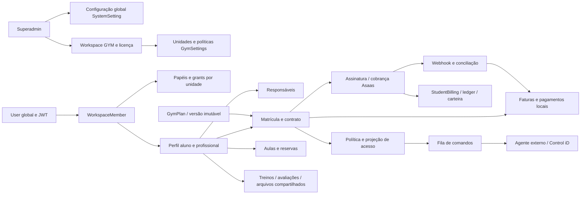

# Diagnóstico técnico e funcional do módulo de academias — AtlasFit

Data de consolidação: **01/10/2026**. Escopo: auditoria e documentação, sem correções de implementação.

## 1. Resumo executivo

O módulo possui uma base extensa: workspace de academia, unidades, equipe, alunos, responsáveis, planos versionados, matrículas, financeiro, aulas, controle de acesso, importação e governança. Há **14 páginas de academia, 21 páginas na área inicial do superadmin e 114 arquivos de API de academia, com 152 operações HTTP**. Isso não significa 152 fluxos operacionais concluídos. Parte das interfaces está desconectada, algumas operações usam permissões excessivas e os domínios financeiro e de acesso mantêm fontes de verdade que nem sempre convergem.

Os problemas de maior impacto são: retorno de campos de autenticação em DTOs de matrícula; emissão de sessão Credentials sem impor o segundo fator do fluxo de login; autorização insuficiente sobre recursos e unidades; suspensão de academia sem bloqueio no guard; anonimização de identidade global por uma operação local; possibilidade de referências e movimentações entre academias; divergências de pagamentos, estornos, assinaturas e conciliação; e promessas de bloqueio de catracas que não são cumpridas pelo servidor. Esses problemas estão demonstrados por caminhos de código; não foi realizado ataque nem alteração de dados reais.

A configuração individual da academia tem contrato incompatível com a API e respostas sujeitas a falha de serialização de BigInt. A configuração **global** das academias tem excesso de explicações e apresenta controles como se todos fossem efetivos, embora muitos valores apenas sejam armazenados. A prioridade é tornar os controles verdadeiros e verificáveis; a simplificação visual deve acompanhar essa correção de significado.

Tipos passaram. A suíte teve **420 testes aprovados e 1 falha, em 37 arquivos**. A falha está no teste de entitlements de catracas. Os testes inspecionados usam mocks; o teste denominado ponta a ponta não substitui execução com banco, autenticação, navegador, Asaas e equipamento. Cinco provas locais, sem rede e com dados sintéticos, confirmaram comportamentos de serialização, autorização e mapeamento de identidade externa descritos no catálogo.

**Conclusão de alcance:** a auditoria estática e sua documentação foram consolidadas. A homologação operacional permanece pendente. Não há base para declarar o módulo pronto para operação financeira ou controle físico apenas pelos testes atuais.

## 2. Escopo, metodologia, ambiente e limitações

O checkout informado existe em `C:\Users\gabriel\development\atlasfit`. Referência Git: `56f221bfebcf7aabe48fa4bba760d57372804398`. O alvo efetivo foi a **árvore de trabalho**, já com dezenas de alterações e arquivos não rastreados, inclusive grande parte de `gym`, migrations e documentação. Não atribuir todo o diagnóstico ao conteúdo daquele commit. [Snapshot](snapshot.json), [hashes/imports](inventario-tecnico.json) e [matriz por arquivo](cobertura.md) permitem reconhecer o conteúdo analisado.

Foram procuradas instruções `AGENTS.md` no projeto e ancestrais; nenhuma foi localizada. Foram lidas as regras de `.agents/rules` sobre configuração/layout, componentes compartilhados, confirmação de ações destrutivas e estados assíncronos. As referências técnicas locais de Prisma Client e integração Asaas foram consultadas. A instrução do solicitante de somente documentar foi preservada.

O trabalho combinou inventário AST, leitura de handlers, métodos de serviços, layouts, clientes, guards, schema, SQL e testes; rastreamento de imports e consumidores; comparação entre interface, API, regra e persistência; e provas isoladas de funções reais. A extração automática serve de índice, não como evidência suficiente de conclusão funcional. Algumas saídas extensas foram truncadas; a cobertura registra essa limitação e os achados usam trechos/funções específicos conferidos.

| Termo utilizado | Significado nesta auditoria |
|---|---|
| Fato confirmado | Relação, condição ou comportamento demonstrado no código inspecionado |
| Problema reproduzido | Comportamento observado ao executar; distinguir prova isolada de fluxo real |
| Risco identificado | Condição demonstrada, impacto depende de concorrência, configuração ou dados |
| Hipótese | Explicação ainda sem confirmação suficiente |
| Lacuna de inspeção | Parte não verificada ou verificada apenas estruturalmente |
| Proposta de evolução | Novo desenho sugerido; não atribuído a requisito original |

Não foram executados migrations, seeds, conexão investigativa ao banco, chamadas de cobrança, envio de mensagens, operação de catracas ou requisições com dados reais. Não foram copiados valores de `.env`, credenciais nem registros pessoais. Não foi iniciado o servidor/navegador: não se confirmou uma base isolada, e existem caminhos de leitura com efeitos de escrita. Portanto, UX, mobile, contraste, foco e comportamento visual são avaliações do código, sem captura ou teste em dispositivo. Configuração implantada, volume real, índices efetivos, backup, cron externo, R2/Asaas/Ably e agente local continuam não verificados.

| Verificação | Comando/resultado | Alcance |
|---|---|---|
| Tipos | `npx.cmd --no-install tsc --noEmit --incremental false`: exit 0; [saída](verificacao-tipos.txt) vazia | Contratos TS compilam; `any`, JSON e regras de autorização continuam fora dessa garantia |
| Testes existentes | `npm.cmd test -- --reporter=dot`: exit 1; 420/421; [saída](verificacao-testes.txt) | Falha `gym-021.test.ts:109`, espera flag true, recebe false; cenário não fornece o setting global necessário |
| Provas isoladas | `node docs/audits/academias/provas-isoladas.cjs`: exit 0; [resultados](verificacao-provas-isoladas.json) | BigInt lança TypeError; workspace inativo autorizado; fallback de unidade autorizado; serializer mantém campos sensíveis sintéticos; mesma pessoa pode receber IDs externos distintos em comandos diferentes |
| npm/npx iniciais | PowerShell bloqueou scripts `.ps1` pela ExecutionPolicy; repetido com `.cmd` | Restrição de shell, não defeito do módulo |
| Lint | Não localizado script/config próprio de ESLint no inventário consultado | Não foi inventado comando de lint; configuração externa permanece lacuna |
| Build/HTTP/DB/browser | Não executados | Não presumir fluxo testado; build inclui `prisma generate` e não acrescentaria prova operacional |

Stack observada: Next.js **16.2.6** App Router, React **19.2.4**, TypeScript strict, Prisma **7.8** com PostgreSQL/adapter `pg`, NextAuth **5 beta.31** Credentials e JWT, Tailwind 4, shadcn/Radix/Base UI, Valtio, Sonner, Lucide, Framer Motion, Vitest. Há Asaas para cobranças/carteira, AbacatePay para SaaS pessoal, Ably, FCM/Firebase, Resend e armazenamento S3/R2. Código gerado Firebase/DataConnect existe; presença não comprova uso nos fluxos de academia. Não foram localizados manifesto de deploy, workflow `.github` ou implementação distribuível do agente local nas buscas pertinentes; um deploy fora do repositório pode existir.

## 3. Mapa do módulo, atores e fronteiras



| Ator real | Identidade e responsabilidade implementada | Limites/contradições |
|---|---|---|
| Superadmin | `User.role=SUPERADMIN`; gerencia configurações, usuários, workspaces e gateways; guard concede todas as capabilities | Suspensão não é aplicada ao guard; impersonação não preserva o ator original em toda auditoria |
| Proprietário | `Workspace.ownerId`, papel legado OWNER e/ou grant OWNER | Três meios de reconhecer propriedade; `ownerId` não tem FK para User |
| Gerente | Papel MANAGER; quase todas as capabilities | Não recebe `wallet.withdraw` na matriz, mas endpoint aceita `workspace.manage`; pode promover OWNER |
| Financeiro | FINANCE; recebíveis, pagamentos, carteira de leitura e relatórios financeiros | PATCH de aluno aceita `students.read`, ultrapassando responsabilidade declarada |
| Recepcionista | RECEPTIONIST; cadastro, matrícula, cobrança presencial, reservas, acesso e CRM | Tem anonimização via `students.manage`; recebe informações de saúde indevidamente |
| Profissional da academia | TRAINER; alunos, saúde e treino atribuídos, aulas e relatórios operacionais | Algumas leituras ignoram atribuição; multi-role muda `memberRole` usado em filtros |
| Assistente | ASSISTANT; leitura de alunos, treinos e aulas | `students.read` permite edição e `classes.read` permite mutações em reservas |
| Aluno | WorkspaceMember STUDENT; identidade global STUDENT ou USER conforme caminho de criação | Layout aluno rejeita USER; API genérica de aula permite alterar reservas alheias |
| Responsável | GymGuardian; vínculo por `guardianUserId` ou CPF da conta global | Não existe role global GUARDIAN nem papel workspace GUARDIAN; alguns endpoints exigem membership que o responsável puro não tem |
| Personal | Global TRAINER e workspace PERSONAL; área pessoal e assinatura SaaS de User | Componentes/actions e recursos de treino são reutilizados em GYM; quotas, exclusão e seleção ainda misturam domínios |
| Agente do equipamento | Token de dispositivo validado no servidor; heartbeat/pull/ACK/cache/eventos | Cliente local não localizado; marca/modelo anunciado não equivale a driver funcional |

Uma pessoa pode ter vários WorkspaceMember em diferentes academias e grants múltiplos. Não existe uma exclusividade geral “um usuário = uma academia”. O papel global governa parte da navegação/autenticação; o papel no workspace governa parte da operação. Responsável, aluno e profissional podem compartilhar a mesma identidade; certas rotinas ainda tratam um único `memberRole` como suficiente.

## 4. Inventário de funcionalidades e estado real

**“Implementada, mas ainda não verificada em execução”** significa que entrada/serviço/persistência/resposta foram rastreados estaticamente, não que a regra esteja correta. Nenhum conjunto amplo foi classificado como “implementada e verificada” em aplicação conectada. As provas isoladas verificam apenas os comportamentos descritos.

| Funcionalidade | Estado | Conexões e motivo |
|---|---|---|
| Provisionamento de academia/dono/unidade/licença | Parcialmente implementada | UI superadmin → serviço → transação parcial → backfill/settings/subscription fora dela; sem fluxo de aprovação formal localizado |
| Ativação/suspensão | Parcialmente implementada | Campo `Workspace.isActive` administrável; guard não bloqueia e listagem omite o campo |
| Configuração global | Parcialmente implementada | GET/PATCH SystemSetting funcionais por código; flags restantes armazenadas, sem enforcement correspondente |
| Configuração individual/licença | Quebrada por contrato estático; HTTP não executado | Cliente envia `licenseLimits/policies`; servidor espera `settings/subscription`; BigInt bruto |
| Cobrança da licença AtlasFit à academia | Parcialmente implementada na administração de licença; cobrança GYM não localizada no recorte | WorkspaceSubscription mantém status/plano/limites/trial. Não foi localizado fluxo de checkout/renovação externa da licença GYM ligado a essa entidade; cobrança de aluno via Asaas e SaaS pessoal não comprovam esse fluxo |
| Seleção de workspace | Parcialmente implementada | Action segura na tela seletora; switcher compartilhado altera só store, contexto servidor permanece no cookie |
| Pedido de upgrade pelo switcher | Interface sem fluxo funcional completo | Botão apresenta toast de solicitação enviada sem API/action de pedido nesse handler; não confundir com checkout pessoal existente em outro fluxo |
| Equipe, perfil, convite e remoção simples | Implementada, mas ainda não verificada em execução; com defeitos | UI staff → APIs → StaffService; token/hash/expiração existem; não valida e-mail na aceitação, promoção OWNER possível |
| Desligamento com repasse de aulas | Backend sem integração com a interface | `/staff/[id]/terminate` e OffboardingService; UI utiliza DELETE simples |
| Cadastro/lista/detalhe de alunos | Parcialmente implementada | UI → GymStudentService → User/Member/Profile; conta criada sem entrega de ativação; cadastro de menor não oferece dados necessários |
| Responsáveis e representação | Parcialmente implementada | APIs/MinorService/portal existem; assinatura representada não verifica identidade adequadamente e não substitui contrato de matrícula |
| Planos e versões | Implementada, mas ainda não verificada em execução | UI → GymPlanService → GymPlanVersion/snapshot; preserva histórico; assinatura externa não acompanha toda mudança |
| Matrícula e ciclo | Parcialmente implementada | CRUD, pausa, renovação, troca/cancelamento existem; aceite sem consumidor UI localizado, regras de ativação inconsistentes |
| Aceite contratual da matrícula | Backend sem integração com a interface | Endpoint/serviço verificam signer; busca de consumidor não encontrou chamada UI ao endpoint de aceite |
| Faturas e pagamentos presenciais | Implementada, mas ainda não verificada em execução; riscos de integridade | InvoiceService/Allocation; alçada confiada ao cliente, idempotência/concorrência e caixa divergentes |
| Cadastro de recebedor/cobrança online | Dependente de serviço ou configuração externa; parcial | Asaas/subconta/API key/encriptação; compensação e isolamento do pagador insuficientes |
| Assinatura recorrente | Parcialmente implementada e dependente de serviço externo | External subscription + invoice local; taxa inicial/baixa/cancelamento divergem; agendamento automático local não localizado |
| Contas, caixa, despesas, fornecedores | Implementada, mas ainda não verificada em execução; com defeitos | UI financeiro → CashDrawerExpenseService; sangria pode atualizar conta de outro workspace |
| Carteira/saque/estorno | Dependente de serviço externo; parcial | StudentBilling/ledger/snapshot distintos de GymPayment; falta reserva atômica e controles coerentes |
| Conciliação/reprocessamento | Parcialmente implementada | Relatório usa dados locais; reprocessar pode marcar pago/resolvido sem lançar as contrapartidas |
| Aulas, salas, modalidades e grade | Backend sem integração com a rota pública atual | Cliente extenso existe, mas `/gym/classes` redireciona ao dashboard |
| Reserva, espera, presença e no-show | Parcialmente implementada | Serviços/APIs/cliente órfão; autorização permissiva e ausência de proteção concorrente no schema |
| Agenda/reserva do aluno | Backend sem integração com a interface localizada | `/api/student/classes` existe; `/student/classes` não localizado; responsável depende de membership adicional |
| Política de acesso/overrides | Parcialmente implementada | Serviços distintos de `check-access`, projeção e avaliação; condições contratuais e de vigência divergem |
| Página de acessos | Quebrada por chamadas estáticas | Feed sem unitId obrigatório; POST `/api/gym/reception/checkin` não localizado |
| Recepção/check-in rápido | Parcialmente implementada | Autorização visual/servidor incompleta; avaliação sem deviceId gera decisão, não comando físico |
| Provisionamento e comandos | Dependente de serviço externo; parcial | Token/hash/ACK e Control iD existem; não encontrado agente instalável nem drivers dos demais fabricantes |
| Offline/recuperação/contingência | Parcialmente implementada e dependente de agente | Cache, eventos e divergências existem; claim/retry/SENT e escopo insuficientes |
| Biometria | Parcialmente implementada | Tipos facial/digital acabam traduzidos como QR_CODE; consentimento/purga/ACK não comprovados |
| Treinos | Backend sem integração com a rota atual; reuso parcial em ficha | `/gym/workouts` redireciona; service/adapters e APIs de aluno/templates existem |
| Avaliações/arquivos | Implementada, mas ainda não verificada em execução; controles incompletos | PhysicalEvaluation/StudentFile e serviço; saúde/assignment/upload/retention divergem |
| CRM | Backend sem integração com a rota atual | `/gym/crm` redireciona; leads/conversão persistem via API; contas USER sem ingresso no portal |
| Comunicação dirigida | Parcialmente implementada | Persiste Notification; parâmetro EMAIL/PUSH/ALL não aciona os canais; helper de conversa sem caller funcional localizado |
| Indicadores/exportações | Implementada, mas ainda não verificada em execução; fórmulas/filtros divergentes | Dashboard + tab métricas do financeiro; CSV real, sem neutralização de fórmulas de planilha |
| Importação assistida | Parcialmente implementada | Preview/commit/transação/saldo local existem; commit confia linhas/hash e contorna matrícula/limites |
| Titularidade | Implementada, mas ainda não verificada em execução; risco Prisma | Protege último dono e usa transação; upsert compound unique com unitId null exige validação real |
| Privacidade/anonimização | Parcialmente implementada e insegura em escopo | Request executa anonimização global imediatamente; export incompleto; purga física não confirmada |
| Piloto/readiness/saúde | Backend implementado com verificações locais; ainda não verificado em execução | Checklists/checks são sinais do banco, não atestado de equipamento, backup e pagamento real |
| Encerramento completo da academia | Não localizado como fluxo próprio | Existe exclusão compartilhada PERSONAL com acesso por dono, sem coordenar cancelamento externo/purga/retention |

## 5. Inventário de páginas, dados, ações e estados

O [anexo de páginas](inventario-paginas.md) fornece arquivos, imports, componentes, textos, estados locais, chamadas e breakpoints de cada página. As rotas abaixo usam os arquivos `src/app/(gym)/gym/<rota>/page.tsx` e seus clientes do mesmo diretório; rotas dinâmicas permanecem como `[id]`. Os controles indicados são os implementados, não as permissões recomendadas.

| Rota GYM | Acesso servidor / objetivo | Dados e componentes principais | Ações e integração | Estado/pendência e mobile pelo código |
|---|---|---|---|---|
| `/gym/dashboard` | reports.operational OU reports.finance OU workspace.manage; visão diária | GymPageHeader/MetricCard, AnalyticsService, Entitlements e 6 logs | Atalhos para operação/financeiro, filtros/indicadores | Mascara valores financeiros sem direito; logs gerais permanecem. Grid adaptável; gráfico/layout requer navegador |
| `/gym/students` | students.read; cadastro e fichas | GymStudentsClient, lista paginada/User/Member/Profile, diálogo com abas, equipe/unidade/planos | students GET/POST/PATCH, duplicidade, avaliações, arquivos, responsáveis e treinos | Loaders/toasts/vazios locais; saúde exposta; criação menor sem guardian. Tabela/diálogos precisam confirmar uso em viewport estreita |
| `/gym/staff` | staff.read; equipe | GymStaffClient, perfis/grants/unidades/convites, tabelas e diálogos | invitations, staff GET/PATCH/DELETE; link copiado | Feedback local e confirmação de remoção; CREF convite não persistido; repasse aulas fora deste fluxo. Tabela com scroll |
| `/gym/plans` | enrollments.read; catálogo | GymPlansClient, cards/lista, GymPlan/version | create/update/deactivate/version; canManage na UI | Estados/toasts e confirmação; server precisa continuar garantindo gestão. Layout responsivo declarado |
| `/gym/enrollments` | enrollments.read; contratos ativos/pendentes | GymEnrollmentsClient, planos/alunos/matrículas | create, activate, pause/resume, change/simulate/renew/cancel, subscription | Aceite não conectado; checkbox paymentVerified não é pagamento. Diálogos extensos; scroll/tamanho mobile a validar |
| `/gym/finance` | invoices.read; cobranças, caixa e métricas | GymFinanceClient, profile, billings, invoices/payments 20, Analytics, alunos/matrículas até 100, todos responsáveis | APIs finance, subscriptions, analytics export/kpis; tabs de carteira/despesas/caixa | Loaders/toasts; inicial já consulta indicadores para perfil sem reports.finance; campos de pagador/saúde excessivos. Muitas tabs, tabelas scrolláveis |
| `/gym/analytics` | Contexto/auth; navegação de compatibilidade | Sem tela própria | Redirect `/gym/finance?tab=metrics` | Implementação intencional de tab unificada; acesso final depende de invoices.read, exclui TRAINER com reports.operational |
| `/gym/reception` | Layout/auth/contexto GYM; **sem guard por capability no page** | Todos alunos ativos com CPF/foto, dispositivos/logs e ReceptionClient | evaluate, device command, biometrics; busca/check-in | Sem paginação; status financeiro aproximado. Hardware ainda interfere com flag off. Mobile grid declarado; foco/densidade a validar |
| `/gym/access` | access.read; feed e controle | GymAccessClient, membros/devices/logs e diálogos | Feed e endpoint de check-in não localizado | Erros silenciosos/404 estáticos; tabelas, filtros e diálogo, sem validação visual |
| `/gym/classes` | Wrapper redirect | ClassesClient completo presente, sem render nesta rota | Dashboard como destino; APIs de classes continuam acessíveis | Interface sem fluxo funcional completo na rota; não há conclusão mobile da tela órfã |
| `/gym/crm` | Wrapper redirect | CrmClient/pipeline/leads presente, sem render | APIs CRM persistem e convertem leads | Backend sem integração atual; modal/pipeline móvel só pode ser avaliado após integrar |
| `/gym/workouts` | Wrapper redirect | WorkoutsClient/template/adapters presente, sem render | APIs gym workouts e reuso ficha/aluno | Backend/cliente desconectados da rota; atribuição precisa verificar direitos sobre aluno |
| `/gym/import` | students.manage OU workspace.manage; migração assistida | GymImportClient, planos ativos convertidos para Number, passos/preview | template, preview, commit; atualização local final | Erro por linha/avisos; commit confia linhas do cliente. Tabela de preview densa com scroll |
| `/gym/settings` | workspace.manage; governança | GymSettingsClient, workspace, equipe elegível, últimos 10 DataSubjectRequest | transfer-ownership, privacy/export, delete-request, reload | Não configura política cotidiana; exige ID manual de titular; textos de garantias legais excedem implementação. Duas colunas `md`, tabela horizontal |

Layouts e navegação: `src/app/(gym)/layout.tsx`, `gym-sidebar.tsx`, `gym-mobile-navbar.tsx`, `gym-breadcrumbs.tsx`, `gym-tabs-list.tsx`, `gym-page.tsx` e switcher/workspace store compartilhados. Sidebar/mobile escondem itens por capabilities/flag; isso não constitui autorização de URL/API. Wrapper autentica, resolve contexto e manutenção; redirecionamentos sem capability podem formar jornadas inesperadas para STUDENT/ASSISTANT. Não há experiência negada padronizada comprovada em navegador.

| Rota superadmin | Objetivo/dados/ações e origem | Relação com academia / profundidade |
|---|---|---|
| `/superadmin` | Entrada/layout/navegação global | Shell e role SUPERADMIN; páginas inventariadas abaixo |
| `/superadmin/dashboard` | Resumo global via store/API/cards | Referência de layout; métricas globais não são atestado de gym |
| `/superadmin/workspaces` | Lista/filtros/create/suspender e acesso a detalhes; SuperAdminService/store | Inspeção profunda; não recebe isActive, toggle assimétrico |
| `/superadmin/workspaces/[id]` | Abas dados/membros/financeiro/políticas/licença/unidades; APIs workspaces/gym-config/impersonate/payments | Inspeção profunda; contrato incompatível, BigInt, endereço e métricas legadas |
| `/superadmin/gym-settings` | Cinco seções globais, SystemSetting e API gym-settings | Inspeção profunda; proposta específica na seção 13 |
| `/superadmin/users` | Usuários globais, filtros e ações pelo store | Dependência de dono/identidade; edição/exclusão global não equivale a desligamento |
| `/superadmin/users/[id]` | Dados/perfis/conta global, mudança/exclusão/impersonação | Fronteira de identidade/auditoria; não auditado todo SaaS pessoal |
| `/superadmin/asaas` | Configuração/visão Asaas via API asaas | Dependência financeira inspecionada; segredo não copiado; configuração externa pendente |
| `/superadmin/finance` | Transações globais/filtros/tabela via finance/transactions | Inventário estrutural; não presumir que agregados reconciliam GymInvoice |
| `/superadmin/finance/payouts` | Saques via superadmin/payouts | Fronteira financeira; API/workflow global não integralmente homologado |
| `/superadmin/settings` | Configurações gerais, manutenção e segurança/TOTP | Referência visual e fronteira auth; gym_requireTwoFactorAuth não é o setting global real de 2FA |
| `/superadmin/logs` | Trilha AuditLog via store | Inspecionado logger/atribuição; ausência de before/after e ator original |
| `/superadmin/storage` | Cota/uso global via storage | Dependência de arquivos/cota inspecionada; modelo pessoal concorrente com licença gym |
| `/superadmin/files` | Busca/lista/delete de arquivos via API files | Estrutura inventariada; execução destrutiva não realizada |
| `/superadmin/subscriptions` | Assinaturas SaaS/planos via store | Não confundir Subscription por User com WorkspaceSubscription por academia |
| `/superadmin/deletion-requests` | Wrapper curto | Inventário/redirecionamento; não é confirmação de atendimento do pedido gym |
| `/superadmin/abacatepay` | Produtos/checkouts/cupons/métricas | Área SaaS adjacente; extração estrutural, sem auditoria completa do gateway |
| `/superadmin/credits` | Pacotes/créditos, upload e sincronização | Adjacentemente inventariada; não é limite de aluno de academia |
| `/superadmin/engage` | Banners/campanhas, uploads e ações globais | Upload compartilhado pertence ao diagnóstico; campanha inteira é lacuna |
| `/superadmin/exercises` | Catálogo/solicitações de exercícios | Reuso treinos; inventário estrutural, catálogo global não integralmente auditado |
| `/superadmin/ai` | Agentes/modelos/estatísticas | Estrutura inventariada; não é infraestrutura do agente de catraca |
| `/superadmin/roadmap` | Features/votos/polls/status | Estrutura inventariada; fora da operação gym |

Estados dessas páginas globais são extraídos individualmente no anexo: store, carregamento, diálogo/alerta/toast e breakpoints. Não foi conferido o ciclo funcional completo de AI, roadmap, créditos e campanhas por não aparecerem como dependência de regra de academia. Isso é fronteira explícita, não alegação de auditoria total do AtlasFit.

Outras telas necessárias: `/auth/gym`, `/auth/invite/[token]`, `/select-workspace`, dashboard global de encaminhamento, `/guardian/dependents`, layouts student/guardian e componentes de setup de senha. A seleção chama `selectActiveWorkspace`, grava cookie e calcula rota; o switcher não usa essa mesma sequência. O portal de dependentes carrega via MinorService, exige identidade reconhecida e expõe só saúde quando autorizado; BigInt em settings impede serialização em caminhos existentes.

Estados comuns: skeleton/Spinner no shell e componentes, toasts e disabled em ações, mensagens de lista vazia em tabelas/cards. Não há evidência de uma estratégia uniforme de retry, acessibilidade de erro, foco após fechar modal e persistência de filtro. A confirmação de ações destrutivas aparece em várias telas, mas não corrige alçada/API. No global gym-settings uma falha de GET mantém skeleton sem recuperação. Pós-mutação alterna fetch manual, state local, `router.refresh` e `window.location.reload`; não existe um contrato único de invalidação de cache demonstrado.

## 6. Inventário de APIs e Server Actions

O [inventário por operação](inventario-apis.md) contém **186 operações no recorte**, das quais 152 em `/api/gym`: caminho, método, linha, guard, parâmetros de rota/body/query, condições, calls de serviços, entidades inline, respostas/status e consumidores encontrados. [JSON das operações](operacoes.json) permite filtrar. O índice de fetch literal pode não reconhecer URL montada indiretamente; “sem consumidor localizado” não é prova de inutilidade.

| Família | Persistência/regra | Controles encontrados / contratos importantes |
|---|---|---|
| students/check-duplicate/files/evaluations/workouts/guardians | GymStudent/Assessment/Workout/Minor services; User/Member/Profile/Evaluation/File | GET/PATCH e capabilities não equivalentes; alguns IDs são User, outros Member; assignment inconsistente |
| staff/invitations/transfer | StaffService/Ownership/Offboarding | Token hash/72h/single estado; e-mail do destinatário não imposto; terminate existe separado |
| plans/enrollments | GymPlanService/EnrollmentService | Versionamento/snapshot/estado; body parcialmente validado por `if`, sem schema uniforme; paging alguns endpoints |
| finance/profile/billings/wallet | Financial/Wallet services + Asaas | Operações externas primeiro, dados do pagador, limites/segredos; KYC e idempotência pendentes |
| finance/invoices/payments | InvoiceService | BigInt em centavos, allocation, receipt/reversal; confiança no aprovador e disputa de saldo |
| finance/accounts/expenses/cash/transfers | CashDrawerExpenseService | Regras de conta, operador e caixa; tenant do destino não sempre validado |
| finance/reconciliation | WalletReconciliationService | GET também persiste divergências; reprocessamento não recompõe todo ledger |
| classes/* | Class/BookingService | classes.read abre mutações; escopo do aluno não imposto; horário/capacidade/concorrência |
| access/biometrics/devices/reception | AccessPolicy/Device/Biometrics/Offline/Recovery | Tokens distintos de JWT; IDs de dispositivo/aluno nem sempre cruzados; flag não protege servidor |
| crm/communication/analytics/import | Serviços respectivos | Estados reais persistidos; UI desconectada, canais não enviados, CSV/import trust |
| privacy/operations/pilot | Offboarding/Recovery/Pilot | Export/delete alçada larga; readiness mede dados/config local, não valida infraestrutura externa |
| superadmin/workspaces/gym-settings | SuperAdminService/FeatureFlags | role global, alteração de config/reason/audit; BigInt e UI/API incompatíveis |
| student/guardian | Student-auth/Minor/Booking services | Contexto próprio/CPF/guardianUser; membership exigido onde não representa guardião |
| storage/ably/cron/webhooks | Serviços compartilhados | Assinatura/token/quotas/idem específicos; middleware exclui APIs e não resolve autorização |

| Server Action | Localização e consumidores | Validação/efeito e limite |
|---|---|---|
| selectActiveWorkspace/clearActiveWorkspace | `src/modules/workspaces/application/actions.ts`; seletora | Auth + membership ativo; grava/limpa cookie. Não exige workspace.isActive |
| getPersonalWorkspaces | `src/components/application/actions.ts`; switcher | Filtra papéis OWNER/TRAINER/ASSISTANT, não tipo GYM/PERSONAL; exclui gerente/recepção/financeiro; consulta plano do User dono |
| getTrainerWorkspaceLimit/createWorkspace | Mesmo arquivo; criação do switcher | Subscription/FreeTrial pessoais e contagem de dono; cria workspace default PERSONAL, sem provisionamento gym |
| login/setupPassword/reset | `src/components/auth/actions.ts`; auth forms | Rate limit local, password hash e etapas 2FA no formulário; setup registra aceites mas ignora booleans acceptedTerms/acceptedPrivacy |
| ações/encaminhamento superadmin | Stores e handlers listados no anexo | Store facilita cliente, mas autorização deve ocorrer no servidor; auditoria não foi homologação de cada action SaaS |

APIs usam principalmente `req.json`, checks manuais, casts de enum e conversões `Number/BigInt/Date/parseInt`. HTTP 400/401/403/404 via WorkspaceAccessError convivem com catch genérico 400 ou 500 e formatos `{error:{code,message}}`, `{error:string}` e dados brutos. Corpo malformado ou enum/data inválida pode terminar em erro Prisma interno. Falta um contrato de DTO/validação uniforme. O anexo mostra as diferenças por handler; não se presumiu validação por haver tipos TypeScript.

## 7. Modelo de dados, integridade e dados em falta

O [dicionário](modelo-dados.md) transcreve **133 models e 71 enums** do schema completo, para rastrear inclusive relações compartilhadas; não são 133 entidades exclusivas de academia. Ele documenta campos, tipos, nulabilidade, defaults, relations, índices e unicidade. Inclui 20 migrations SQL disponíveis e divergências de tabelas. O estado efetivo do banco continua não inspecionado.

| Grupo | Entidades principais e cardinalidade | Responsabilidade / invariantes |
|---|---|---|
| Identidade/contexto | User 1:N WorkspaceMember; member único por user/workspace; Workspace N:1 ownerId sem FK | Identidade global, participação local; isActive do workspace e member são distintos |
| Organização | Workspace 1:1 GymSettings/WorkspaceSubscription; 1:N GymUnit; Member 1:N RoleGrant; 1:1 Staff/StudentProfile | Papel legado e grants concorrentes; unidade principal não garante escopo de toda ação |
| Convite/representação | WorkspaceInvitation/tokenHash único; Member 1:N GymGuardian | Estado/expireAt/acceptedAt; representante legal/financeiro/saúde são flags separadas |
| Comercial | Workspace 1:N GymPlan; Plan 1:N Version única plan/version; Member 1:N Enrollment | Valores BigInt centavos; versão imutável/snapshot; várias matrículas ACTIVE são possíveis |
| Histórico | Enrollment 1:N ContractAcceptance/Event/Pause | Estado, datas, crédito, acesso, cancelamento e assinatura externa têm transições em serviços diferentes |
| Recebíveis | Invoice 1:N Item; Payment N:N Invoice via Allocation | Total/pago/saldo e ledger exigem convergência; não há FK composta impondo workspace em cada associação |
| Caixa/despesas | FinancialAccount/Transfer/ExpenseCategory/Supplier/Expense/CashDrawerSession/Movement | Contas/caixa têm saldos derivados e mutáveis; defaults/criação também ocorrem na leitura |
| Gateway/carteira | PaymentProviderAccount/GatewayCustomer/StudentBilling/WalletLedger/Snapshot/PayoutRequest/WebhookEvent | Identificação externa/env/provider/idempotency; GymPayment não é fonte automática da wallet |
| Aulas | Modality/Room/Schedule/Session/Booking/Waitlist | Capacidades e contadores, papéis de instrutor, horário e fila; inexistência de unique ativo reserva/espera no SQL/schema |
| Acesso | Grant/Override/DecisionLog/Device/Command/AccessLog/ReconciliationDivergence | Projeção de direito ≠ decisão ≠ comando enviado ≠ ACK ≠ passagem física |
| Reuso/privacidade | Workout/Exercise/PhysicalEvaluation/StudentFile/Notification/Conversation/LegalAcceptance/PrivacyConsent/DataSubjectRequest/AuditLog | Parte dos dados pertence ao User global; campos workspaceId sem FK em Evaluation/File permitem resíduos |

Muitas relações locais têm cascades; financeiro usa retenção/Restrict em relações específicas. Consultar cada `@relation` no anexo antes de planejar delete. IDs independentes de workspace e resource podem ser válidos separadamente e incompatíveis em conjunto. Precisam de validação de tenant no serviço ou FK composta. `WorkspaceRoleGrant @@unique(memberId,role,unitId)` com unitId nullable não elimina duplicatas de grants globais no PostgreSQL; o upsert fornece null em input Prisma que exige campo da chave, aspecto a reproduzir com banco/client real.

O histórico SQL do checkout não é um baseline reproduzível do schema atual: a migration de agosto altera PaymentProviderAccount sem criação localizada; migrations gym dependem de tabelas compartilhadas ausentes no histórico. O baseline de maio também não representa todas as evoluções de papel/Subscription atuais. Não se conclui que a produção esteja sem tabelas: pode ter recebido db push ou baseline externo. Corrigir a reprodutibilidade requer reconciliar estado real antes de novo SQL.

| Tipo de informação em falta | Evidência e consequência | Natureza |
|---|---|---|
| Conta/ingresso do aluno | Novo User sem senha e setupToken sem distribuição retornada/enviada nos caminhos gym; CRM sem setupToken | Necessário para o fluxo já implementado de acesso à plataforma |
| Vínculo de responsável | Formulário principal não oferece dados exigidos para menor; guardianUserId/CPF sem verificação suficiente | Necessário para cadastro/representação já existentes |
| Aprovação real de desconto | discountAuthorizedByUserId aceito como texto; não há ato/aprovador validado | Integridade de alçada já prometida pela regra |
| Correspondência externa/local | IDs/chaves/ciclo/valor e fase da operação precisam ser inequívocos | Necessário para recuperar cobrança, baixa, cancelamento e duplicidade |
| Validação da prévia de import | Hash e rows não ligados a prévia persistida/signed server-side | Necessário para manter garantias apresentadas na importação |
| Matricula única/condição de acesso | Não existe regra decidida para escolher múltiplas ativas, período e aceite | Ambiguidade de produto + defeitos demonstrados contra invariantes existentes |
| Garantias do backlog | Menor, revoke, offline, reprocessamento e homologação declarados concluídos, mas incompletos | Requisito/documentação encontrados, não nova ideia |
| Histórico de aprovação comercial/suspensão motivada/SLA de suporte | Nenhum fluxo próprio localizado na trilha relevante | Proposta futura, não ausência classificada como defeito original |

Duplica-se informação em User/StudentProfile, role/grants, WorkspacePlan/Member.plan/GymPlanVersion/Enrollment, WorkspacePayment/GymInvoice/StudentBilling, e status de acesso/membership/contrato. Valores legados Float e novos BigInt exigem conversão explícita; BigInt→Number precisa limites seguros se os valores puderem crescer. Transações locais já existem em vários serviços, mas não protegem checks fora da transação, concorrência sob isolamento default, operações HTTP externas ou efeitos posteriores.

## 8. Fluxos operacionais, ponta a ponta e casos de borda

Os handlers detalhados estão no anexo de APIs; os serviços abaixo estão em `src/modules/workspaces/application`. O erro esperado deve preservar estado anterior ou indicar etapa concluída e recuperação, enquanto muitos caminhos apenas retornam toast/catch depois de persistir parcialmente.

| Fluxo / iniciador | Entrada → validação → servidor/autorização | Persistência/resultado/UI e efeitos | Alternativas/erros e bordas |
|---|---|---|---|
| Criar academia / superadmin | Workspace form → dados do dono/tipo → POST workspaces/role global → SuperAdminService | Transação cria WS/Member OWNER/grant/audit; depois settings/unidade/subscription; UI atualiza store | Falha posterior deixa academia incompleta; dono pode ser existente. Aprovação separada não localizada |
| Configurar/suspender / superadmin | Lista/detail/global → PATCHs → role SUPERADMIN | Campos/flags/audit; front mostra sucesso | Lista não sabe isActive; guard ignora suspensão; settings BigInt e DTO incorreto impedem ciclo completo |
| Entrar/selecionar / usuário | Credentials → sessão JWT → resolve memberships → selectActiveWorkspace | Cookie escolhido; rota por tipo/papéis; layout resolve contexto | Vários vínculos exigem seletora; switcher só altera store; usuário sem acesso vai seleção/login; workspace suspenso segue autorizado |
| Convidar colaborador / staff.manage | Modal e-mail/papel/unidade → valida quotas/membro/unidade → createInvitation | Token aleatório/hash; revoga anteriores; prazo 72h; retorna link para copiar | Não envia e-mail; perfil extra ignorado; falha/audit não atomicidade; aceitação não compara e-mail destinatário |
| Aceitar convite / autenticado | Página token → POST accept → hash/pendente/expiry + auth | Transação cria/reativa membro/grant; mark ACCEPTED; UI direciona seletora | Token lido antes tx; requisições paralelas e staff quota não revalidada; outro usuário autenticado pode tomar convite |
| Editar/remover equipe / staff.manage | Ficha/confirmar → PATCH/DELETE; tenant + último dono | Perfil/role/grant; DELETE desativa e repassa alunos, revoga grants | Promoção OWNER e grants velhos; substituto não precisa ser TRAINER; aulas futuras só no terminate avançado, que usa etapas separadas |
| Cadastrar aluno / students.manage | Form/duplicate → POST → tenant/quota/dados → RegisterStudent | User global ou existente + Member STUDENT/Profile; UI insere/refresh; setupToken criado | Menor exige guardian ausente do form; CPF não unique; conta sem entrega de setup; data omitida pode esquecer condição minor |
| Editar/atribuir aluno | Ficha → PATCH/service → students.read indevidamente | User/global e perfil/local; unidade/plano/isActive; atualização UI | FINANCE/ASSISTANT escrevem; novo DOB não recalcula minor; alteração global afeta demais workspaces |
| Responsável / operador ou guardian | Cadastro/verificação manual → flags legal/finance/health → portal por User/CPF | GymGuardian, verificação e LegalAcceptance representada; dependents→JSON | Guardian não é membro; booking endpoint exige membership; aceite representado não valida identidade suficiente e não aceita contrato da matrícula |
| Criar plano/matrícula / enrollments.manage | Catálogo → versão imutável → seleção aluno/versão/preço → createEnrollment | PENDING_ACCEPTANCE, snapshot, pagador, datas/price/fee; UI tabela/modal | Unit/payer/client fields nem sempre tenant-valid; permite múltiplas ativas; versão ativa de plano pai inativo pode ser usada |
| Aceitar/ativar | Endpoint accept identifica signer → ContractAcceptance/hash/IP/UA; activate exige transição/aceite | PENDING_ACTIVATION→ACTIVE e accessGranted pela função; event | UI de aceite não localizada; pagamento é boolean enviado; override reason libera; renovação pode pular estados/aceite |
| Pausar/retomar/trocar/renovar | Modal→endpoint→EnrollmentService; condições status/plano | Pause/Event/datas/crédito/preço/current/scheduledVersion; UI refresh | Pausa futura já bloqueia; datas inválidas; troca calcula amountToPay sem cobrança; externa não sincroniza; renew bypass de contrato |
| Cancelar aluno/matrícula | Modal → endpoint simples ou avançado | Cancelamento local; avançado revoga grants, queue DELETE_USER e cancela bookings | Não cancela assinatura externa; cancelamento programado bloqueia imediatamente; bookedCount/fila não convergem; membership pode permanecer ativo |
| Fatura/recebimento presencial | Finance form→invoice/payment → caps → InvoiceService | Item/Invoice; Payment/Allocation/recibo; update status/saldo; publish | Idem é nova UUID em retry UI; concorrência/prechecks; aprovador client spoof; CASH sem sessão; reversal não desfaz caixa corretamente |
| Recebedor/cobrança/recorrência online | Onboarding/payer→AsaasAdapter→persistência | ProviderAccount/key encrypted; GatewayCustomer; StudentBilling ou subscription/Invoice; retorno link/QR | Chamada externa antecede persistência; retry duplica; split pode ser removido; taxa inicial não acompanha value recorrente |
| Webhook/baixa | Auth token Asaas → normalize event → unique event/env → processor | StudentBilling/ledger ou GymPayment/Allocation/Invoice; notifications/e-mails/realtime | Claim não exclusivo; handler subscription falha e outer marca processed; TRANSFER_FAILED cai antes em branch genérico; HTTP200 não prova convergência |
| Caixa/despesa/transferência | Contas e modal valores → caps → CashDrawerExpenseService | Session/Movement/Expense/AccountTransfer; account balances/audit; UI/realtime | Unit/conta de sangria fora tenant; checks de saldo concorrentes; paidAmount arbitrário fecha despesa; audit/realtime depois tx pode falhar |
| Carteira/saque/estorno/conciliação | Wallet snapshot/localbillings→request→Asaas→persistir; reconciliation GET | PayoutRequest/ledger/snapshot e Divergence; UI relatório | Sem reserva atômica; MANAGER pode sacar; recorrência não forma wallet; reprocessar pode só marcar pago/resolvido; partial refund com base total |
| Aulas/reservas/presença | Clientes existentes, mas rota redirect → APIs manuais → Class/BookingService | Grade/sessões/booking/waitlist/counters e notificações | classes.read muta alheios; UTC ignora unit timezone; última vaga concorrente/booking duplicate; cancelamento de aula não liquida reservas |
| Acesso físico/recepção | Busca/ID→evaluate → política/overrides→decision/log/projeção→command→agent pull/ACK→passage | Só passagem física confirma execução; UI usa toasts antecipados | workspace/unit/vigência/contrato inconsistentes; deviceId não cruzado; quick checkin sem device; EXIT não encaminhado no API |
| Offline/biometria/recuperação | Token dispositivo→cache/eventos/ACK; operador→enroll/revoke/replay/replace | Grant/cache/divergence/command/token rotate; logs/hardware | Cache ignora parte de estado; eventos com member foreign; biometric vira QR; SENT perdido não recupera; contingência flag sem efetivo comando; agente externo lacuna |
| Treinos/saúde/arquivos/CRM/comunicação | Ficha/serviços→APIs→User/Member/Workout/Eval/File/Lead/Notification | Reuso existente; targeted cria notificações; UI de CRM/workouts órfã | Assignment/health scopes incompletos; EMAIL/PUSH não enviados; quota/upload pessoal; URLs/consulta excessivas |
| Importar legado / students.manage | CSV→preview maps/avisos→rows/hash devolvidos→commit | Transação cria User/Member/Guardian/ACTIVEenrollment/openingInvoice/grant/ImportJob | Sem cobrança Asaas automática na import é confirmado; mas aceita rows/isMinor/action/preço/hash adulterados, sem quota/aceite; duplicação simultânea |
| Direitos do titular/encerramento | ID manual→export/delete-request→caps largas→Offboarding | Export JSON/Request; anon globalUser/consents + localMember; queues delete | Nome de request executa ato; sem verificação titular; dados de outras academias afetados; dossier/purga incompletos; encerramento ws não coordenado |

Regras positivas existentes: tenant é filtrado em muitos findFirst, DTOs de alunos básicos usam selects, convite armazena hash, token de dispositivo é protegido, há snapshots/versionamento, histórico de eventos, transações locais e validação de token de webhook. Os achados mostram caminhos em que essas proteções deixam de ser suficientes.

## 9. Matriz de permissões conforme implementada

Fonte: `src/modules/workspaces/domain/roles.ts`. Papéis podem ser acumulados. SUPERADMIN e proprietário recebem tudo pelo guard. O quadro descreve as capabilities declaradas; a autorização real de cada API também inclui os desvios abaixo e os contratos do anexo.

| Recurso/ação | OWNER | MANAGER | FINANCE | RECEPTIONIST | TRAINER | ASSISTANT | STUDENT |
|---|---|---|---|---|---|---|---|
| Alunos ler/gerir | L/G | L/G | L | L/G | L | L | — |
| Saúde atribuída ler/gerir | L/G | L/G | — | — | L/G | — | — |
| Treinos ler/gerir atribuídos | L/G | L/G | — | — | L/G | L | — |
| Equipe ler/gerir | L/G | L/G | — | — | — | — | — |
| Matrículas ler/gerir | L/G | L/G | L | L/G | — | — | — |
| Faturas ler/emitir | L/E | L/E | L/E | L/E | — | — | — |
| Pagamentos ler/registrar | L/R | L/R | L/R | L/R | — | — | — |
| Estornos aprovar | Sim | Sim | Sim | — | — | — | — |
| Carteira ler/sacar | L/S | L | L | — | — | — | — |
| Aulas ler/gerir | L/G | L/G | — | L | L | L | L |
| Reservas gerir | Sim | Sim | — | Sim | — | — | — |
| Acesso ler/override | L/O | L/O | — | L/O | — | — | — |
| Dispositivos gerir | Sim | Sim | — | — | — | — | — |
| Relatório financeiro/operacional | F/O | F/O | F | O | O | — | — |
| Privacidade/workspace gerir | P/W | P/W | — | — | — | — | — |
| CRM ler/gerir | L/G | L/G | — | L/G | — | — | — |
| Comunicação gerir | Sim | Sim | — | Sim | Sim | — | — |

Desvios confirmados: PATCH aluno usa leitura; reservas/presença aceitam leitura de aulas; export aceita reports.operational; delete aceita students.manage; payout aceita workspace.manage; reception page não exige access/students capability. Unit grant só filtra se unitId passa ao guard e pode cair no fallback legado. O recurso deve pertencer ao tenant **e** ao ator/atribuição correspondente; a primeira condição não substitui a segunda.

## 10. Segurança e isolamento

GYM-AUD-001 a 011, 017 a 019, 027, 032 a 035, 038 a 041, 047 e 049 concentram os controles de identidade, tenant, alçada e dados. O catálogo diferencia falha demonstrada de exploração real não executada. Não foi confirmado vazamento ocorrido na produção.

Prioridades técnicas: reduzir retornos a allowlists; validar vínculo do recurso/aluno/unidade/device/account/pagador; impedir autoconcessão de OWNER; impedir operação de identidade global por autoridade local; bloquear workspace inativo no servidor; centralizar entitlement/flag; restringir token Ably às capacidades do usuário. A produção do Ably pode já usar chave restrita: sem capability no token, ele herda a chave, segundo [documentação oficial](https://ably.com/docs/auth/capabilities); o impacto cross-tenant permanece condicionado às capabilities reais dessa chave.

Há proteção do webhook Asaas por token e comparação apropriada no adapter, hashes de convite/dispositivo e headers de segurança em Next config. Não foi feita prova de CSRF contra Credentials/Server Actions; proteções do framework não substituem autorização de objetos. O `authorize` Credentials verifica senha/manutenção, mas não a prova 2FA/3FA exigida pela Server Action de login (GYM-AUD-064). JWT role pode continuar antigo após alteração de User; remover senha não revoga sessão JWT existente (065). Os logs redigem alguns padrões sensíveis, mas rawHardwareLog e console.error de payload/erro externo exigem inspeção de conteúdo em homologação com dados sintéticos. Não afirmar que logging nunca vaza nem copiar payload real.

## 11. Infraestrutura, confiabilidade e desempenho

| Dependência | Evidência no checkout | Pendência/limite |
|---|---|---|
| PostgreSQL/Prisma | Pool singleton em dev, PrismaPg/DATABASE_URL; extensão findFirst tenta cookie ativo e retorna query original se não acha | Não comprova isolamento por si; todas as queries restantes precisam filtro. Pool/timeouts/TLS/índices reais não medidos |
| Asaas | Adapter/provider keys/environment/subaccount, checkout/subscription/transfer/webhook | Autenticação da subconta usa master key/header no caminho examinado, diferente da documentação de apiKey da subconta; risco de contrato a validar em sandbox ([fonte](https://docs.asaas.com/docs/criacao-de-subcontas)) |
| Criptografia | Chaves/config usadas para credenciais/payload; falha pode ser capturada e continuar onboarding | Validar obrigatórias antes da chamada externa; existência/rotação em deploy não inspecionada |
| Ably | Publish workspace:user channels e token autenticado; atualização financeira | Capability omitida no token; vários publishes depois tx, sem outbox/retry garantido |
| Resend/FCM/notificações | EmailService e notificações compartilhados; aviso de ausência RESEND no teste | Não foi enviado e-mail. Targeted gym ignora canal; falhas externas podem perder efeito posterior |
| S3/R2 | Presigned PUT/GET, tipo/tamanho informados pelo cliente, StudentFile/progress metadata | Cota pessoal, autorização/ACL, HEAD tamanho e scanning não confirmados no objeto/deploy |
| Cron | Recurrence compartilhada, cron expire de enrollment, endpoints de ciclo/reconciliation | Nenhum agendador de produção comprovado. Cron legado fail-open sem secret; pode alcançar GYM |
| Hardware | ControlIDAdapter + tokens/command/pull/ACK/cache/offline/recovery | Drivers de outros fabricantes/instalador/service local não localizados; equipamentos não testados |
| Logs/readiness | AuditLog/DecisionLog/AccessLog/Divergence, operações/health/pilot | Falta ator original/antes-depois e correlação entre etapa externa e local; readiness não comprova backup/alertas |

Variáveis/configuração pertinentes identificadas por **nomes**, não por valores: DATABASE_URL, AUTH_SECRET, API keys/environment/webhook auth do Asaas, chaves de encriptação, ABLY_API_KEY, RESEND_API_KEY e remetente, CRON_SECRET, endpoint/bucket/credenciais S3/R2 e credenciais Firebase/FCM. Os identificadores exatos por consumidor constam no arquivo correspondente; SystemSetting financeiro também participa da resolução. Não houve validação das variáveis em produção. Ausência RESEND observada no teste não prova ausência em deploy.

GETs podem criar assinatura trial, conta/categorias padrão e divergências. Isso complica cache, retry e auditoria. Queue command não tem claim exclusivo com lease; webhook idem não equivale a processamento exclusivo. Com default PostgreSQL normalmente ReadCommitted, transação interativa não garante invariant “última vaga” ou “saldo suficiente”; [Prisma documenta isolamento e retry](https://docs.prisma.io/docs/orm/v7/prisma-client/queries/transactions). Precisa testar a estratégia selecionada com duas conexões reais em banco descartável.

Desempenho: recepção sem paginação; analytics materializa conjuntos amplos; CRM pipeline/listas gerais, wallet/reconciliation e superadmin agregam muitos registros; quota usa consultas por workspace/usuário; page financeiro consulta dados não necessários a todas as tabs. São riscos de crescimento, não latências medidas. Medir planos de consulta, cardinalidade, payload e p95 antes de escolher índice/cache. Datas usam UTC, `getDay/getHours` do servidor e timezone configurado em lugares diferentes. Dinheiro e tempo devem ter semântica única antes de otimizar.

## 12. UX/UI e consistência visual

Referências reais: `gym-page.tsx` (GymPageHeader/GymMetricCard/GymEmptyState), dashboard gym, students/staff/plans, shell/sidebar/mobile, e superadmin/workspaces/settings. Há títulos fortes e `font-black` também nas páginas existentes; portanto o desvio não é simplesmente usar peso alto. O problema específico é a combinação de seções customizadas grandes, textos contínuos, gaps maiores, gradiente/pulso e microtextos, em comparação aos cabeçalhos compactos/cards compartilhados.

| Problema observado pelo código | Impacto/ação fundamentada |
|---|---|
| Navegação anuncia aulas/CRM/treinos mas rotas redirecionam | Decidir integrações e destinos; não criar expectativa sem tarefa disponível |
| Configurações mistura governança/IDs técnicos com garantias legais absolutas | Usar busca de aluno/colaborador; mostrar alcance real, etapas e status de processamento |
| ID manual para dossiê/anonimização | Erro de alvo provável; seleção contextual na ficha com nome e academia |
| Financeiro agrega cobranças, caixa, wallet e métricas | Separar tarefas em tabs/domínios claros, lazy load por permissão, preservar uma navegação consistente |
| Receipt/check-in toasts pressupõem sucesso externo | Feedback distinguir salvo/enfileirado/ACK/confirmado; erro recuperável não pode parecer concluído |
| Muitos textos internos “workspace, middleware, homologado, Art.16, driver” | Levar explicação técnica a ajuda/admin avançado; manter consequência necessária em ação crítica |
| Loading sem retry no global settings | Estado de erro próprio com recarregar; skeleton apenas na espera real |
| Labels/switches sem associação consistente, microtexto 10px, tabelas densas | ids/htmlFor/aria; verificar teclado/leitor e contraste; não declarar conformidade sem teste |
| Layouts usam md/lg/grids/overflow mas modais extensos | Confirmar 360/390/768/1280px, scroll do conteúdo, footer de ação acessível e sticky sem cobrir campos |

Propostas são incrementais. Reusar Button/Card/Badge/Input/Select/Tabs/AlertDialog/Table/Spinner e componentes gym já presentes. Não se justifica reescrever o design system. Skeleton, empty state, toast, confirmação e feedback de campo devem seguir as regras locais. Mensagens de segurança/dados e consequências reais de suspensão, biometria, retenção e titularidade devem permanecer, com precisão.

## 13. Análise específica das configurações de academias no superadmin

Há **duas configurações diferentes**: `/superadmin/gym-settings` governa defaults/flags globais em SystemSetting; `/superadmin/workspaces/[id]` configura uma academia e sua licença/unidades. A primeira não é substituta da segunda. Arquivos principais: `gym-settings/page.tsx` (777 linhas), FeatureFlagsService, `/api/superadmin/gym-settings/route.ts`; detail de workspaces (1358 linhas) e gym-config handler.

O global usa SettingsSection customizado, cinco grupos com descrições longas, títulos com ícones, grandes separações, badge com gradiente/pulso, textos de 10px e cartão operacional de homologação. O texto afirma que desabilitar catracas deixa tudo oculto/sem consultas. O servidor e parte da recepção contradizem isso. Dropdown anuncia Henry/TopData/Intelbras/Hikvision enquanto só foi localizado adapter Control iD. Novos valores exibem badges/status antes de salvar. PATCH persiste objetos sem validação tipada completa; save envia tudo com motivo genérico. GET falho deixa a tela em skeleton.

Informação essencial visível: título **Academias**; escopo “Configuração global”; estado aplicado da política principal; lista concisa dos módulos efetivamente suportados; indicação clara de alterações pendentes; ação Salvar; erro/campo inválido; consequências concretas de desabilitar um recurso. Controles que apenas armazenam valor devem receber indicação de implementação pendente ou ser apresentados em área experimental após decisão de produto, sem alegar que já protegem a operação.

| Conteúdo atual | Destino proposto e problema atendido |
|---|---|
| Parágrafos repetidos de implantação, compatibilidade, agente e arquitetura | Ajuda expansível/documentação operacional; reduz leitura de tarefa recorrente |
| Flags de módulos | Lista curta com título, descrição de uma linha, switch e estado **aplicado**; tooltip só para detalhe |
| Limites padrão e tolerância | Aba “Padrões de operação”; explicitar que só serão usados em novos provisionamentos quando isso estiver implementado |
| Limites de uma academia existente | Continuar no detalhe da academia, em seção Licença; não mesclar com defaults globais |
| Fabricantes/validação biométrica | “Integrações” secundária; listar apenas driver efetivo/experimental e status de conexão comprovado |
| 2FA, exportação e permissões | “Segurança” secundária; labels precisam refletir o controle real, sem fingir enforcement |
| Status “ativo” de valor local e toast de desabilitação antes save | “Alteração pendente”; confirmar sucesso após resposta/persistência; conflito/versionamento posterior se necessário |
| Cartão gigante de homologação | Link “Checklist de integração”; status de homologação só com evidência e data |

Esboço textual, **proposta de evolução de UI sem implementação nesta etapa**:

```text
Academias                          [Configuração global]
Uma linha sobre o alcance dos controles.

[Módulos] [Padrões de operação] [Integrações] [Segurança]

Módulos
  Controle de acesso     descrição curta   Aplicado: desativado [switch]
  Aulas                  descrição curta   estado real          [switch]
  ...apenas controles com semântica definida...

Ajuda e consequências [expandir]

Alterações pendentes (N)        [Descartar alterações] [Salvar]
Erro: campo/código + orientação de recuperação, quando houver.
```

Desktop: container consistente com outras páginas; cabeçalho compacto; tabs; rows alinhadas com switch/valor à direita; largura de leitura curta; footer de salvar. Mobile: tabs roláveis ou Select existente, linhas empilhadas, switch com área de toque adequada, ações acessíveis sem cobrir campos, texto essencial íntegro. Reutilizar Card/Button/Badge/Tabs/GymTabsList/AlertDialog/Spinner e o padrão de cabeçalho compartilhado, adaptando ao shell do superadmin. Mudança global destrutiva pede confirmação da consequência efetiva; não remover essa informação em nome do minimalismo.

Critérios para a proposta: localizar controle por tarefa; número de parágrafos principais reduzido; zero promessa de recurso sem implementação; estados aplicado/pendente claros; erro recuperável; leitura/touch/teclado conferidos em desktop e mobile. Validar esses critérios depois de corrigir contrato/enforcement, para não padronizar uma interface enganosa.

## 14. Catálogo completo de achados

O [catálogo detalhado](achados.md) contém **65 achados**, com identificadores estáveis **GYM-AUD-001 a GYM-AUD-065**, distintos do backlog de implementação `GYM-001…`. Cada achado registra categoria, severidade justificada, confirmação, operação, referências/linhas, evidência, atual/esperado com fundamento, condições, impacto, causa, intervenção, dependências, validação e esforço/incerteza. A gravidade técnica é independente da prioridade de execução.

Severidade: crítica para exposição de material de autenticação em fluxo acessível; alta para ultrapassar tenant/identidade/alçada, cobrar indevidamente ou comprometer integridade relevante; média para bloqueio de uma tarefa, divergência de relatório/contrato/recuperação ou risco limitado; baixa para clareza e organização sem dano maior demonstrado. Exploração, volume e configuração podem alterar o impacto de riscos; não foram artificialmente classificados como incidentes.

## 15. Dívidas, duplicidades e decisões de produto

| Tema | Código/documentação e decisão necessária |
|---|---|
| Papel global vs papel local | Quem pode entrar no portal aluno sendo USER/profissional? Uma sessão deve permitir alternância de responsabilidade sem mudar identidade? |
| Role legado vs grants | Qual fonte governa permissões? Revogar grant deve também mudar role legado? Unidade e fallback precisam semântica única |
| OwnerId/OWNER | Titular exclusivo ou múltiplos coproprietários? Interface diz controle exclusivo; schema/grants admitem vários |
| Licença/flags/settings | Diferença entre disponível globalmente, habilitado para academia, comprado, limite e preferência local; definir composição e enforcement |
| Aprovação/suspensão | Academia precisa aprovação formal? Suspensão bloqueia aluno, financeiro de recuperação, agente/offline ou apenas novas operações? Não inventar política |
| Múltiplas matrículas | Permitidas? Quais direitos/preços/horários somar? Política atual escolhe uma matrícula sem regra suficiente |
| Plano/troca/pausa/cancelamento | Quando aplicar alteração, que aceite pedir, que cobrança/estorno gerar, o que fazer com aulas e assinatura externa? |
| Menores/responsáveis | Self-checkin, data de maioridade, signer, pagador, acesso a saúde e ingresso do responsável precisam regras alinhadas |
| Saúde global/local | Que dado pode ser compartilhado entre academias/personal? Alteração/anônima local não pode pressupor controle da identidade global |
| Dinheiro | Invoice/GymPayment vs StudentBilling/wallet/legacyWorkspacePayment: reconciliar fatos, não criar mais projeções divergentes |
| Caixa/POS | Dinheiro exige caixa aberto? Operador pode fechar outro? POS é registro local ou integração de estorno? Definir antes da UI |
| Offline/hardware | Cache, TTL, EXIT, contingência e purga reconhecida devem ser contratos com agente real, não só campos |
| Privacidade/retention | Separar solicitação, autorização, processamento, retenção e confirmação; texto de 5 anos não demonstra obrigação aplicável ou job de retenção |
| Homologação | Backlog “CONCLUÍDO” não substitui evidência DB/HTTP/browser/gateway/hardware; runbook anuncia full sync não demonstrado |

Documentação comparada: `docs/gym/diagnostico.md`, `plano.md`, `backlog.md`, `runbooks.md`, `piloto-checklist.md` e plano de 30/09 sobre configurações/permissões. Há boas invariantes e escopo, mas marcações de conclusão e garantias operacionais excedem o implementado. O plano cita Next 15 enquanto package usa 16. Atualizar documentos após fechar evidência, preservando o histórico do que era requisito e do que foi verificado. “Completou testes mockados” é um estado distinto de “homologado”.

## 16. Plano priorizado e incremental

Nenhuma correção abaixo foi implementada. A ordem evita ativar fluxos inseguros ou produzir uma UI simples sobre contratos inválidos. Esforços são estimativas técnicas, não compromisso de prazo.

| Etapa/prioridade | Achados atendidos | Dependências / resultado esperado | Critério de conclusão |
|---|---|---|---|
| 0 — Ambiente verificável / P0 | GYM-AUD-046, 050 e lacunas de cobertura | Snapshot das alterações; baseline/schema reconciliado em banco descartável; chaves sandbox e agente simulador sem e-mails reais | Deploy local reproduzível com migrations reconciliadas, fixtures sintéticas e smoke HTTP/browser; sem acesso a dados reais |
| 1 — Segurança/isolamento / P0 | 001–011, 017–019, 027, 032–035, 038–041, 047, 049, 056–059, 064–065 | DTO allowlist, MFA no autenticador, tenant/resource/actor guard, suspensão/flags, anti-promoção e privacidade local/global | Matriz negativa de perfis/unidades/academias; nenhum campo auth no payload; sessão revogada quando aplicável; cross-tenant rejeitado |
| 2 — Contratos e fluxos bloqueados / P1 | 012–016, 020–024, 045, 048, 054, 060–061 | Contrato settings/license/unit, contexto único, ingresso aluno/guardian, aceite matrícula, rotas efetivas e feedback | Config persistida e recarregada correta; aluno recebe ativação em stub; menor passa por representação; navegação não redireciona tarefa indevidamente |
| 3 — Integridade financeira / P0/P1 | 025–031, 036, 037, 042, 055–056 | Semântica de fatura/pagamento/ledger; idem server e cliente; autorização de desconto/saque; concorrência e compensação | Retry não duplica cobrança/saque; subpagamento não quita; reversal recompõe caixa; taxas/valores conciliam; assinatura cancelada externamente ou pendente explícita |
| 4 — Ciclo e operação / P1 | 021–024, 032–035, 043, 044, 054–055, 057, 060–061 | Fonte única de estado; regras de múltiplas matrículas/cancelamento/cron; repasse equipe e booking | Vigência/aceite/pagamento geram mesmo direito em booking/access/cache; última vaga/espera testadas com concorrência; jobs fail-closed |
| 5 — Assíncrono/hardware / P1 | 028–031, 038–041, 043, 044, 062–063 | Claim/lease/ACK/outbox/retry; mapping/driver e agente real; entitlement aplicado aos agentes | Evento repetido processa uma vez; falha deixa retry visível; SENT perdido recupera; release expira; purga tem ACK e cache converge |
| 6 — Organização/UX / P2 | 012–016, 045, 048, 051 | Contratos e controles verdadeiros das etapas anteriores; reuso componentes | Proposta seção13 em UI testada 360–1280px; estado pending/applied; erro/retry; tarefas críticas sem ID manual e consequências precisas |
| 7 — Desempenho/observabilidade / P2 | 036, 042–044, 052–053 | Métricas de homologação; paginação/queries/indexes e correlação estruturada | p95/payload/plano de consulta registrados; informação suficiente para recuperar operação e provar convergência |
| 8 — Evoluções de produto / P3 | Decisões da seção15 | Aprovação formal, históricos de decisão, automação de retenção e suporte só após requisitos explícitos | Requisitos novos separados de correções; critérios e permissões aprovados; implantação incremental |

Organização proposta: manter módulo atual e separar comandos de consultas; serviços de tenant/ator, matrícula/direitos, fatura/ledger, integração externa e delivery assíncrono; DTOs/validadores compartilhados entre página e API. Migração gradual com compatibilidade dos nomes legados, sem reescrita completa. Não há evidência de que alterações incrementais seriam insuficientes.

## 17. Matriz de cobertura e anexos

| Área | Cobertura real | Lacuna restante |
|---|---|---|
| Três áreas iniciais | 14 páginas GYM, 21 superadmin, 114 handlers GYM inventariados; lógica principal e contratos cruzados | Páginas globais periféricas têm inspeção estrutural, não fluxo SaaS completo |
| Domínio workspace | Serviços de pessoas, contratos, financeiro, classes, acesso, import/privacidade/contexto rastreados | Alguns trechos longos extraídos tiveram truncamento; não alegar leitura perfeita de cada linha |
| Auth/compartilhado | Layouts/guard/middleware/contexto/student-auth/store/switcher/actions/storage/recurrence/payments/webhook | Endpoints de outros módulos fora das dependências rastreadas não integralmente auditados |
| Dados | Schema completo indexado; relações pertinentes e 20 SQLs analisados | Sem inspeção de DB real/drift, locks, enum instalado e índices efetivos |
| Qualidade | Tipos, suíte existente, provas isoladas | Sem DB concorrente, navegador, gateway/agent de verdade e testes reais ponta a ponta |
| Infra/deploy | Config e chamadas no repo | Variáveis/permissions/SLA/backup/cron/monitoramento implantados não vistos |
| UX/UI | Estrutura, textos, componentes, classes responsivas | Sem screenshots, teclado/leitor/contraste/device real |

Matriz detalhada com **327 arquivos no recorte**: [cobertura.md](cobertura.md). Arquivos não lidos integralmente permanecem marcados. [leituras.json](leituras.json) registra 255 arquivos com pedidos de leitura/extração, não 255 fluxos testados. Evidências são do momento da auditoria; futuras mudanças invalidam linhas/hashes.

Anexos de consulta:

- [Catálogo de achados](achados.md).
- [Inventário de APIs](inventario-apis.md) e [operações JSON](operacoes.json).
- [Inventário estrutural de páginas](inventario-paginas.md).
- [Dicionário e migrations](modelo-dados.md).
- [Cobertura por arquivo](cobertura.md), [inventário técnico](inventario-tecnico.json), [snapshot](snapshot.json).
- [Testes](verificacao-testes.txt), [tipos](verificacao-tipos.txt), [provas isoladas](verificacao-provas-isoladas.json) e [script das provas](provas-isoladas.cjs).
- [Verificação da documentação](verificacao-documentacao.json): seções, IDs/campos, links locais/linhas, 761 hashes de arquivos de `src` iguais ao inventário inicial e lista de arquivos tracked modificados. Essa verificação confere o artefato/preservação do código, não os fluxos da aplicação.

## 18. Perguntas e confirmações pendentes

| Confirmação necessária | Por que altera o diagnóstico/plano |
|---|---|
| Qual baseline foi aplicado e qual banco descartável representa o deploy? | Histórico SQL não reconstrói schema; não executar migrations atuais sem reconciliar |
| Existem agente instalável, drivers adicionais e evidência de homologação física fora do repo? | UI/runbook apresentam integração mais ampla que código localizado |
| Quais capabilities da chave Ably e credenciais por subconta Asaas são usadas no ambiente? | Define impacto de token amplo e viabilidade do header de subconta |
| Quais jobs executam cron-expire, ciclos, reconciliation, retry e retention? | Endpoints não demonstram agendamento contínuo |
| Quem pode administrar matrícula, reservas, saúde, financeiro e dados globais? | Corrigir autorização exige decisão sobre casos legítimos multi-role/guardian |
| Múltiplas matrículas e vínculos são política aceita? | Hoje possíveis, sem resolução consistente de direito/cobrança |
| Suspensão/PAST_DUE/TRIAL expirado bloqueiam o quê? | Guard e entitlements não impõem ciclo uniforme |
| Há requisito de consentimento/retention aprovado e evidência de purga/arquivo? | Textos de conformidade e cinco anos não são comprovação técnica/legal |
| Qual rota/fluxo deve servir aulas, CRM, treinos e aluno/guardian? | Não reativar cliente órfão antes de corrigir suas permissões |
| Existem E2E, métricas de performance, backups e monitoramento externos ao checkout? | Esses itens foram explicitamente deixados sem confirmação |

Essas confirmações não foram usadas como motivo para interromper a auditoria. São lacunas para a etapa de homologação e decisões de produto posteriores; as propostas acima não foram aplicadas ao código.
