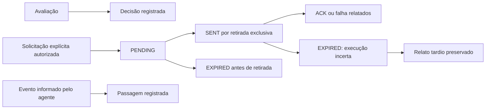

# Acesso, protocolo do agente e credenciais — lote de 02/10/2026

Implementação incremental em andamento. Este lote verifica contratos do servidor com PostgreSQL e HTTP local; **não homologa equipamento, agente instalável, modalidade biométrica ou eliminação física**. A auditoria original permanece intacta.

## Fronteiras e comportamento implementado

| Operação | Contrato atual | Resultado que pode ser afirmado | Verificação |
|---|---|---|---|
| Avaliar acesso | Academia GYM, unidade e dispositivo cruzados; direção encaminhada; horário do servidor; corpo estrito sem timestamp cliente | `EVALUATED`, sem comando, sem passagem física | PostgreSQL e HTTP: dispositivo estrangeiro, unidade indevida, data forjada, saída e ausência de efeitos físicos |
| Enfileirar comando | Ator atual e capacidade da unidade; tipo/valores limitados; payload construído no servidor; chave de operação e fingerprint | `PENDING`: obrigação registrada, ainda não retirada | PostgreSQL: seis retries concorrentes produzem uma obrigação e uma auditoria; HTTP de unidade/DTO/idempotência |
| Retirar comando | Licença, flag global, academia/unidade/dispositivo; revalidação do ator e vínculo; transação Serializable | `SENT`: o servidor reservou a entrega para uma retirada; a resposta pode se perder | PostgreSQL: seis pulls concorrentes entregam uma vez; HTTP concorrente |
| Confirmar comando | Mesmo dispositivo; exige `sentAt`; primeira confirmação imutável; retry retorna o original | `ACKNOWLEDGED`/`FAILED`: relato do agente, sem comprovar passagem física | PostgreSQL e HTTP: pending, dispositivo errado, retry e confirmação contraditória |
| Expirar entrega | Prazo por tipo também limita registros legados sem TTL ou com TTL excessivo; PENDING e SENT são expirados ao consultar fila | SENT expirado significa execução **incerta**, sem reenvio automático | PostgreSQL: abertura máxima de 30 segundos; sem ACK não se torna outra abertura |
| Confirmação tardia | Resultado sanitizado e data registrados; status permanece EXPIRED | Histórico de relato tardio, sem reabrir a obrigação | PostgreSQL; não executou hardware |
| Recuperar comando | Nova tentativa vinculada à original; autoridade e condições atuais revalidadas; operação de recuperação idempotente | Original preservado; nova obrigação PENDING para tipos elegíveis | PostgreSQL concorrente; RELEASE/REBOOT exigem nova solicitação explícita |
| Registro de passagem | Data, direção e boolean explícitos; associação academia/unidade; ID de evento ou fingerprint do conteúdo; raw arbitrário não é persistido | `PASSAGE_REPORTED`: relato autenticado do agente | PostgreSQL de concorrência/tenant/unidade; HTTP ampliado consta no registro de checks |
| Lote offline | Até 100 eventos/16 KiB no endpoint; schema, contexto e dedup por dispositivo; log/divergência/metadados no mesmo commit | `EVENTS_RECORDED`: fatos e observações de reconciliação registrados | PostgreSQL: evento estrangeiro após evento válido faz rollback de todo o lote; quatro retries registram uma vez |

As comparações e escritas que sustentam idempotência/pertencimento ficam na transação. Uma perda de resposta PULL não autoriza repetir abertura: a tentativa fica SENT, depois EXPIRED quando a fila for consultada. **Não há novo agendamento que expire comandos sem consulta**. O agente precisa persistir IDs recebidos e relatos antes de confirmar; esse runtime externo não foi localizado nem homologado.

Não existe uma seta automática de avaliação para abertura, de ACK para passagem, ou de passagem para presença em aula.

## Credenciais e privacidade

| Tema | Implementação | Limite restante |
|---|---|---|
| Modalidade anunciada | QR/RFID; FACIAL/BIOMETRIC devolvem 409 antes de criar concessão, consentimento ou comando | Driver, representação/consentimento contextual e homologação física necessários antes de reativar biometria |
| Direito de acesso | Cadastro exige vínculo estudantil atual, perfil/unidade, matrícula ACTIVE vigente, aceite persistido e `accessGranted` | Política completa de inadimplência, múltiplas matrículas, pausa/troca e todas as projeções ainda não consolidadas |
| Sincronização | Pessoa e credencial são obrigações transacionais; credencial aguarda ACK da pessoa; revalidação na retirada recusa direito revogado | Recuperação/revinculação de dependências após falha e projeção para outras unidades legítimas ainda precisam jornada própria |
| Revogação | REVOKED local; código/tipo e histórico conservados; remoção QR/RFID compatível é enfileirada | Não transforma automaticamente em QR, não confirma purga, não apaga consentimento global |
| Biometria histórica | Revogação local com `PENDING_RECONCILIATION`; nenhuma falsa exclusão de template como cartão/barcode | Purga física de face/digital permanece dependência identificada |
| Módulo/licença indisponíveis | Cadastro/sincronização/pull/cache recusados; ACK anterior e relato de evento continuam recebíveis; revogação local mantém pendência física explícita | Desativação não revoga cache já entregue ao equipamento; suspensão/offline precisa confirmação e política de tolerância |
| Identidade externa | Mesmo mapeamento com matrícula numérica no sync/removal; RFID não remove caracteres nem usa valores fictícios; QR numérico continua barcode na remoção | Mapeamento persistente por dispositivo, colisão do hash legado, identificação de eventos e reconciliação de IDs já gravados continuam pendentes |

Uma nova credencial não sobrescreve silenciosamente outra: a substituição/suspensão/revogação exige reconciliação. **A jornada completa de substituição após confirmação de remoção ainda não está implementada**. Não declarar esta restrição uma nova política contratual definitiva. Cadastro de credencial exige `devices.manage`; a recepção com apenas `access.override` continua podendo solicitar abertura avulsa, mas não cadastrar credenciais. Os controles cliente precisam refletir essa diferença por unidade.

## Cache e eventos

O cache passou a conferir licença/flag, unidade, assinatura de máquina obrigatória, início/validade do grant, matrícula/aceite/acesso, membro ativo e STUDENT atual. A geração é transacional, com incremento atômico de versão. Não usa o segredo fixo de fallback. Isso não encerra GYM-AUD-040: inadimplência e política completa ainda precisam ser comuns à avaliação/projeção/cache, e um cache anterior pode continuar no agente até seu prazo.

Lotes offline preservam o instante informado; um offset de relógio observado no envio não é aplicado retroativamente como se fosse verdade histórica. Observações de membro/concessão atualmente indisponível não afirmam que esse era o estado no instante da passagem. Nova persistência não armazena raw arbitrário, templates, tokens ou código completo nos snapshots de divergência.

Dedup offline usa chave com dispositivo e hash do identificador estável. Um registro legado com chave antiga só é reconhecido quando pertence ao mesmo dispositivo/academia; não foi apagado nem renomeado. O novo fingerprint detecta reutilização com condições diferentes. Registros antigos sem fingerprint não comprovam comparação de todos os campos. Divergências perdidas antes deste lote ainda exigem recuperação específica; não foram fabricadas retrospectivamente.

Passagem online aceita `eventId` estável; sem ele, usa o conteúdo/data exatos como identidade de retry. Duas passagens verdadeiramente distintas com os mesmos campos e timestamp podem se confundir sem ID de equipamento: **a precisão e a identidade do evento precisam de homologação do agente**. Campos antigos omissos agora devolvem 400; o emissor deve preservar o evento e reenviá-lo com data, direção e resultado explícitos, não assumir processamento bem sucedido.

## Transição e migration

`20261002010000_gym_device_command_integrity` acrescenta unicidade `(deviceId,idempotencyKey)` e trigger que cruza comando, dispositivo, unidade e academia GYM. Chaves null continuam admitidas no histórico. A prévia aborta duplicidades ou inconsistências; não elimina registros nem escolhe automaticamente uma operação financeira/física como correta.

Aplicada **somente** ao PostgreSQL descartável `127.0.0.1:56432/atlasfit_gym_stabilization_20261001`. Prisma Client gerado localmente. Nenhuma aplicação em base existente foi feita. A falha histórica da cadeia de migrations continua aberta; esta alteração aditiva não a resolve.

Comandos legados sem contrato contextual verificável deixam de ser entregues automaticamente e ficam FAILED com motivo de reconciliação. As ordens antigas de substituição, desligamento e contingência permanecem históricas. Novas substituições usam o [contrato canônico de recuperação](recuperacao-equipamentos.md); contingência contínua é recusada explicitamente, sem gravar uma ativação física fictícia. Outros produtores, inclusive desligamento, continuam pendentes. Não considerar uma jornada concluída só porque o comando foi impedido de executar. Registros e credenciais de máquina não foram apagados ou cancelados em ambiente externo.

## Achados e situação do lote

| ID | Tratamento demonstrado | Pendência que impede encerramento |
|---|---|---|
| GYM-AUD-002 | Autoridade atual por unidade nos comandos/retirada/recepção; grant revogado não recupera papel; navegação anuncia papel local sem autorização global | Demais consultas/listas/SSR e jornadas reais do switcher |
| GYM-AUD-011 | Trigger de tenant de comandos, associação de eventos, esquema e transações | Demais FKs/escritores, movimentação de dispositivo e recuperação de inconsistências antigas |
| GYM-AUD-038 | Avaliação sem efeito físico, horário/direção/dispositivo/unidade e suspensão | Vigência/aceite/financeiro/minoridade e escolha de múltiplas matrículas em todos os motores |
| GYM-AUD-039 | Enfileiramento/retirada/ACK/expiração/replay e substituição rastreáveis no contrato verificado | Agente persistente, lotes acima de 100 concessões, UI de substituição, ordens antigas e execução física |
| GYM-AUD-040 | Associação, schemas, idempotência por dispositivo, log+divergência atômicos, cache versionado e sem segredo padrão | Recuperação legada, política offline/financeiro, revogação de cache físico e identidade externa |
| GYM-AUD-041 | Modalidade sem driver desabilitada; sem consentimento global fictício; cadastro/revogação QR/RFID com estados honestos | Biometria/purga física, substituição completa, UI por capacidade/unidade |
| GYM-AUD-045 | Ação de recepção chama avaliação efetiva e não anuncia abertura | Demais rotas de treino/CRM/aulas e check-in anunciado em outros clientes |
| GYM-AUD-062 | Sync/removal central usam a mesma matrícula numérica; sem defaults numéricos fictícios | Registro persistente, colisões do mapeamento legado e todos os produtores/eventos |
| GYM-AUD-063 | Dois produtores recusam ativação contínua sem driver; interface registra resolução local sem afirmar retorno físico | Contrato físico, expiração da contingência e confirmação de retorno |

## Cobertura deste lote

| Arquivos | Profundidade | Fluxos/pêndencias |
|---|---|---|
| `gym-device-service.ts`, `gym-device-commands.ts`, `device-command-contract.ts`, `device-command-dto.ts` | Serviço original lido integralmente; novas operações acompanhadas de DTO a persistência/testes | Provisionamento/quota/update/lista/heartbeat ainda não estão todos consolidados |
| `gym-access-policy-service.ts` | Entrada/seleção/decisão e retirada do efeito físico acompanhadas; não declarar todas as projeções verificadas | Partes de projeção, diagnóstico e equivalência de direitos permanecem em revisão |
| `gym-recovery-service.ts`, `gym-device-recovery-commands.ts` | Replay/substituição/contingência delegados ao contrato canônico e testados | Saúde/reprocessamento, batch e interface de substituição |
| `gym-biometrics-service.ts`, `gym-credential-commands.ts` | Cadastro/revogação originais lidos integralmente e substituídos; feed parcialmente revisado | Dados/status/escopo das consultas de recepção e jornada de substituição pendentes |
| `gym-offline-reconciliation-service.ts`, `device-event-context.ts`, `device-event-contract.ts` | Cache e ingestão completos cruzados com schema/handlers; contexto e atomicidade testados | Administração/reprocessamento de divergências, contingência e prova histórica restantes |
| Rotas `access/evaluate`, `devices/[id]/command`, `devices/commands/[id]/replay`, `devices/agent/{pull,ack,offline-cache,passage,sync-offline-events}`, `biometrics/{enroll,revoke}` | Corpo, autorização, serviço, DTO e erros acompanhados | Heartbeat e demais rotas administrativas ainda exigem contrato comum |
| `reception/page.tsx`, `reception-client.tsx`, `superadmin/gym-settings/page.tsx` | SSR da recepção usa snapshot paginado por unidade; ações, modalidade, rótulos e seletor de fabricante revistos | Demais configurações e navegador/mobile/teclado não inspecionados |
| `actor-authority.ts`, `guard.ts`, `access-roles.ts`, `gym-module-authority.ts`, `context-service.ts` | Autoridade/live grants/flags/unidade cruzados | Contexto inicial e listagens com grants apenas locais permanecem em revisão |
| Schema + migration de comandos; `access-evaluation.integration.ts`, `device-commands.integration.ts`, `http.spec.ts` | Tipos, unicidade/trigger, concorrência e HTTP reais disponíveis no registro | Não equivalem a execução ou homologação do driver no equipamento |

Os resultados atualizados, nomes de cada caso e falhas intermediárias estão em [verificacoes-isoladas.json](verificacoes-isoladas.json) e no documento principal. A suíte existente continua falhando; [inventário individual](falhas-suite-existente.md) não presume que sejam todas fixtures. A matriz PERSONAL/GYM registra os pontos compartilhados. Sem mensagens, cobranças, transferências ou comandos enviados a serviços/equipamentos reais.
