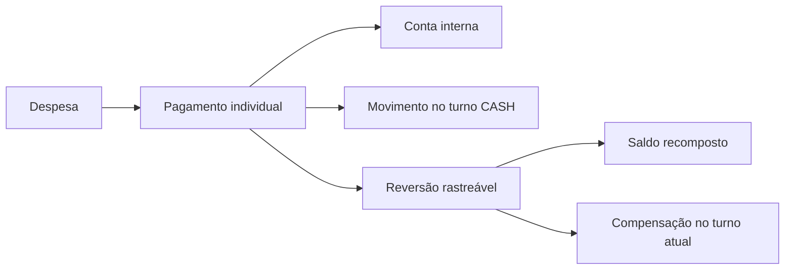

# Caixa e despesas — implementação e limites

Atualização de 03/10: [retry de caixa, unidades e contratos implementados](caixa-retry-unidades.md). Pendências de idempotência descritas abaixo representam o lote anterior.

Complemento do [acompanhamento](../estabilizacao-modulo-academias.md). Alterações incrementais relacionadas a GYM-AUD-018, 025, 026 e 036. Não substitui a reconciliação de históricos existentes.

## Registros e invariantes

| Registro | Responsabilidade | Efeito |
|---|---|---|
| GymExpense | Obrigação: nominal + multa − desconto; saldo = total − pagamentos ativos | Parcial continua pendente/vencida; PAID exige saldo zero |
| GymExpensePayment | Pagamento individual novo | Valor, data, conta, forma, operador, comprovante quando informado e chave/fingerprint; nunca sobrescrever pagamentos anteriores |
| GymFinancialAccount | Conta interna da academia/unidade | Recebimento incrementa; pagamento de despesa decrementa; reversão compensa; não é saldo de gateway |
| GymCashDrawerSession | Turno do operador em uma conta CASH/unidade | Uma sessão OPEN por operador/academia e por conta; abertura/fechamento são contagens, não receitas |
| GymCashDrawerMovement | Livro do turno | OPENING/CLOSING não se somam novamente. SUPPLY/CASH_INFLOW_PAYMENT somam; BLEED/EXPENSE_PAYMENT subtraem; valores negativos compensam o fato original |
| GymAccountTransfer | Transferência interna neutra | Débito e crédito atômicos; quando envolve CASH, lançamento equivalente no turno próprio aberto |
| AuditLog | Rastreabilidade da operação | Persistido na mesma transação; log não substitui comprovante bancário ou reconciliação |

`cash-mutations.ts` mantém leituras de permissões, pertencimento, saldo, status e turno dentro de Serializable. Não basta a capacidade verificada pelo handler. Destino de sangria, fornecedor, categoria, conta e unidade precisam pertencer ao workspace. Conta GATEWAY_ONLINE não participa destes comandos. A conta de uma unidade não paga despesa de outra; conta global exige autoridade global. Transferências verificam alçada sobre ambas as unidades.

O operador do turno movimenta/fecha seu próprio caixa. Conferência gerencial usa refunds.approve e motivo, sem reabrir turno fechado. Esta escolha conserva a política já usada para recebimento em CASH. Coproprietário não adquire acesso ao turno de outro operador por existir um botão.

Criação de despesa e pagamento exigem chave estável de 8–128 caracteres. Chave tem escopo de academia/tipo, hash e fingerprint do conteúdo/ator. Repetir devolve o registro existente; alterar conteúdo sob a mesma chave retorna 409. A interface preserva chave durante retry e a renova ao mudar os dados. Isso não transforma repetição de sangria ou transferência em operação idempotente: esses dois comandos ainda precisam de chave/contrato próprio.

Reversão conserva o pagamento individual original, registra operador/data/motivo e recompõe conta e obrigação. Em CASH, exige turno atual do operador na mesma conta e grava EXPENSE_PAYMENT negativo. O turno original fechado permanece intacto. Uma segunda reversão devolve o estado já persistido, sem novo crédito. Recebimento de mensalidade usa a compensação inversa; agora recusa devolução sem saldo disponível na conta/turno.

## Contratos e interface

| Operação | Endpoint | Particularidade |
|---|---|---|
| Criar despesa | POST /api/gym/finance/expenses | idempotencyKey obrigatória; pagamento imediato segue a mesma obrigação/ledger |
| Registrar pagamento | POST /api/gym/finance/expenses/:id/pay | idempotencyKey, conta, centavos positivos, data opcional não futura; resposta inclui paymentId e saldo |
| Consultar | GET /api/gym/finance/expenses | Limite 1–100, filtros coerentes; até 100 pagamentos recentes por obrigação, quantidade total informada |
| Reverter | POST /api/gym/finance/expenses/:id/payments/:paymentId/reverse | Motivo mínimo de cinco caracteres; refunds.approve sobre recurso/conta; 404 para pagamento de outro contexto |

Interface de despesas mostra total efetivo, valor pago/saldo parcial, histórico, operador e conta, além de confirmação separada para reversão. Pagar continua disponível para vencidas. Cancelamento é recusado enquanto houver pagamento ativo. O seletor de ação principal e a mensagem de sucesso distinguem parcial de quitação. Carregamento com erro possui tentativa novamente; requisições antigas são abortadas ao trocar contexto. Validação visual e teclado/mobile ainda pendentes.

Entradas monetárias do caixa/despesas usam parser compartilhado de centavos, sem parseFloat parcial: `R$ 1.234,56` resulta em 123456. Formatos inválidos/negativos e valores acima de Number.MAX_SAFE_INTEGER são recusados. Persistência conserva BigInt; DTOs antigos baseados em number recusam valores fora do intervalo em vez de arredondar. Contratos monetários do restante do módulo ainda precisam da mesma consolidação.

Indicadores de despesas mostram saldos pendentes/vencidos e valores pagos **nas obrigações filtradas**, incluindo baixas parciais. Não são uma demonstração de saídas bancárias por período de pagamento. Analytics geral/MRR ainda estão pendentes e não herdam automaticamente esta correção.

## Migration e histórico

`20261001050000_gym_expense_receipts` é aditiva. Acrescenta ledger e chaves nullable na obrigação histórica; não fabrica recebimentos para agregados antigos. Prévia aborta se houver mais de um turno aberto por operador ou conta. CHECK exige valor positivo no pagamento e todos os campos de reversão juntos. Aplicação validada somente no PostgreSQL descartável; migration histórica completa continua quebrada e exige estratégia própria.

Despesa antiga paga sem recibo individual permanece consultável, com agregado intacto. O endpoint não inventa pagamento para permitir reversão: exige reconciliação identificada. Foreign keys RESTRICT preservam os recibos novos, portanto encerramento de academia precisa coordenar retenção/transição; não reutilizar exclusão em cascata como rotina financeira.

Ainda pendentes: reconciliação prévia de dados legados; idempotência de sangrias/transferências; autoridade/paginação em todas as consultas por unidade; escrita de defaults de categorias em GET; aplicação uniforme de flags/licença; retry de comunicação após commit; histórico além dos 100 itens; comprovantes/uploads efetivos; jornada de navegador e testes antigos com mocks incompletos. Não houve cobrança externa, saque, transferência em gateway ou mudança em dados existentes.

## Evidência disponível

Testes reais: [cash-expense.integration.ts](../../../../tests/gym/cash-expense.integration.ts), [manual-finance.integration.ts](../../../../tests/gym/manual-finance.integration.ts) e [http.spec.ts](../../../../tests/gym/http.spec.ts). [Registro sanitizado](verificacoes-isoladas.json) conserva os casos e resultados. PostgreSQL verifica concorrência, constraints, rollback e compensação; HTTP verifica contratos/autenticação. Helpers puros de formatação e fixtures internas não comprovam homologação de equipamento, gateway ou navegador.
