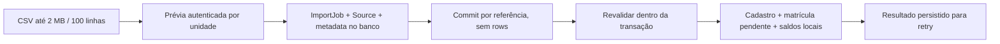

# Importação GYM com prévia no servidor

Lote associado a GYM-AUD-055; também limita caminhos de 001, 002, 015, 020, 048 e 060. A solução preserva registros anteriores e não executa gateway, e-mails ou equipamentos.

## Antes e depois

O commit anterior recebia `rows` livres, confiava em action/status/isMinor/preço e criava matrícula e RFID ativos. O hash da prévia não provava que aquelas linhas haviam sido examinadas. Agora o CSV bruto é persistido em ImportSource, com SHA-256 e ImportJob `gym-import-v2`. Uma prévia de uma hora é vinculada a academia, unidade e operador. ImportRecord guarda hash das linhas derivadas no servidor, prazo e resultado de conclusão; o navegador envia somente referência/hash/unidade e confirmações.

O servidor rejeita `rows` e campos desconhecidos no commit, relê o CSV e revalida catálogo, identidade, permissões, licença, flags, quota e pertencimento dentro de uma transação Serializable. Mudança nos dados relevantes exige nova conferência. Chave única com hash de academia/unidade/conteúdo e retry de conflitos impedem dois commits do mesmo lote. O resultado original é persistido para devolver contadores corretos no retry. Um lote de outro operador não recebe autoridade por conhecer seu ID.

## Regras e efeitos

| Parte | Regra implementada | Resultado |
|---|---|---|
| Permissão | students.manage da unidade; contratos exigem enrollments.manage | Revogação entre preview e commit é efetiva |
| Tenant/unidade | Unidade ativa local explícita; escolha automática apenas se houver uma única unidade | Nunca escolhe a primeira entre várias nem transfere aluno implicitamente |
| Parser | 2 MB UTF-8, até 100 linhas, campos até 2.000 caracteres; erros de CSV recusados | Lote atômico com tamanho limitado, sem processamento externo |
| Identidade | Nome, CPF quando informado, e-mail, telefone e nascimento validados | Homônimo não vincula pessoa; CPF/e-mail divergentes não são mesclados |
| Conta externa | Importação não vincula automaticamente User sem participação na academia | Exige ingresso identificado; não muda dados globais existentes |
| Duplicidade | CPF/e-mail/matrícula/cartão repetidos; cadastro local; estados de contrato correntes | Linha inválida não ganha override; contrato ativo ou pendente ignora a linha inteira |
| Menor | Idade derivada do nascimento; responsável completo, CPF válido e parentesco | Responsável não é marcado como verificado; conta própria não recebe token |
| Plano | Plano e versão ativos do tenant; preço da versão preservado | CSV não negocia desconto fora da alçada; mudança de catálogo exige repreview |
| Contrato | PENDING_ACCEPTANCE, accessGranted=false, evento com ator e origem | Nenhum aceite fictício, ativação ou assinatura externa |
| Dívida histórica | Valor estrito, vencimento informado, confirmação e invoices.issue/refunds.approve | Invoice/Item locais; nada recebido ou debitado externamente |
| Crédito histórico | Plano associado; confirmação/alçada; snapshot em creditBalanceInCents e evento | Não é receita, recebimento, alocação automática ou saldo externo |
| RFID | devices.manage, módulo hardware/licença; cartão não duplicado | SUSPENDED e restrito à unidade; nenhum comando físico |
| Quota | Contagem de alunos inclui perfil/multipapel e é relida na transação | Dois lotes disputando última vaga não excedem limite nesse caminho |
| Erro | Rollback de criação e estados; prévia READY preservada | Correção e nova conferência; não confirma sucesso antes do commit |

A confirmação de alertas serve apenas para avisos não impeditivos, como biometria ignorada ou linha que será pulada. Nunca converte INVALID em VALID. Qualquer linha inválida impede o lote inteiro: a interface informa isso e desabilita conclusão. Datas civis importadas usam AAAA-MM-DD estrito, sem rollover; moeda usa parser inteiro compartilhado.

## Caminhos alternativos e preservação PERSONAL

As oito rotas de `/api/personal/migration` continham onze blocos operacionais sem fronteira completa, incluindo alteração de registro por ID, cancelamento e processamento sem vínculo. `assertPersonalImportJobAccess` agora exige workspace PERSONAL e students.manage; o record deve pertencer ao job do URL. Prévia GYM não pode ser editada, cancelada, processada, receber upload ou commit por esse namespace. O tratamento de recusa ocorre antes do catch de processamento registrar FAILED.

A importação PERSONAL continua com entidades, parser, IA, revisão, quotas e commit próprios; sua jornada completa ainda precisa de regressão. Esses componentes não foram copiados para GYM nem passaram a depender da licença da academia. Leitura de job PERSONAL autorizado é preservada, sem liberar job/record de outra pessoa ou empresa.

## Transição, validação e lacunas

- Nenhuma migration adicional necessária: usa entidades existentes. ImportJob anterior permanece intacto. Hash bruto de lote histórico COMPLETED no mesmo tenant impede reimportação automática e exige reconciliação; não se inventa aceite histórico.
- CSV modelo agora contém somente cabeçalhos, incluindo Vencimento_Saldo. Não fornece dados fictícios de responsáveis como substitutos de dados obrigatórios.
- Testes PostgreSQL verificam adulteração, concorrência/retry, plano desativado, escopo/ator/grants revogados, quota, CPF/datas/moeda inválidos, menores, saldos, expiração, parse/flags/suspensão. Os cenários de cartão usam apenas persistência; não homologam hardware.
- Testes HTTP acompanham preview/commit e as recusas das rotas PERSONAL alternativas; não constituem verificação visual.
- Recuperação/transferência administrativa de prévia de outro operador, listagem/cancelamento de prévios GYM e política de retenção do CSV com dados pessoais ainda precisam de jornada explícita. Não foi inventado prazo legal nem rotina de exclusão.
- Saldo credor histórico é preservado, mas sua utilização e reversão integral no ciclo de contratação ainda precisam de consolidação financeira. Não se converteu crédito legado em pagamento.
- Cadastro comum e conversão de lead passaram ao comando canônico; importação compartilha a contagem de quota, com teste PostgreSQL de disputa da última vaga entre cadastro e importação. A criação comum de contrato, lifecycle e outros escritores legados ainda precisam consolidar as demais invariantes; não afirmar estabilização de todos os ingressos.
- Jornada visual de importação, documentos/ativação, responsável, mobile e acessibilidade permanece pendente. A prévia caduca em uma hora por política operacional deste comando; 48 horas refere-se ao convite de setup, não ao CSV.
