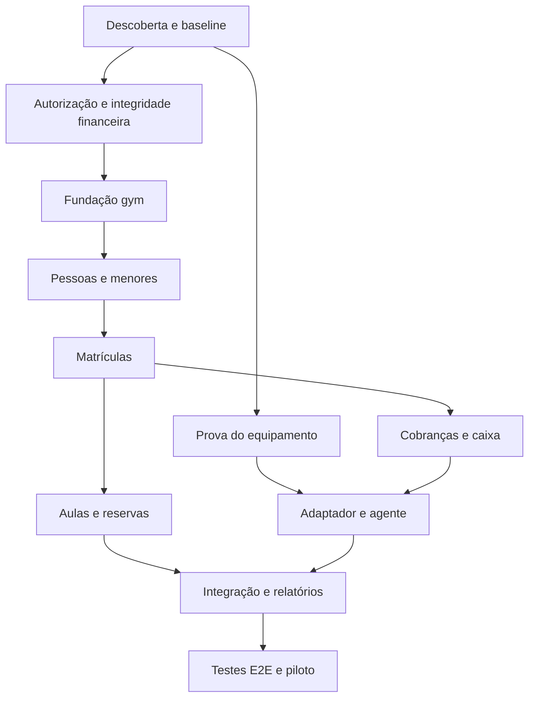

# AtlasFit — Backlog de Implementação de Academias

Atualização de 11/10/2026: as descrições de setembro abaixo são registros históricos de implementação. O estado vigente está no [tratamento dos 65 achados](../audits/academias/estabilizacao/tratamento-achados.md) e nas [pendências restantes](../audits/academias/estabilizacao/pendencias-restantes.md). CRM, turmas, equipamentos e gateway GYM foram retirados do escopo; as antigas marcações de conclusão não demonstram que esses módulos estão disponíveis ou homologados. O financeiro GYM é local/manual.

24/09/2026 · Ordem proposta para execução a partir de `main@56f221b`.

Escopo de lançamento confirmado: **uma unidade, gestão, aulas, catraca biométrica e menores de idade**. Este backlog complementa o [plano](plano.md) e o [diagnóstico](diagnostico.md).

Prioridades: **P0** = pré-requisito técnico ou de integridade; **P1** = funcionalidade necessária ao lançamento; **P2** = evolução posterior. Esforços relativos: S = pequeno, M = médio, L = grande, XL = deve ser quebrado após descoberta. Não representam dias nem garantias de entrega.

## Pacote 0 — descoberta e ambiente reproduzível

### GYM-001 · Levantamento operacional · P0 · M

- Mapear atendimento da recepção, papéis reais da equipe, planos, renovações, trancamento, cancelamento, meios de pagamento e alçadas.
- Identificar faixa etária, verificação de responsáveis, acesso ao aplicativo e uso de biometria por menores.
- Registrar quantidade de alunos/equipe, pico de acesso, aulas, regras de falta e reposição.
- Levantar sistema de origem, exportações, conta recebedora, configuração de hospedagem/cron e backup.
- **Aceite:** matriz de regras versionada e pendências com responsável; nenhuma suposição comercial escondida no código.

### GYM-002 · Prova técnica da catraca · P0 · L/indeterminado

- Identificar fabricante/modelo do leitor e da catraca, firmware, SDK, licença e rede.
- Testar identificação, concessão/revogação, passagem, timeout, desconexão e reinício.
- Determinar agente local ou API cloud, runtime exigido e capacidades offline.
- **Aceite:** relatório reproduzível no equipamento real, capacidades suportadas e limitações explícitas. Simulador sozinho não encerra este item.
- **Dependência externa:** informação de equipamento e acesso técnico autorizado da academia.

### GYM-003 · Reconciliação de schema e migrations · P0 · L

- Comparar schema atual e migrações com cópia controlada do ambiente.
- Definir baseline e caminho de upgrade sem reset; revisar índices, FKs, enums, dados incompatíveis e defaults.
- Criar banco de desenvolvimento/teste descartável e fixtures de personal, duas academias, alunos e responsáveis.
- **Aceite:** instalação em banco vazio e upgrade da cópia produzem schema equivalente; dados preservados e restauração ensaiada.

### GYM-004 · Automação de qualidade e ambientes · P0 · M

- Manter Vitest, TypeScript e build em CI; separar validação unitária, integração PostgreSQL e testes de provider.
- Revisar lockfile efetivo: existem package-lock e yarn.lock; escolher o usado pelo deployment antes de alterar dependências.
- Configurar segredos por ambiente, sandbox financeiro, worker/agendador e logs sem PII.
- **Aceite:** pipeline reproduzível, sem acesso de testes automatizados à produção; cron falha fechado sem credencial.

## Pacote 1 — corrigir as bases reutilizadas

### GYM-010 · Autorização central e isolamento · P0 · XL [CONCLUÍDO]

- Criado `modules/workspaces` com contexto, guard, papéis, 26 capacidades e escopos granulares.
- Cobertas APIs antigas de alunos, treinos, finanças, organização e Server Actions com `requireWorkspaceAccess`.
- DTOs sanitizados (`sanitizeStudentListItem`, `sanitizeStudentDetail`) removendo senhas e `setupToken`.
- **Status:** Concluído com 22 testes unitários dedicados em `workspace-guard.test.ts`.

### GYM-011 · Pagamento afeta somente sua obrigação · P0 · L [CONCLUÍDO]

- Removidas baixas amplas `workspacePayment.updateMany` nos três caminhos: webhook, sincronização da carteira e financeiro do aluno.
- Criada a função `settleStudentWorkspaceObligation` isolando estritamente aluno, workspace e ordem cronológica (FIFO).
- Um pagamento recebido de um aluno jamais altera pendências de outros alunos do mesmo workspace/academia.
- **Status:** Concluído com testes em `gym-011-012.test.ts`.

### GYM-012 · Estados, idempotência e recuperação financeira · P0 · XL [CONCLUÍDO]

- Criada máquina de estados formal em `modules/payments/domain/billing-state-machine.ts` com validação estrita de transições.
- Cobranças `SETTLED` jamais regridem para `CONFIRMED`, `PENDING` ou `OVERDUE` mesmo com webhooks fora de ordem.
- Chave de idempotência contábil unificada (`getBillingLedgerCreditKey`) impedindo créditos duplicados entre webhook e syncs.
- `payloadEncrypted` e método `replayEvent` implementados para replay auditável de webhooks falhos (`FAILED_RETRYABLE`).
- Recorrência (`recurrence.ts`) corrigida: cobranças nascem sempre como `pendente`; presunção de `status=pago` sob `AUTOMATIC` eliminada.
- Mutações de recorrência removidas de todas as rotas GET (`personal/finance`, `personal/clients/[id]/finance`, `student/dashboard`).
- **Status:** Concluído com testes em `billing-state-machine.test.ts` e `gym-011-012.test.ts`.

### GYM-013 · Realtime, arquivos e revogação · P0 · L

- Delimitar capabilities Ably, separar canais operacionais/financeiros/privados e validar conversa para anexos.
- Limpar store/canais ao trocar identidade; limitar dados em mensagens realtime.
- Implementar prazo e estratégia de revogação de token/grants.
- **Aceite:** recepção não assina financeiro, membro removido não continua obtendo dados, arquivo privado não é acessível por simples conhecimento da chave.

## Pacote 2 — fundação da nova área

### GYM-020 · Schema aditivo de workspace, unidade e papéis · P0 · L [CONCLUÍDO]

- Modelos e enums aditivos implementados em `prisma/schema.prisma`:
  - `Workspace.type` (`WorkspaceType`: `PERSONAL`, `GYM`) com default `PERSONAL`.
  - `WorkspaceRole` expandido com papéis de academia: `MANAGER`, `RECEPTIONIST`, `FINANCE`.
  - Modelos `GymSettings`, `GymUnit`, `WorkspaceRoleGrant`, `WorkspaceInvitation`, `GymStaffProfile`.
  - Migração aditiva sem downtime criada em `prisma/migrations/20260925000000_add_gym_workspace_models/migration.sql`.
- Serviços de domínio e aplicação em `src/modules/workspaces/`:
  - `OwnershipService`: garante consistência de titularidade, impede remoção/desativação do último OWNER e implementa transferência atômica auditada.
  - `BackfillService`: backfill transparente de papéis legados em `WorkspaceRoleGrant` e criação de settings/unidade padrão.
  - `GymService`: gestão de unidades, concessão/revogação de grants de papéis e perfis de equipe (`GymStaffProfile`).
  - `guard.ts`: resolução combinada de múltiplos grants (suporte simultâneo funcionário + aluno), escopo por unidade e fallback legado.
- **Status:** Concluído com 7 testes dedicados em `gym-020.test.ts` (110 testes passando no total).

### GYM-021 · Contexto, login e entitlements · P0 · L [CONCLUÍDO]

- Modelo aditivo `WorkspaceSubscription` e enum `WorkspaceSubscriptionStatus` em `prisma/schema.prisma` com migração SQL zero-downtime `20260925010000_add_workspace_subscription`.
- Serviço de direitos unificado `EntitlementsService`:
  - `resolveEntitlements`: isolamento total entre assinaturas GYM e planos de personal ("sem fallback financeiro para outro workspace").
  - Funcionário com papel global `USER` opera em academia ativa sem exigir assinatura individual própria.
  - Limites operacionais (`maxStudents`, `maxStaff`, `maxUnits`, `maxDevices`) e métodos defensivos de validação (`canPerformAction`, `assertCanPerform`).
- Contexto de workspace e cookies em `WorkspaceContextService`:
  - Cookies persistentes `atlasfit_active_workspace_id` e compatibilidade com `student_active_workspace_id`.
  - Validação estrita contra IDOR/BOLA (rejeita cookies apontando para workspaces aos quais o usuário não pertence).
  - Roteamento inteligente em `/dashboard` e `/select-workspace`: auto-resolve para destino operacional quando usuário possui 1 workspace e apresenta seletor com papéis e badges quando possui múltiplos.
- Roteamento e login:
  - Adicionada entrada em `/auth/gym`.
  - Revisados `/dashboard`, `AuthForm`, reset de senha, setup de senha, personal onboarding e student onboarding para utilizar o despachante dinâmico.
  - Sincronização segura com store Valtio e suporte a limpeza na troca de conta (`clear()`).
- **Status:** Concluído com 10 testes dedicados em `gym-021.test.ts` (120 testes passando no total).

### GYM-022 · Shell e componentes gym · P1 · M [CONCLUÍDO]

- Layout do servidor `src/app/(gym)/layout.tsx` com guarda de autenticação, validação de tenant, `SidebarProvider`, breadcrumbs e barra móvel.
- Componentes de navegação e shell:
  - `GymSidebar`: navegação contextual por papel (oculta financeiro/gestão de colaboradores exclusivos de recepção), seletor de workspace, alternador de tema e perfil com logout seguro.
  - `GymMobileNavbar`: barra de navegação móvel rápida com transições suaves (Framer Motion).
  - `GymBreadcrumbs`: navegação em trilha usando componentes shadcn (`@/components/ui/breadcrumb`).
- Páginas operacionais do shell:
  - `src/app/(gym)/gym/dashboard/page.tsx`: visão executiva com 4 cartões de KPIs (alunos, passagens, aulas, equipe), feed recente de catraca e ações rápidas.
  - `src/app/(gym)/gym/reception/page.tsx` & `reception-client.tsx`: balcão de atendimento com busca instantânea, feedback imediato e modal de confirmação destrutiva (`AlertDialog`) com justificativa obrigatória para liberações manuais excepcionais, com minimização de dados (zero exposição de dados de saúde/anamneses confidenciais).
  - `src/app/(gym)/gym/loading.tsx`: skeleton completo simulando dashboard e cartões (conforme regra `skelletonsloaders.md`).
  - `src/app/(gym)/gym/error.tsx`: barreira de contenção de erros com recuperação rápida.
- **Status:** Concluído e validado com compilação limpa do TypeScript (`npx tsc --noEmit` code 0).

### GYM-023 · Superadmin e configuração da academia · P1 · M [CONCLUÍDO]

- Implementado serviço `SuperAdminGymService` em `src/modules/workspaces/application/superadmin-service.ts`:
  - `provisionWorkspace`: criação atômica de workspace GYM com `GymSettings`, `GymUnit` padrão, `WorkspaceSubscription` com status `TRIAL`/`ACTIVE`, concessão de papel `OWNER` ao diretor e log de auditoria com severidade `success`.
  - `updateGymConfig`: atualização de limites de licenciamento (`maxStudents`, `maxStaff`, `maxUnits`, `maxDevices`), sincronização de assinatura e políticas operacionais (`billingGracePeriodDays`, `allowMinorSelfCheckin`, `requireGuardianSignature`, `biometricValidationMode`).
  - `addGymUnit`: adição de filial física respeitando teto de unidades (`maxUnits`) da licença corporativa.
- Rotas de API Superadmin:
  - `GET`, `PATCH`, `POST /api/superadmin/workspaces/[id]/gym-config`: endpoints protegidos para consulta/edição de limites e adição de filiais.
  - Atualizadas rotas `/api/superadmin/workspaces` e `/api/superadmin/workspaces/[id]` com suporte ao tipo `GYM`, transferência segura de titularidade via `OwnershipService` e backfill de configurações.
- Interface Superadmin:
  - `src/app/(superadmin)/superadmin/workspaces/page.tsx`: seletor de tipo de workspace (`Personal` vs `Academia (GYM)`), badges visuais de diferenciação e indicação do modo multi-unidade.
  - `src/app/(superadmin)/superadmin/workspaces/[id]/page.tsx`: aba dedicada "Academia & Unidades" exibindo barras de progresso de consumo de licença, formulário reativo de limites/políticas com estados assíncronos e toast de confirmação, listagem de unidades físicas e modal para adição de novas filiais.
  - Impersonate seguro para suporte: geração de token de uso único (2 minutos de validade) com auditoria imutável completa (`userId`, ação, data/hora) sem compartilhamento de senhas.
- **Status:** Concluído com 6 testes dedicados em `gym-023.test.ts` (126 testes passando no total, `npx tsc --noEmit` exit code 0).

## Pacote 3 — pessoas, responsáveis e matrículas

### GYM-030 · Equipe e atribuições · P1 · L [CONCLUÍDO]

- Modelagem e migração de banco de dados (`20260925020000_add_member_unit_and_staff_assignment`):
  - Adicionado `unitId` em `WorkspaceMember` com vínculo a `GymUnit` (`MemberPrimaryUnit`).
  - Adicionado `assignedStaffId` em `WorkspaceMember` (auto-relacionamento `StaffAssignedStudents`) para atribuição de alunos a profissionais e personal trainers.
  - Relacionamentos integrados com `GymStaffProfile` (registro CREF, cargo, bio, datas de contratação e rescisão, contatos de emergência).
- Serviço de aplicação `StaffService` em `src/modules/workspaces/application/staff-service.ts`:
  - `inviteStaffMember`: validação estrita de e-mail e papel (proíbe `STUDENT` no fluxo de equipe), verificação de capacidade máxima contratada (`maxStaff` do `WorkspaceSubscription`), prevenção de duplicação de colaborador ativo, invalidação de convites pendentes anteriores, geração de token criptográfico de alta entropia (256 bits) com expiração de 72 horas e armazenamento exclusivo do hash SHA-256 (`tokenHash`), além de auditoria imutável (`STAFF_INVITATION_CREATED`).
  - `getInvitationByToken`: busca segura por hash de token com verificação de validade temporal (marcação automática de `EXPIRED` após 72h) e integridade de status.
  - `acceptInvitation`: transação atômica que localiza ou cria o `WorkspaceMember`, concede explicitamente a role grant (`WorkspaceRoleGrant`), inicializa o perfil profissional (`GymStaffProfile`), atualiza o convite para `ACCEPTED` e registra auditoria.
  - `revokeInvitation`: cancelamento seguro de convites pendentes com auditoria.
  - `listStaff`: consulta paginada com contagem de alunos sob responsabilidade, papéis granulares, unidade física e busca textual por nome/e-mail.
  - `getStaffMember` & `updateStaffMember`: manutenção de cargo, CREF, bio, contatos e alteração de papel protegida (com verificação de último proprietário).
  - `offboardStaffMember`: fluxo de desligamento seguro com delegação a `OwnershipService.preventLastOwnerRemoval` (impedindo a remoção do último `OWNER`), reatribuição atômica de carteira de alunos para substituto ou desvinculação, revogação de concessões ativas de papéis, preenchimento de `terminationDate`, desativação do membro (`isActive = false`) e geração de log de auditoria de severidade alta (`severity: "high"`).
  - Preservação da autoria: treinos (`Workout.creatorId`), avaliações físicas e registros financeiros permanecem íntegros e com autoria histórica preservada após o desligamento.
  - Isolamento de dados e capabilities: recepcionistas (`RECEPTIONIST`) têm escopo estrito de atendimento e são impedidos de visualizar anamneses/avaliações físicas de saúde confidenciais (`health.read.assigned`), enquanto treinadores acessam apenas alunos da sua carteira.
  - `reassignStudents`: migração em lote de alunos entre profissionais com rastreabilidade completa.
- Rotas de API dedicadas:
  - `GET`, `POST /api/gym/staff`: listagem com filtros e envio de convites de equipe.
  - `GET`, `PATCH`, `DELETE /api/gym/staff/[id]`: detalhes, atualização e desligamento seguro com substituição de treinador.
  - `GET /api/gym/invitations`: listagem de convites pendentes (sem expor hashes de token).
  - `DELETE /api/gym/invitations/[id]`: revogação de convite.
  - `GET`, `POST /api/gym/invitations/accept`: verificação prévia de token e aceitação atômica com definição de cookie de workspace ativo.
- Interfaces e UX (`asyncloader.md`, `configlayout.md`, `confirmationmodals.md`, `skelletonsloaders.md`):
  - `src/app/auth/invite/page.tsx`: tela de aceitação de convite com validação instantânea, redirecionamento para autenticação com retorno seguro, confirmação visual de integração e ativação do workspace.
  - `src/app/(gym)/gym/staff/page.tsx` & `staff-client.tsx`: dashboard completo de equipe com cards de métricas (ativos, licença disponível, pendentes), abas de colaboradores e convites, diálogo para novo convite com cópia de link, edição de atributos e diálogo de confirmação destrutiva (`AlertDialog`) para offboarding seguro com seleção de profissional substituto.
- **Status:** Concluído com 9 testes automatizados passando em `src/modules/workspaces/__tests__/gym-030.test.ts` (135 testes passando no total da aplicação, `npx tsc --noEmit` exit code 0).

### GYM-031 · Alunos e cadastro assistido · P1 · L [CONCLUÍDO]

- Modelagem e migração de banco de dados (`20260925030000_add_gym_student_profile`):
  - Criado modelo `GymStudentProfile` com `registrationNumber` (matrícula sequencial/customizada), `emergencyContactName`, `emergencyContactPhone`, `medicalClearance`, `medicalClearanceExpiresAt`, `notes`, `enrolledAt` e `status` ("ACTIVE", "INACTIVE", "SUSPENDED", "CANCELLED").
  - Adicionada relação 1-para-1 `studentProfile GymStudentProfile?` em `WorkspaceMember`.
  - Adicionado índice `@@index([cpfCnpj])` no modelo `User` para deduplicação instantânea.
- Serviço de aplicação `GymStudentService` em `src/modules/workspaces/application/gym-student-service.ts`:
  - `listStudents`: listagem paginada com ordenação, filtros por filial (`unitId`), instrutor responsável (`assignedStaffId`), plano e status, busca abrangente (nome, e-mail, matrícula, CPF e telefone). Escopo de permissão estrito: treinadores restritos sem capacidade `students.manage` visualizam exclusivamente sua carteira atribuída (`assignedStaffId`).
  - DTO e sanitização de segurança (Regra de Segurança #29): omissão estrita de `password`, `setupToken` e segredos internos na listagem de alunos.
  - `getStudentById`: detalhamento individual do aluno com validação de vínculo e carteira do treinador.
  - `checkDuplicate`: mecanismo inteligente de busca por CPF, e-mail ou WhatsApp que distingue usuários já matriculados no workspace (`ALREADY_MEMBER`) de usuários globais existentes na plataforma (`EXISTING_USER_CAN_LINK`), exibindo dados mascarados de privacidade (`maskEmail`, `maskCpf`) para permitir vinculação assistida segura sem duplicar contas.
  - `registerStudent`: fluxo assistido no balcão da recepção. Valida e aplica a capacidade contratada de alunos (`maxStudents` do `WorkspaceSubscription`). Permite matrícula sem exigir e-mail obrigatório ou senha na hora (proibindo expressamente a geração de e-mails fictícios). Para novos alunos, armazena `email: null` de forma consistente ou gera `setupToken` para ativação voluntária futura do app. Gera automaticamente número sequencial de matrícula (`MAT-YYYY-XXXX`) e registra log de auditoria imutável (`STUDENT_REGISTERED`).
  - `updateStudent`: atualização atômica de dados locais da academia (filial, instrutor, plano, contatos de emergência, observações médicas e status).
- Rotas de API dedicadas:
  - `GET`, `POST /api/gym/students`: listagem paginada e cadastro assistido.
  - `GET /api/gym/students/check-duplicate`: verificação prévia de duplicidade e busca para vinculação de conta.
  - `GET`, `PATCH /api/gym/students/[id]`: consulta de detalhes e atualização de dados e status.
- Interfaces e UX (`asyncloader.md`, `configlayout.md`, `confirmationmodals.md`, `skelletonsloaders.md`):
  - `src/app/(gym)/gym/students/page.tsx` & `students-client.tsx`: tela de gestão de alunos com cartões de indicadores (total na listagem, barra de progresso da licença corporativa, unidades ativas), barra de busca com filtros e abas de status (Ativos, Inativos, Todos), tabela responsiva com badges de filial, plano e status, paginação, modal de matrícula assistida em 3 etapas com verificação de duplicidade instantânea e feedback contextual, diálogo de ficha e edição, e diálogo de confirmação destrutiva (`AlertDialog`) para inativação de matrícula.
- **Status:** Concluído com 8 testes automatizados dedicados passando em `src/modules/workspaces/__tests__/gym-031.test.ts` (143 testes passando no total da aplicação, `npx tsc --noEmit` exit code 0).

### GYM-032 · Menores, representação e portal do responsável · P1 · XL [CONCLUÍDO]

- Modelagem e migração de banco de dados (`20260925040000_add_gym_minor_guardian`):
  - Modelo `GymGuardian` com segregação explícita de poderes: representação legal (`isLegalRepresentative`), financeiro (`isFinancialResponsible`), contato de emergência (`isEmergencyContact`) e acesso restrito a dados de saúde (`hasHealthAccess`, default `false`).
  - Flag `isMinor` (`Boolean @default(false)`) em `WorkspaceMember`.
  - Campos `representedUserId` e `representationRole` em `LegalAcceptance` com suporte a representação de menores.
- Serviços de aplicação e domínio:
  - `validateGymMinorEligibility` em `src/lib/privacy/age-validator.ts`: política contextual que permite de 12 a 17 anos em academias exigindo responsável verificado, preservando estritamente a política 18+ para o SaaS de Personal Trainer.
  - `MinorService` em `src/modules/workspaces/application/minor-service.ts`: adição, edição, revogação e verificação física presencial de responsáveis, registro de aceite legal para dependente com validação de poderes, listagem sanitizada de dependentes com redação rigorosa de dados médicos e de saúde para responsáveis sem `hasHealthAccess` (LGPD Art. 14), e transição automática de maioridade (`checkMajorityTransition`).
  - Integração no cadastro assistido (`GymStudentService.registerStudent`): criação atômica do responsável no cadastro do menor e validação etária preventiva.
- Rotas de API dedicadas:
  - `GET`, `POST /api/gym/students/[id]/guardians`: listagem e adição de responsáveis pelo staff.
  - `PATCH`, `DELETE /api/gym/guardians/[id]`: atualização de poderes e revogação.
  - `POST /api/gym/guardians/[id]/verify`: validação documental presencial na recepção.
  - `GET /api/guardian/dependents`: listagem de dependentes no portal do responsável autenticado.
  - `POST /api/guardian/dependents/[id]/accept-terms`: assinatura eletrônica do termo de autorização de menor.
- Interface e Portal do Responsável:
  - `src/app/(guardian)/guardian/dependents/page.tsx` & `dependents-client.tsx`: portal responsivo para responsáveis, com cards de dependentes, badges visuais de poderes atribuídos, indicação clara de políticas de acesso/catraca e saúde, e diálogo para assinatura digital de termos legais.
- **Status:** Concluído com 8 testes automatizados dedicados passando em `src/modules/workspaces/__tests__/gym-032.test.ts` (151 testes passando no total da aplicação, `npx tsc --noEmit` exit code 0).

### GYM-033 · Planos versionados e contrato · P1 · L [CONCLUÍDO]

- Modelagem e migração de banco de dados (`20260925050000_add_gym_plan_enrollment_contracts`):
  - Modelos `GymPlan` e `GymPlanVersion` (catálogo comercial próprio independente dos planos SaaS de personal trainer): preços em centavos (`BigInt`), taxas de matrícula, ciclo de cobrança (`GymBillingCycle`), duração, créditos de aula por ciclo e restrições de acesso (horário inicial/final e dias da semana).
  - Modelo `GymEnrollment` (vínculo contratual): aluno, versão do plano, unidade física, status contratual (`GymEnrollmentStatus`: `DRAFT`, `PENDING_ACCEPTANCE`, `PENDING_ACTIVATION`, `ACTIVE`, `PAUSED`, `CANCELLED`, `EXPIRED`), snapshot do preço contratado, pagador próprio (`billingPayerUserId` ou `billingPayerGuardianId` para dependentes menores) e flag de acesso físico à catraca (`accessGranted`).
  - Modelo `GymContractAcceptance`: comprovação jurídica com snapshot imutável dos termos aceitos, versão do documento, signatário (`signerUserId`), aluno representado (`representedUserId`), papel de representação (`SELF` ou relação de parentesco), endereço IP, User-Agent e data/hora.
  - Modelos `GymEnrollmentEvent` (trilha de auditoria e transições de estado) e `GymEnrollmentPause` (registro de trancamento e retornos).
- Domínio e Serviços de Aplicação (`modules/workspaces`):
  - `src/modules/workspaces/domain/enrollment-state-machine.ts`: máquina de estados com transições estritas e validador de acesso físico `shouldGrantPhysicalAccess` (exige `status == ACTIVE`, aceite contratual assinado e condição de pagamento inicial atendida ou override documentado).
  - `GymPlanService` em `src/modules/workspaces/application/plan-service.ts`: criação de plano com versão inicial v1, publicação de novas versões sem alterar ou deletar contratos vigentes de alunos (garantia de imutabilidade), e serialização segura de `BigInt` para DTOs.
  - `GymEnrollmentService` em `src/modules/workspaces/application/enrollment-service.ts`: criação de matrícula nascendo com `accessGranted = false`, assinatura eletrônica validando titular adulto ou responsável legal autorizado do menor (`isLegalRepresentative`), ativação com verificação de pagamento e liberação de catraca, trancamento com revogação instantânea de acesso físico, retomada, cancelamento e avaliação de elegibilidade de catraca (`checkStudentTurnstileAccess`).
- Rotas de API dedicadas:
  - `GET`, `POST /api/gym/plans`: listagem do catálogo e criação de plano com versão v1.
  - `GET`, `PATCH /api/gym/plans/[id]`: consulta detalhada e atualização de metadados.
  - `POST /api/gym/plans/[id]/versions`: publicação de nova versão do plano.
  - `GET`, `POST /api/gym/enrollments`: listagem com filtros (status, aluno, unidade, busca) e nova matrícula.
  - `GET /api/gym/enrollments/[id]`: consulta de contrato, termos, signatário e histórico de eventos.
  - `POST /api/gym/enrollments/[id]/accept`: assinatura digital do contrato (titular ou responsável).
  - `POST /api/gym/enrollments/[id]/activate`: ativação de matrícula com liberação de catraca.
  - `POST /api/gym/enrollments/[id]/pause`, `/resume`, `/cancel`: trancamento, retorno e cancelamento.
  - `GET /api/gym/enrollments/check-access`: verificação de elegibilidade física para integração com catraca.
- Interface e Navegação:
  - `src/app/(gym)/gym/plans/page.tsx` & `plans-client.tsx`: catálogo visual de planos com KPIs, cards detalhando preços/ciclos/horários, selo de imutabilidade, diálogos para novo plano, publicação de nova versão, histórico completo de versões e modal de confirmação destrutiva (`AlertDialog`).
  - `src/app/(gym)/gym/enrollments/page.tsx` & `enrollments-client.tsx`: dashboard de matrículas com filtros por abas de status, busca por aluno/CPF, badges de acesso físico à catraca (Liberado/Bloqueado), modal de detalhes com snapshot dos termos imutáveis e comprovação eletrônica (IP/Signatário), modais para ativação, pausa e cancelamento.
  - Atualizado `src/components/application/gym-sidebar.tsx` com atalhos diretos para "Matrículas & Contratos" e "Catálogo de Planos".
- **Status:** Concluído com 10 testes automatizados dedicados passando em `src/modules/workspaces/__tests__/gym-033.test.ts` (161 testes passando no total da aplicação, `npx tsc --noEmit` exit code 0).

### GYM-034 · Ciclo da matrícula · P1 · L [CONCLUÍDO]

- Modelagem e migração de banco de dados (`20260925060000_add_gym_enrollment_lifecycle_fields`):
  - Adicionado `scheduledPlanVersionId` em `GymEnrollment`: relacionamento com `GymPlanVersion` para troca de plano programada para o próximo ciclo de renovação.
  - Adicionado `creditBalanceInCents` (`BigInt @default(0)`): custódia de saldo credor resultante de downgrade ou sobras de pró-rata para abatimento em faturas futuras.
  - Adicionado `cancellationEffectiveDate` (`DateTime?`): suporte a cancelamento diferido ao final do ciclo pago, impedindo novas renovações e preservando acesso até o término.
  - Adicionado `extendEndDate` (`Boolean @default(true)`) em `GymEnrollmentPause`: configuração que garante que a "pausa não apaga pagamento" ao prorrogar a vigência final pelos dias trancados.
- Domínio e Fórmulas de Ciclo de Vida (`src/modules/workspaces/domain/enrollment-lifecycle.ts`):
  - `simulatePlanChange`: simulação matemática com cálculo preciso de pró-rata da diária (`currentDailyRateInCents`), dias consumidos vs restantes, créditos não consumidos do ciclo anterior (`unusedCreditInCents`), compensação líquida para upgrades (diferença a pagar) e acumulação de créditos para downgrades (`newCreditBalanceInCents`).
  - `calculateRenewalDates`: encadeamento automático de vigência para renovações antecipadas (inicia exatamente na data final do contrato vigente) e vencidas (inicia no dia atual).
  - `calculatePauseExtension`: cálculo exato de prorrogação somando os dias de trancamento à data de término do contrato.
- Serviços de Aplicação (`src/modules/workspaces/application/enrollment-service.ts`):
  - `simulatePlanChange`: endpoint de simulação com DTO enriquecido e serialização segura de centavos.
  - `changePlan`: execução transacional em dois modos:
    - `NEXT_CYCLE`: grava `scheduledPlanVersionId`, mantém plano atual e vigência, efetivando a migração na próxima renovação.
    - `IMMEDIATE`: atualiza `planVersionId`, recalcula vigência, ajusta `priceInCents`, credita saldo remanescente em `creditBalanceInCents` e emite logs e eventos de ciclo de vida.
  - `renewEnrollment`: renovação com suporte a migração automática para `scheduledPlanVersion` se houver agendamento pendente, encadeamento de datas e manutenção de acesso físico.
  - `pauseEnrollment` & `resumeEnrollment`: suporte a `extendEndDate` com prorrogação automática da vigência final ao retomar.
  - `cancelEnrollment`: suporte a cancelamento imediato (`immediate = true`) com revogação instantânea de acesso físico, ou programado (`immediate = false`) com desativação de renovação (`autoRenew = false`) e preservação do acesso até `cancellationEffectiveDate`.
  - `processExpiredEnrollments`: job/cron idempotente para expiração de contratos vencidos e efetivação de cancelamentos programados com revogação do acesso à catraca física (`accessGranted = false`).
  - `checkStudentTurnstileAccess`: verificação defensiva contra `cancellationEffectiveDate` vencido.
- Rotas de API dedicadas:
  - `POST /api/gym/enrollments/[id]/simulate-change-plan`: simulação de pró-rata e cálculo financeiro.
  - `POST /api/gym/enrollments/[id]/change-plan`: execução de troca imediata ou agendada.
  - `POST /api/gym/enrollments/[id]/renew`: renovação de vigência e efetivação de planos programados.
  - `POST /api/gym/enrollments/cron-expire`: job idempotente para expiração e cancelamento programado.
  - Atualizadas rotas `/api/gym/enrollments/[id]/pause` (`extendEndDate`) e `/api/gym/enrollments/[id]/cancel` (`immediate`).
- Interface e Experiência do Usuário (`enrollments-client.tsx`):
  - Diálogo "Trocar de Plano" com simulação dinâmica em tempo real, abas para alternar entre "Próximo Ciclo" e "Imediato", cartão visual detalhando diária, crédito aproveitado e diferença líquida.
  - Confirmação de renovação com aviso sobre migração de versão programada.
  - Indicadores na listagem: saldo credor em centavos, badge de plano programado e data de cancelamento agendado.
  - Seletor no cancelamento entre rescisão imediata e rescisão ao final do ciclo pago.
  - Skeletons de carregamento conforme diretrizes de UI.
- **Status:** Concluído com 10 testes dedicados em `src/modules/workspaces/__tests__/gym-034.test.ts` (171 testes passando no total, `npx tsc --noEmit` exit code 0).

## Pacote 4 — financeiro da academia

### GYM-040 · Perfil recebedor e pagador · P0 · L [CONCLUÍDO]

- Modelagem e migração de banco de dados (`20260925070000_add_financial_profile_user_workspace`):
  - Criado enum `FinancialProfileType` com valores `USER` e `WORKSPACE`.
  - `PaymentProviderAccount`: adicionado `profileType` (`@default(USER)`), transformado `personalUserId` em opcional, adicionado `workspaceId` (`String? @unique`) com relação `Workspace` (`WorkspacePaymentProviderAccount`) e índice composto `[profileType, status]`.
  - `Workspace`: adicionadas relações `paymentProviderAccount`, `studentBillings` (`WorkspaceStudentBillings`) e `gatewayCustomers` (`WorkspaceGatewayCustomers`).
  - `GatewayCustomer`: adicionados `workspaceId`, `payerUserId`, `payerGuardianId`, `payerCpfCnpj`, `payerNameSnapshot`, com índices `[workspaceId, payerCpfCnpj]` e `[workspaceId, studentUserId]`.
  - `StudentBilling`: adicionados `workspaceId`, `enrollmentId` (com relação `GymEnrollment`), `payerUserId`, `payerGuardianId`, `payerName` e `payerCpfCnpj`.
  - `GymEnrollment`: adicionada relação `billings` (`EnrollmentBillings`).
- Serviço de Domínio e Aplicação (`GymFinancialService` em `src/modules/workspaces/application/gym-financial-service.ts`):
  - `getGymFinancialProfile`: consulta da conta recebedora vinculada ao `workspaceId`, status KYC, CNPJ/Razão Social mascarados e saldos disponíveis/pendentes.
  - `onboardGymAccount`: onboarding corporativo no Asaas para CNPJ/Razão Social, persistência de `PaymentProviderAccount` com `profileType: WORKSPACE`, criptografia segura da API key em repouso (`encryptSubAccountApiKey`), registro de auditoria e garantia de isolamento total entre filiais da mesma rede.
  - `resolveEffectivePayer`: resolução do pagador financeiro (aluno adulto, responsável legal/financeiro via `GymGuardian` para dependentes menores, ou pagador terceiro/corporativo conveniado).
  - `getOrCreatePayerGatewayCustomer`: registro seguro do cliente na subconta da academia no Asaas, indexado por `[workspaceId, payerCpfCnpj]` para prevenir colisões entre filiais.
  - `createGymBilling`: emissão de fatura/Pix vinculado exclusivamente à subconta da academia e não ao operador da recepção, com split de plataforma, retenção de snapshots do pagador e vínculo opcional a `GymEnrollment`.
  - `listGymBillings`: listagem paginada com filtros por status/aluno/matrícula e identificação visual do pagador.
  - `syncGymBalance`: sincronização ao vivo do saldo da subconta no Asaas com persistência de `WalletBalanceSnapshot`.
  - Compatibilidade regressiva 100% preservada para contas `USER` de Personal Trainer no `PaymentService` (`getAccountByWorkspaceId` adicionado).
- Rotas de API dedicadas:
  - `GET`, `POST /api/gym/finance/profile`: consulta e onboarding da conta corporativa da unidade.
  - `GET`, `POST /api/gym/finance/billings`: listagem e emissão de cobranças pela recepção/financeiro.
  - `POST /api/gym/finance/sync-balance`: sincronização em tempo real do saldo bancário da academia.
- Interface e Experiência do Usuário:
  - `src/app/(gym)/gym/finance/page.tsx` & `finance-client.tsx`:
    - Visão de onboarding corporativo com formulário de dados fiscais (Razão Social, Nome Fantasia, CNPJ, Endereço, Faturamento) e nota de isolamento multiunidade.
    - Dashboard operacional com 4 KPIs: Saldo Disponível, A Receber (Pendente), Status da Subconta Asaas e Total de Cobranças.
    - Sincronização em tempo real de saldo com feedback sonner e spinner assíncrono.
    - Tabela de cobranças com badges de identificação do pagador efetivo (Próprio Aluno, Responsável Legal ou Terceiro/Empresa Conveniada) e links para faturas externas.
    - Diálogo "Nova Cobrança" com busca de aluno, auto-detecção de menor de idade, seleção dinâmica de pagador financeiro e cálculo automático de taxas.
    - Navegação habilitada via `GymSidebar` no item "Financeiro & Caixa".
- **Status:** Concluído com 8 testes automatizados dedicados passando em `src/modules/workspaces/__tests__/gym-040.test.ts` (179 testes passando no total da aplicação, `npx tsc --noEmit` exit code 0).

### GYM-041 · Recebíveis, alocações e pagamentos presenciais · P1 · XL [CONCLUÍDO]

- Modelagem e migração de banco de dados (`20260925080000_add_gym_invoice_payment_allocations`):
  - Criados enums: `GymInvoiceStatus` (`DRAFT`, `OPEN`, `PARTIALLY_PAID`, `PAID`, `CANCELLED`, `OVERDUE`, `REFUNDED`), `GymInvoiceItemType` (`PLAN_SUBSCRIPTION`, `ENROLLMENT_FEE`, `PRODUCT`, `SERVICE`, `PENALTY`, `OTHER`), `GymInPersonPaymentMethod` (`CASH`, `EXTERNAL_POS_DEBIT`, `EXTERNAL_POS_CREDIT`, `BANK_TRANSFER_MANUAL`, `OTHER`), `GymPaymentStatus` (`CONFIRMED`, `REVERSED`), `GymAllocationStatus` (`ACTIVE`, `REVERSED`).
  - Model `GymInvoice`: ciclo completo de fatura com itens, cálculo preciso em centavos (`subtotalInCents`, `discountInCents`, `totalInCents`, `paidAmountInCents`, `balanceRemainingInCents`), alçada de desconto da recepção (`discountPercentage`, `discountReason`, `discountAuthorizedByUserId`), relacionamento com pagador efetivo (`payerType`, `payerName`, `payerCpfCnpj`, etc.), aluno (`WorkspaceMember`), matrícula (`GymEnrollment`), `dueDate` e `competenceMonth`.
  - Model `GymInvoiceItem`: itens detalhados com quantidade, preço unitário em centavos, total em centavos e vínculo opcional a `GymPlanVersion`.
  - Model `GymPayment`: pagamentos presenciais de balcão com valor em centavos, método físico (`CASH`, `EXTERNAL_POS_DEBIT`, `EXTERNAL_POS_CREDIT`, `BANK_TRANSFER_MANUAL`), origem verificável (`posCardBrand`, `posAuthorizationCode`, `posNsu`, `posTerminalId`, `bankTransferProofUrl`, `bankTransferTransactionId`), número de recibo amigável (`REC-YYYYMM-XXXXXX`), número de pagamento (`PAG-YYYYMM-XXXXXX`), operador da recepção (`receivedByUserId`), disclaimer fiscal legal e idempotency key (`@unique`).
  - Model `GymPaymentAllocation`: alocações seguras entre pagamentos e faturas (`allocatedAmountInCents`), status ativo/revertido e relacionamento auditável.
  - Model `GymSettings`: acrescidos campos de governança `maxReceptionistDiscountPercentage` (padrão 10.0%) e `maxReceptionistDiscountInCents` (padrão 2000 cents / R$ 20,00).
- Serviço de Domínio e Aplicação (`GymInvoiceService` em `src/modules/workspaces/application/invoice-service.ts`):
  - `createInvoice`: validação estrita de itens em centavos, cálculo defensivo, aplicação de alçada de desconto com bloqueio de recepcionista acima do limite (`DISCOUNT_LIMIT_EXCEEDED` 403) a menos que haja autorização gerencial ou que o operador seja gerente/proprietário, obrigatoriedade de justificativa (`DISCOUNT_REASON_REQUIRED`), resolução do pagador efetivo e log de auditoria.
  - `recordInPersonPayment`: recebimento no balcão com validação da soma das alocações (`ALLOCATION_AMOUNT_MISMATCH`), conferência de idempotência por chave única, anti-sobrealocação atômica (`INVOICE_OVERALLOCATION` 400 se o valor alocado exceder o saldo devedor restante), emissão de recibo, atualização de status da fatura para `PARTIALLY_PAID` ou `PAID`, e auto-ativação de matrícula em `PENDING_ACTIVATION` com contrato assinado.
  - `reversePayment`: estorno de pagamento presencial com justificativa obrigatória (`REVERSAL_REASON_REQUIRED`), reversão atômica de alocações, restauração do saldo devedor e reabertura da fatura para `OPEN` ou `PARTIALLY_PAID`, com trilha de auditoria e bloqueio de estorno duplo.
  - `getPaymentReceipt`: recibo estruturado com dados do operador, detalhes de verificação do POS/banco, quebra das alocações e disclaimer fiscal obrigatório: *"Este documento é um recibo comprobatório de pagamento e não substitui o documento fiscal (NFS-e/NFC-e)"*.
  - `listInvoices` & `listPayments`: listagens paginadas e filtráveis por status, aluno, matrícula, método de pagamento e busca textual.
- Rotas de API dedicadas:
  - `GET`, `POST /api/gym/finance/invoices`: listagem e emissão de faturas com itens detalhados e validação de alçada de desconto.
  - `GET`, `POST /api/gym/finance/payments`: listagem e registro seguro de pagamentos presenciais no balcão.
  - `GET /api/gym/finance/payments/[id]/receipt`: consulta aos dados completos do recibo com disclaimer fiscal e identificação do caixa.
  - `POST /api/gym/finance/payments/[id]/reverse`: estorno de pagamento com recálculo de faturas e exigência de justificativa.
- Interface e Experiência do Usuário:
  - `src/app/(gym)/gym/finance/finance-client.tsx`:
    - Abas integradas: "Visão Geral", "Cobranças Asaas", "Faturas & Alocações" e "Pagamentos Presenciais (Balcão)".
    - Tabela de Faturas com status badges, saldo devedor restante em destaque, botão direto "Receber no Balcão".
    - Tabela de Pagamentos Presenciais com número do recibo, método, dados do POS/maquininha, operador do caixa e ações de "Ver Recibo" e "Estornar".
    - Diálogo "Nova Fatura": adição dinâmica de múltiplos itens, cálculo automático do subtotal, validação em tempo real de desconto vs alçada de desconto da recepção com aviso visual caso necessite autorização gerencial.
    - Diálogo "Receber Pagamento Presencial": seleção de método (Dinheiro, Cartão Débito POS, Cartão Crédito POS, Pix/Transferência Manual), campos específicos para maquininha (Bandeira, NSU, Código de Autorização, ID do Terminal) ou comprovante bancário, validação anti-sobrealocação e prevenção de double-submit.
    - Diálogo "Recibo Comprovatório": modal estilizado com disclaimer legal destacado, resumo das faturas quitadas, dados do operador e opções de imprimir e copiar recibo.
    - Diálogo de Confirmação de Estorno (`AlertDialog`): justificativa obrigatória e reversão segura com feedback sonner.
- **Status:** Concluído com 17 testes automatizados dedicados passando em `src/modules/workspaces/__tests__/gym-041.test.ts` (196 testes passando no total da aplicação, `npx tsc --noEmit` exit code 0).

### GYM-042 · Recorrência e checkout Asaas · P1 · XL [CONCLUÍDO]

- Modelagem e migração de banco de dados (`20260925090000_add_gym_recurrence_and_checkout`):
  - Criados enums: `GymRecurrenceMode` (`LOCAL`, `PROVIDER`), `GymSubscriptionStatus` (`INACTIVE`, `ACTIVE`, `OVERDUE`, `CANCELLED`, `EXPIRED`), `GymBillingType` (`UNDEFINED`, `CREDIT_CARD`, `PIX`, `BOLETO`).
  - Model `GymEnrollment`: adicionados `recurrenceMode` (default `LOCAL`), `providerSubscriptionId`, `subscriptionStatus` (default `INACTIVE`), `billingType` (default `UNDEFINED`), `checkoutUrl`, `creditCardToken`, `creditCardBrand`, `creditCardLast4`, `nextDueDate`, `nextCycleBillingDate`, `cycleCount`, `lastPaymentStatus` e índice em `providerSubscriptionId`.
  - Model `GymInvoice`: adicionados `providerSubscriptionId`, `cycleNumber`, `hostedCheckoutUrl`, `pixQrCodePayload`, `pixQrCodeUrl`, `bankSlipUrl`, e índices em `providerSubscriptionId` e `[enrollmentId, competenceMonth]`.
- Integração e Gateway Asaas (`src/modules/payments/providers/asaas/asaas-adapter.ts`):
  - Métodos adicionados no `AsaasAdapter`: `createSubscription`, `getSubscription`, `updateSubscription`, `getSubscriptionPayments`, `tokenizeCreditCard`.
  - Tokenização segura de cartão de crédito no gateway em estrita conformidade com PCI DSS (Regra #30) sem armazenar PAN ou CVV no banco de dados da aplicação nem em logs.
- Serviço de Domínio e Aplicação (`GymSubscriptionService` em `src/modules/workspaces/application/subscription-service.ts`):
  - `setupEnrollmentSubscription`: configuração da esteira de recorrência por matrícula em modo `LOCAL` (geração interna pelo cron/balcão) ou `PROVIDER` (assinatura externa com subconta Asaas da academia, checkout hosted, split e tokenização de cartão). Criação da primeira fatura do ciclo com status `OPEN`.
  - `generateCycleInvoice`: avanço seguro de ciclo com garantia matemática anti-duplicação (`INVOICE_ALREADY_EXISTS_FOR_CYCLE`), protegendo contra conflitos concorrentes de cron ou emissão dupla manual na mesma competência.
  - `cancelSubscription`: cancelamento atômico de assinatura no Asaas com preservação do histórico de faturas e pagamentos anteriores e registro de auditoria.
  - `reconcileSubscription`: reconciliação operacional de pagamentos do gateway com o financeiro local, baixa automática de faturas pagas e auto-ativação de matrículas em `PENDING_ACTIVATION` com contrato assinado.
  - `handleSubscriptionWebhook`: processamento especializado de eventos de assinatura do gateway Asaas (`PAYMENT_CREATED`, `PAYMENT_RECEIVED`/`CONFIRMED`, `PAYMENT_OVERDUE`, `PAYMENT_REFUNDED`), sincronizando faturas locais, atualizando inadimplência e liberando acesso físico na catraca.
- Processador de Webhooks Conectado (`src/modules/payments/webhooks/webhook-processor.ts`):
  - Roteamento inteligente de eventos com `payment.subscription` para `gymSubscriptionService.handleSubscriptionWebhook`.
- Rotas de API dedicadas:
  - `POST`, `DELETE /api/gym/enrollments/[id]/subscription`: configuração de recorrência/checkout e cancelamento de assinatura externa.
  - `POST /api/gym/enrollments/[id]/subscription/cycle`: geração manual/automática de fatura para novo ciclo com validação anti-duplicação.
  - `POST /api/gym/enrollments/[id]/subscription/reconcile`: reconciliação operacional sob demanda com gateway Asaas.
- Interface e Experiência do Usuário (`src/app/(gym)/gym/enrollments/enrollments-client.tsx`):
  - Badges de recorrência (`LOCAL` / `ASAAS`) e forma de pagamento (`Cartão`, `Pix`, `Boleto`) integradas na visualização da tabela de matrículas.
  - Botão de ação "Recorrência" abrindo diálogo de configuração de assinatura e checkout externo com validação de cartão ou chave Pix.
  - Botão de ação "Ciclo" para gerar fatura de nova competência com proteção visual contra competências duplicadas.
  - Ação rápida "Reconciliar" com spinners assíncronos e feedback sonner de faturas sincronizadas.
  - Conformidade total com `asyncloader.md`, `configlayout.md` e `confirmationmodals.md`.
- **Status:** Concluído com 9 testes automatizados dedicados passando em `src/modules/workspaces/__tests__/gym-042.test.ts` (205 testes passando no total da aplicação, `npx tsc --noEmit` exit code 0).

### GYM-043 · Despesas, contas e caixa · P1 · L [CONCLUÍDO]

- Modelagem e migração de banco de dados (`20260925100000_add_gym_cash_drawer_and_expenses`):
  - Enums criados: `GymFinancialAccountType` (`CASH_DRAWER`, `BANK_ACCOUNT`, `GATEWAY_ESCROW`, `SAFE_DEPOSIT`, `OTHER`), `GymExpenseStatus` (`PENDING`, `SCHEDULED`, `PAID`, `CANCELLED`, `OVERDUE`), `GymCashDrawerStatus` (`OPEN`, `CLOSED`, `RECONCILED`), `GymCashMovementType` (`OPENING_BALANCE`, `CASH_INFLOW_PAYMENT`, `SUPPLY`, `BLEED`, `CLOSING_BALANCE`, `CORRECTION`).
  - Model `GymFinancialAccount`: controle central de contas bancárias, caixas físicos e cofres com saldo seguro em centavos (`balanceInCents`), status ativo e isolamento multiunidade estrito (`workspaceId`).
  - Model `GymAccountTransfer`: transferências internas entre contas patrimoniais com garantia de neutralidade contábil (sem duplicar receita ou despesa).
  - Model `GymExpenseCategory`: plano de contas e categorização orçamentária de despesas (aluguel, folha, manutenção, etc.).
  - Model `GymSupplier`: cadastro fiscal de fornecedores e prestadores de serviço com documento (`cpfCnpj`), contatos e dados bancários.
  - Model `GymExpense`: contas a pagar com competência (`competenceMonth`), vencimento (`dueDate`), liquidação (`paidAt`), débito em conta financeira (`GymFinancialAccount`), categoria, fornecedor e cancelamento auditado com justificativa obrigatória (`cancellationReason`).
  - Model `GymCashDrawerSession`: sessões do caixa da recepção com identificação do operador (`openedByUserId`), saldos de abertura/fechamento em centavos, conferência física de numerário (`countedCashInCents`), cálculo de quebra/sobra (`differenceInCents`) e justificativa obrigatória (`differenceReason`).
  - Model `GymCashDrawerMovement`: movimentações auditáveis de caixa (suprimento, sangria, recebimento presencial em dinheiro, abertura, fechamento e correções formais).
  - Model `GymPayment`: relacionado à sessão de caixa ativa (`cashDrawerSessionId`).
- Serviço de Domínio e Aplicação (`GymCashExpenseService` em `src/modules/workspaces/application/cash-drawer-expense-service.ts`):
  - `ensureDefaultCashAccount` & `ensureDefaultCategories`: provisionamento automático de conta caixa físico e categorias operacionais essenciais.
  - `listFinancialAccounts`, `createFinancialAccount`, `transferBetweenAccounts`: gestão patrimonial com validação de contas distintas (`INVALID_TRANSFER_ACCOUNTS`) e saldo suficiente (`INSUFFICIENT_ACCOUNT_BALANCE`).
  - `listExpenseCategories`, `createExpenseCategory`, `listSuppliers`, `createSupplier`: gestão de fornecedores e classificação orçamentária.
  - `listExpenses`, `createExpense`, `payExpense`, `cancelExpense`: ciclo completo de despesas com liquidação debitando conta financeira de forma atômica e cancelamento auditado com justificativa (`CANCELLATION_REASON_REQUIRED`).
  - `getCurrentSession`, `openCashDrawer`, `recordCashMovement`, `closeCashDrawer`, `reconcileCashDrawer`: controle de caixa com proibição de múltiplos caixas abertos para o mesmo operador (`CASH_DRAWER_ALREADY_OPEN`), bloqueio de movimentações em caixas fechados (`CASH_DRAWER_CLOSED`), suprimentos e sangrias com ajuste de saldo, fechamento com cálculo ao vivo de diferença e exigência estrita de justificativa em caso de quebra ou sobra (`CASH_DRAWER_DIFFERENCE_REASON_REQUIRED`).
  - Integração com `GymInvoiceService.recordInPersonPayment`: vinculação automática de pagamentos em dinheiro à sessão de caixa aberta do atendente, gerando `CASH_INFLOW_PAYMENT` e creditando o caixa físico.
- Rotas de API dedicadas:
  - `GET`, `POST /api/gym/finance/accounts`: consulta e criação de contas financeiras.
  - `POST /api/gym/finance/transfers`: transferências patrimoniais com neutralidade de receita.
  - `GET`, `POST /api/gym/finance/expenses/categories`: categorias de despesa.
  - `GET`, `POST /api/gym/finance/suppliers`: fornecedores.
  - `GET`, `POST /api/gym/finance/expenses`: listagem de contas a pagar e cadastro de despesas com liquidação opcional no ato.
  - `POST /api/gym/finance/expenses/[id]/pay`: baixa/pagamento de despesa debitando conta financeira.
  - `POST /api/gym/finance/expenses/[id]/cancel`: cancelamento de despesa com justificativa obrigatória.
  - `GET`, `POST /api/gym/finance/cash-drawer`: consulta da sessão atual/histórico e abertura de caixa.
  - `POST /api/gym/finance/cash-drawer/movements`: registro de sangria ou suprimento de caixa.
  - `POST /api/gym/finance/cash-drawer/close`: fechamento de sessão com conferência de numerário e justificativa para divergências.
  - `POST /api/gym/finance/cash-drawer/reconcile`: conciliação gerencial de fechamentos de caixa.
- Interface e Experiência do Usuário (`src/app/(gym)/gym/finance/finance-client.tsx` & componentes dedicados):
  - Nova aba "Caixa da Recepção" (`src/app/(gym)/gym/finance/components/cash-drawer-tab.tsx`):
    - Card de status em tempo real com operador, horário de abertura e saldo físico atual.
    - Modal de Abertura de Caixa com fundo de troco configurável.
    - Modais de Suprimento e Sangria com feedback visual, validação de limites e motivo obrigatório.
    - Modal de Fechamento de Caixa com calculadora ao vivo de divergência (saldo esperado vs contado) e campo obrigatório de justificativa de quebra/sobra.
    - Tabela de movimentações da sessão atual e histórico com auditoria gerencial.
  - Nova aba "Despesas & Contas a Pagar" (`src/app/(gym)/gym/finance/components/expenses-tab.tsx`):
    - Cards de KPI: A Pagar (Pendente), Total Pago e Despesas Vencidas.
    - Modal de Nova Despesa com suporte a quitação imediata na criação, parcelas/recorrência e seleção de fornecedor e categoria.
    - Modal de Pagamento de Despesa com escolha da conta bancária de débito.
    - Diálogo de Confirmação de Cancelamento (`AlertDialog`) com justificativa obrigatória.
  - Nova aba "Contas & Transferências" (`src/app/(gym)/gym/finance/components/accounts-tab.tsx`):
    - Grid de contas financeiras com tipo visual (Caixa, Banco, Gateway, Cofre) e saldo consolidado.
    - Modal de Nova Conta com dados de agência/conta bancária.
    - Modal de Transferência Interna com explicação transparente sobre a neutralidade contábil.
  - Conformidade estrita com `asyncloader.md`, `configlayout.md`, `confirmationmodals.md` e Regras Globais de Segurança (cálculo em centavos, tenant isolation por `workspaceId`, audit logs).
- **Status:** Concluído com 15 testes automatizados dedicados passando em `src/modules/workspaces/__tests__/gym-043.test.ts` (220 testes passando no total da aplicação, `npx tsc --noEmit` exit code 0).

### GYM-044 · Carteira, conciliação e exceções · P1 · L [CONCLUÍDO]

- Modelagem e migração de banco de dados (`20260925110000_add_gym_wallet_reconciliation_and_exceptions`):
  - Enums criados: `GymDivergenceType` (`PAID_GATEWAY_UNPAID_INVOICE`, `STATUS_MISMATCH`, `CHARGEBACK_DISPUTE`, `UNLINKED_GATEWAY_PAYMENT`, `AMOUNT_MISMATCH`) e `GymDivergenceStatus` (`PENDING`, `RESOLVED`, `IGNORED`).
  - Modelo `GymReconciliationDivergence` com `workspaceId`, `divergenceType`, `resourceType`, `resourceId`, `referenceNumber`, `studentName`, valores esperados, reais e diferenças em centavos (`BigInt`), descrição, notas e datas de resolução.
  - Campo `refundReason` adicionado ao `StudentBilling` para auditoria obrigatória de estornos.
  - Vínculos com `Workspace` e índices por `workspaceId`, `status` e `createdAt`.
- Integração Gateway Asaas (`AsaasAdapter` em `src/modules/payments/providers/asaas/asaas-adapter.ts`):
  - Implementado método `refundPayment` com suporte a estornos parciais ou totais via `POST /payments/{id}/refund`, com propagação de subconta da academia e justificativa.
- Serviço de Aplicação `GymWalletReconciliationService` em `src/modules/workspaces/application/gym-wallet-reconciliation-service.ts`:
  - `getWorkspaceWalletOverview`: demonstrativo consolidado da carteira corporativa (`PaymentProviderAccount` com `profileType: WORKSPACE`), CNPJ e Razão Social mascarados, saldos (Disponível, Pendente, Bloqueado, Negativo), métricas brutas vs taxas (gateway e plataforma) vs líquido efetivo, histórico de saques e extrato do ledger.
  - `requestWorkspacePayout`: solicitação de saque Pix BaaS com validação de capacidade (`wallet.withdraw` ou `workspace.manage`), verificação de saldo disponível, bloqueio estrito em caso de saldo negativo pendente (`ACCOUNT_IN_NEGATIVE_BALANCE`), criação de `WalletPayoutRequest` com idempotência, lançamento de débito no ledger (`PAYOUT_RESERVED`) e log de auditoria.
  - `runReconciliation`: rotina de conciliação tripla entre (1) Faturas locais emitidas (`GymInvoice`), (2) Recebimentos físicos no balcão (`GymPayment` em dinheiro no caixa e maquininhas nos bancos externos) e (3) Cobranças online no gateway (`StudentBilling` no Asaas com split e retenção de tarifas). Detecção automática de divergências e relatório analítico explicando matematicamente as diferenças.
  - `reprocessDivergence`: resolução de divergências pendentes com baixa e liquidação de faturas locais (`PAID`), atualização de status para `RESOLVED` e auditoria.
  - `refundOnlineBilling`: estorno total ou parcial com validação de capacidade (`refunds.approve` ou `workspace.manage`), justificativa obrigatória, chamada ao gateway Asaas, débito no ledger (`REFUND` / `PARTIAL_REFUND`), atualização de faturas vinculadas e auditoria.
- Rotas de API dedicadas:
  - `GET /api/gym/finance/wallet`: overview da carteira corporativa.
  - `POST /api/gym/finance/wallet/payout`: solicitação de saque Pix com verificação de alçada.
  - `GET`, `POST /api/gym/finance/reconciliation`: consulta e execução da rotina de conciliação tripla.
  - `POST /api/gym/finance/reconciliation/reprocess`: reprocessamento e resolução de divergências.
  - `POST /api/gym/finance/billings/[id]/refund`: estorno parcial/total de cobrança online.
- Interface e Experiência do Usuário (`src/app/(gym)/gym/finance/finance-client.tsx` & componentes dedicados):
  - Nova aba "Carteira & Saques" (`src/app/(gym)/gym/finance/components/wallet-tab.tsx`):
    - Titularidade corporativa da academia (Razão Social, CNPJ mascarado, status KYC).
    - Painel de saldos em cards distintos (Disponível, Pendente, Bloqueado, Negativo).
    - Demonstrativo de Bruto vs Taxas Retidas vs Líquido Efetivo.
    - Modal de Saque Pix BaaS com alçada, validação e feedback visual imediato.
    - Extrato de saques e movimentações de ledger.
  - Nova aba "Conciliação Tripla" (`src/app/(gym)/gym/finance/components/reconciliation-tab.tsx`):
    - Comparativo triplo consolidado (Faturas vs Balcão/Caixa vs Gateway Online).
    - Relatório explicativo em texto com detalhamento claro das diferenças.
    - Tabela de divergências ativas com status, impacto financeiro e botão de reprocessamento imediato.
    - Modal de Estorno Online com diálogo de confirmação (`AlertDialog`), justificativa obrigatória e opção de estorno parcial.
  - Conformidade estrita com `asyncloader.md`, `configlayout.md`, `confirmationmodals.md`, `skelletonsloaders.md` e Regras Globais de Segurança (cálculo em centavos, tenant isolation por `workspaceId`, audit logs).
- **Status:** Concluído com 15 testes automatizados dedicados passando em `src/modules/workspaces/__tests__/gym-044.test.ts` (235 testes passando no total da aplicação em 21 arquivos, `npx tsc --noEmit` exit code 0).

## Pacote 5 — aulas

### GYM-050 · Modalidades, salas e grade · P1 · L [CONCLUÍDO]

- Recorrência local, sessões concretas, professor, sala, capacidade e bloqueio de conflitos.
- Editar ocorrência/série futura, substituição e cancelamento com histórico.
- **Aceite:** sem colisão de sala/professor; job repetido não duplica sessão; fuso/feriados funcionam.
- **Implementado:**
  - Modelagem e migração de `GymModality`, `GymRoom`, `GymClassSchedule`, `GymClassSession` e enum `GymClassSessionStatus`.
  - Validação estrita de capacidade ($\text{capacidade da aula} \le \text{capacidade máxima da sala}$) e sobreposição temporal (`ROOM_SCHEDULE_CONFLICT`, `INSTRUCTOR_SCHEDULE_CONFLICT`).
  - Geração de sessões concretas com garantia de idempotência via constraint `@@unique([scheduleId, sessionDate])`.
  - Substituição pontual de professor com justificativa obrigatória e bloqueio de conflito de agenda do substituto.
  - Cancelamento pontual de sessão com motivo obrigatório e auditoria em `auditLog`.
  - Rotas de API completas em `/api/gym/classes/...` e interface completa em `/gym/classes` com tabs (Grade Semanal, Sessões & Diário, Modalidades, Salas), modais shadcn/ui e feedback assíncrono.
  - Testes unitários e de integração em `gym-050.test.ts` (20 testes passando; 255 testes totais na suíte).

### GYM-051 · Reserva, espera e cancelamento · P1 · L [CONCLUÍDO]

- Elegibilidade pelo contrato, janela, limites de aulas, última vaga atômica e lista de espera.
- Oferta expira e promove próximo de forma transacional; cancelamento devolve direito conforme política.
- **Aceite:** 50 tentativas concorrentes para a última vaga produzem no máximo uma confirmação; ninguém aparece duas vezes na sessão.
- **Implementado:**
  - Modelagem e migração de `GymClassBooking`, `GymClassWaitlist` e enums `GymClassBookingStatus` e `GymClassWaitlistStatus`.
  - Campos de contagem atômica `bookedCount` e `waitlistCount` na `GymClassSession`.
  - Serviço `GymBookingService` com validação de elegibilidade do aluno (matrícula ativa, filial autorizada, restrição de horários e saldo de créditos por ciclo).
  - Alocação atômica da última vaga com zero race conditions e bloqueio de concorrência.
  - Prevenção rigorosa de duplicidade (`ALREADY_BOOKED` e `ALREADY_IN_WAITLIST`).
  - Fila de espera transacional ordenada (`position`) com bloqueio de lotação (`WAITLIST_FULL`).
  - Cancelamento inteligente com detecção de antecedência (tempestivo $\ge 2$h vs `LATE_CANCELLED` $< 2$h).
  - Promoção automática transacional do 1º da fila de espera quando houver desistência ou cancelamento de vaga.
  - Rotas de API completas em `/api/gym/classes/sessions/[id]/book`, `/waitlist`, `/roster`, `/api/gym/classes/bookings/[id]/cancel` e `/api/gym/classes/waitlist/[id]/leave`.
  - Modal interativo de Roster & Chamada na interface `/gym/classes` com métricas em tempo real e inscrição via balcão.
  - Testes automatizados em `gym-051.test.ts` (18 testes passando, incluindo simulação concorrente com 50 requisições simultâneas para 1 vaga; 273 testes totais na suíte).

### GYM-052 · Chamada e experiência de aluno/responsável · P1 · M [CONCLUÍDO]

- Agenda própria, reserva/cancelamento, lista de chamada e registro de presença/falta.
- Notificações para substituição/cancelamento/oferta de vaga sem expor lista de menores.
- **Aceite:** responsável age somente por dependente autorizado; entrada na academia não marca presença em aula automaticamente.
- **Implementado:**
  - Migração de banco de dados (`20260925140000_add_gym_booking_attendance_fields`): campos de check-in e auditoria (`checkInAt`, `checkInMethod`, `checkInStaffMemberId`, `checkedInByUserId`, `notes`).
  - Chamada e presença (`recordAttendance`, `recordNoShow`, `revertAttendance`): registro de presença com método de check-in (`MANUAL_STAFF`, `SELF_CHECKIN`, `RECEPTION`), falta (`NO_SHOW`) e reversão para `CONFIRMED`, com proteção contra duplicidade (`ATTENDANCE_ALREADY_RECORDED`) e reservas inelegíveis (`BOOKING_NOT_ELIGIBLE_FOR_CHECKIN`).
  - Responsável Legal & Guardião (`bookClassForDependent`, `cancelBookingForDependent`): delegação estrita de ações por responsáveis legais com relação ativa e verificada em `GymGuardian` (`verifiedAt != null`, `revokedAt == null`), bloqueando tentativas não autorizadas com `UNAUTHORIZED_GUARDIAN_ACTION`.
  - Agenda própria e privacidade de menores (`listAvailableClassesForStudent`): visão individual das aulas para alunos e dependentes, exibindo vagas livres e seu próprio status de reserva ou fila (`myBooking`, `myWaitlist`), preservando a privacidade de menores e impedindo vazamento de listas de outros alunos (LGPD).
  - Desacoplamento estrito de catraca: garantia explícita de que acessos físicos na catraca não marcam presença em aulas automaticamente.
  - Rotas de API em `/api/gym/classes/bookings/[id]/attendance`, `/revert`, `/api/guardian/dependents/[id]/classes/book`, `/cancel` e `/api/student/classes`.
  - Interface do Roster em `/gym/classes`: botões contextuais de presença, falta e reversão na lista de alunos confirmados com feedback sonner imediato.
  - Testes automatizados em `gym-052.test.ts` (13 testes passando; 286 testes totais na suíte, `npx tsc --noEmit` code 0).

## Pacote 6 — catraca e acesso físico

### GYM-060 · Política e projeção de acesso · P1 · L [CONCLUÍDO]

- Avaliar contrato, unidade, horário, pausa, dívida/carência e exceção; versionar regra/decisão.
- Gerar/revogar grants após eventos de matrícula/pagamento sem recalcular tudo no frontend.
- **Aceite:** casos de acesso aprovados pela academia são reproduzíveis, com reasonCode e versão da regra.
- **Implementado:**
  - Migração de banco de dados (`20260925150000_add_gym_access_grants_overrides_and_decision_logs`): modelos `GymAccessGrant`, `GymAccessOverride`, `GymAccessDecisionLog` e enums `GymAccessGrantStatus`, `GymAccessDecision`.
  - Motor determinístico de avaliação de acesso (`GymAccessPolicyService.evaluateAccess`):
    - Avaliação de matrícula (`ACTIVE` vs `CANCELLED`, `EXPIRED`, `PENDING_ACTIVATION`).
    - Validação de unidade física autorizada (`allowsAllUnits` vs `unitId` da filial).
    - Validação de faixa de horário (`allowedTimeStart`, `allowedTimeEnd`) e dias da semana (`allowedDaysOfWeek`) com base no timezone local da academia (`America/Sao_Paulo`).
    - Bloqueio por trancamento/pausa vigente (`GymEnrollmentPause`).
    - Validação financeira de carência (`billingGracePeriodDays`): bloqueia inadimplência excedente com `OVERDUE_PAYMENT_BLOCKED` e libera com aviso faturas dentro do prazo com `OVERDUE_WITHIN_GRACE_PERIOD`.
    - Prioridade de liberação excepcional ativa (`VALID_OVERRIDE_ACTIVE`).
    - Gravação imutável de log de decisão (`GymAccessDecisionLog`) com `ruleVersion: "1.0"`, `factors` serializados e `reasonCode`.
  - Projeção de Grants (`projectGrantsForMember` e `projectGrantsForWorkspace`): sincronização determinística de concessões de acesso físicas (QR Code, RFID, biometria) para os dispositivos da academia.
  - Liberações excepcionais da recepção (`createAccessOverride`, `revokeAccessOverride`, `listActiveOverrides`): criação com justificativa obrigatória, validade por 4 horas e trilha de auditoria em `auditLog`.
  - Diagnóstico integrado (`getStudentAccessDiagnostic`): visão consolidada para o operador com histórico de decisões, status de carência e credenciais ativas.
  - Rotas de API dedicadas em `/api/gym/access/evaluate`, `/members/[id]/diagnostic`, `/overrides`, `/overrides/[id]/revoke` e `/grants/sync`.
  - Interface do Balcão da Recepção (`reception-client.tsx`): botões de liberação rápida integrados ao motor de acesso, modal de override manual com justificativa e modal de diagnóstico detalhado de acesso.
  - Testes automatizados em `gym-060.test.ts` (17 testes passando; 303 testes totais na aplicação em 25 arquivos de teste).

### GYM-061 · Adaptador, agente e provisionamento · P1 · XL [CONCLUÍDO]

- Implementar o fabricante aprovado no GYM-002, credenciais por máquina e vínculo de ID externo com pessoa.
- Provisionar/revogar, sincronizar concessão, consultar saúde, emitir comando e receber ACK.
- Instalação documentada, atualização assinada, autenticação de saída e logs locais sanitizados.
- **Aceite:** cenário real de cadastro/entrada/revogação no equipamento; segredo não aparece no browser e não há porta pública para a catraca.
- **Implementado:**
  - Modelagem e migração Prisma (`20260925160000_add_gym_access_devices_commands_and_logs`):
    - Enums `GymDeviceType`, `GymDeviceStatus`, `GymDeviceCommandType`, `GymDeviceCommandStatus`, `GymAccessDirection`.
    - Modelos `GymAccessDevice`, `GymDeviceCommand`, `GymAccessLog` com relações e índices otimizados em `Workspace`, `GymUnit` e `WorkspaceMember`.
  - Adaptador de Hardware Control iD (`ControlIdDeviceAdapter`):
    - Implementação da interface padronizada `DeviceAdapter` e factory `getDeviceAdapter`.
    - Mapeamento determinístico de `externalPersonId` para hardware numérico de até 64 bits.
    - Construção de payloads nativos para endpoints Control iD: `/execute_actions.fcgi` (liberação de giro via `sec_box` e `door`), `/add_users.fcgi`, `/destroy_users.fcgi`, `/add_cards.fcgi`, `/destroy_cards.fcgi`, `/set_system_time.fcgi`, `/reboot.fcgi`.
    - Normalização e parsing de eventos de passagem física e sanitização estrita de ACKs (redaction de sessões, memória interna e biometria bruta).
  - Serviço de Dispositivos e Comandos (`GymDeviceService`):
    - Provisionamento seguro de máquinas com tokens criptográficos de alta entropia (`rawDeviceToken`), armazenamento estrito de SHA-256 (`deviceTokenHash`) e prefixo público (`deviceTokenPrefix`).
    - Autenticação de máquina com verificação em tempo constante (`crypto.timingSafeEqual`) contra timing attacks.
    - Rotação instantânea de tokens de máquina (`rotateDeviceToken`).
    - Fila de comandos com prioridade (`priority`), expiração curta (TTL de 30s para giros), e proteção por chave de idempotência (`idempotencyKey`).
    - Protocolo Pull para agentes/catracas atrás de NAT/firewall sem necessidade de IP público ou portas abertas (`pollPendingCommands`), com limpeza automática de comandos expirados (`EXPIRED`).
    - Recepção e sanitização de confirmação de execução de comandos (`acknowledgeCommand`).
    - Telemetria e heartbeat periódico de saúde (`handleDeviceHeartbeat`).
    - Registro de giro físico de catraca (`recordTurnstilePassage`) no `GymAccessLog`, associando com matrículas de alunos e preservando a **regra de ouro de isolamento de aulas** (o giro físico nunca altera presença de bookings de turmas).
  - Rotas de API completas:
    - Painel Administrativo / Balcão: `GET` / `POST /api/gym/devices`, `GET` / `PATCH` / `DELETE /api/gym/devices/[id]`, `POST /api/gym/devices/[id]/command`, `POST /api/gym/devices/[id]/rotate-token`.
    - Agente / Hardware (autenticado por `x-device-token` ou Bearer): `POST /api/gym/devices/agent/heartbeat`, `POST /api/gym/devices/agent/pull`, `POST /api/gym/devices/agent/ack`, `POST /api/gym/devices/agent/passage`.
    - Integração no motor de avaliação de acesso (`/api/gym/access/evaluate`) aceitando `deviceId` e enfileirando liberação de giro imediata se concedido.
  - Testes automatizados em `gym-061.test.ts`:
    - 25 testes cobrindo provisionamento, rotação de chaves, autenticação de máquina, comandos Control iD, idempotência, protocolo pull/expiração, ACKs sanitizados, heartbeat e registro de passagens.
    - Suíte total do projeto: **26 arquivos de teste, 328 testes passando (100% verde) e 0 erros no TypeScript (`npx tsc --noEmit`)**.

### GYM-062 · Offline, eventos e recuperação · P1 · L [CONCLUÍDO]

- Cache persistente válido, expiração, sequência de eventos, deduplicação, desvio de relógio e reconciliação.
- Distinguir decisão/comando/passagem; contingência de recepção e saída independente.
- **Aceite:** internet/energia indisponível e reconexão não criam concessão ilimitada, entrada duplicada ou bloqueio de saída; janela residual de revogação documentada.
- **Implementado:**
  - Modelagem e migração Prisma (`20260925170000_add_gym_access_offline_and_reconciliation`):
    - Novos campos em `GymAccessDevice`: `contingencyMode`, `contingencyReason`, `contingencyStartedAt`, `contingencyExpiresAt`, `contingencyStartedByUserId`, `lastOfflineSyncAt`, `cacheVersion`.
    - Novos campos em `GymAccessLog`: `offlineSequenceId`, `deduplicationKey` (com constraint única `@unique`), `wasOffline`, `clockDriftMs`, `syncedAt`.
    - Novo modelo `GymAccessReconciliationDivergence` e enums `GymAccessDivergenceSeverity` e `GymAccessDivergenceStatus` para rastreamento de divergências offline.
  - Serviço de Operação Offline e Reconciliação (`GymOfflineReconciliationService`):
    - **Cache Persistente & Snapshot Assinado (`getOfflineGrantsCache`):** Geração de snapshot assinado com HMAC-SHA256 (chave de máquina) contendo concessões ativas daquela unidade com janela residual estritamente controlada (TTL padrão de 24h, limite seguro entre 1h e 72h).
    - **Sincronização em Lote Offline (`syncOfflineEventsBatch`):** Processamento ordenado por sequência offline, cálculo e compensação de desvio de relógio (`clockDriftMs`), deduplicação estrita via `deduplicationKey` idempotente (retransmissão repetida não cria logs duplicados nem altera relatórios).
    - **Detecção Retrospectiva de Divergências:** Identificação automática de acessos offline concedidos com credenciais que haviam sido revogadas (`OFFLINE_REVOKED_GRANT_USED`), alunos inativos (`INACTIVE_MEMBER_OFFLINE_PASSAGE`), credenciais desconhecidas (`UNKNOWN_CREDENTIAL_OFFLINE`) ou desvio excessivo de relógio (`CLOCK_DRIFT_EXCESSIVE` $> 10$ minutos).
    - **Modo de Contingência (Anti-Pânico / Emergência):** Ativação de emergência na recepção (`enableContingencyMode`) com justificativa obrigatória, prazo de expiração (15 a 240 minutos), emissão de comando prioritário de liberação contínua e trilha completa de auditoria (`AuditLog`). Desativação controlada com restauração do fluxo regular.
    - **Saída Independente:** Regra de liberação irrestrita de saídas (`EXIT`), garantindo evacuação segura em conformidade com normas contra incêndio/pânico sem bloqueio por internet ou débito.
    - **Gestão de Divergências (`listDivergences`, `resolveDivergence`, `dismissDivergence`):** Fluxo para o operador analisar, justificar e arquivar divergências com notas de auditoria.
    - **Desacoplamento de Aulas:** Garantia rigorosa de que eventos offline sincronizados nunca alteram presença em turmas ou status de `GymClassBooking`.
  - Rotas de API dedicadas:
    - Agente: `POST /api/gym/devices/agent/offline-cache`, `POST /api/gym/devices/agent/sync-offline-events`.
    - Gestão / Balcão: `POST /api/gym/devices/[id]/contingency`, `GET /api/gym/access/divergences`, `POST /api/gym/access/divergences/[id]`.
  - Testes automatizados em `gym-062.test.ts`:
    - 14 testes cobrindo geração de cache assinado, compensação de clock drift, deduplicação em retransmissão, detecção de divergências retrospectivas, contingência e reconciliação.
    - Suíte total do projeto: **27 arquivos de teste, 342 testes passando (100% verde) e 0 erros no TypeScript (`npx tsc --noEmit`)**.

### GYM-063 · Operação da recepção e biometria · P1 · L [CONCLUÍDO]

- Painel de passagens, negativas, liberação excepcional, status do equipamento e pendências de sincronização.
- Ciclo de cadastro/revogação biométrica e alternativa operacional; atualizar inventário de dados e procedimento de exclusão.
- **Aceite:** operador entende diferença entre “comando enviado” e “entrada registrada”; override tem motivo/prazo; menores seguem a política específica.
- **Implementado:**
  - **Feed Unificado em Tempo Real da Recepção (`getReceptionLiveFeed`):**
    - Diferenciação estrita entre Decisão Avaliada (`GymAccessDecisionLog`), Comando Enviado (`GymDeviceCommand`), Passagem Física Consumada (`GymAccessLog`) e Divergências de Conciliação (`GymAccessReconciliationDivergence`).
    - Monitoramento de saúde e telemetria: status `ONLINE`/`OFFLINE` recalculado dinamicamente com base no limiar de heartbeat (< 3 minutos), contagem de comandos pendentes na fila por dispositivo e flag consolidada de contingência ativa na unidade.
    - KPIs da recepção em tempo real: total de acessos do dia e contagem de divergências offline abertas.
  - **Contingência da Recepção (Modo Anti-Pânico / Emergência):**
    - Ativação emergencial de liberação contínua temporária (15 a 240 minutos) via `enableContingencyMode` com justificativa obrigatória, modal de confirmação defensivo (`AlertDialog`) e trilha de auditoria completa (`AuditLog`).
    - Desativação controlada com restauração do fluxo regular e sincronização com os dispositivos.
  - **Ciclo Biométrico e Governança LGPD (`GymBiometricsService`):**
    - **Cadastro de Credenciais (`enrollBiometricCredential`):** suporte a biometria digital, reconhecimento facial, cartão RFID e QR Code dinâmico com enfileiramento automático de comandos `SYNC_CREDENTIAL` para as catracas.
    - **Proteção de Menores de Idade (LGPD Art. 14):** bloqueio obrigatório de cadastro de biometria para menores que não possuam responsável legal com verificação presencial documental confirmada (`GymGuardian.isLegalRepresentative === true` e `verifiedAt != null`) ou sem o aceite expresso do responsável (`GUARDIAN_CONSENT_REQUIRED_FOR_MINOR`).
    - **Garantia de Alternativa Operacional:** garantia irrevogável de alternativa física/digital (QR Code no app AtlasFit ou cartão RFID) assegurando que nenhum titular ou dependente seja coagido a fornecer dados biométricos sensíveis para usufruir dos serviços da academia.
    - **Revogação e Purga de Hardware (LGPD Art. 18 - Direito ao Esquecimento):** revogação via `revokeBiometricCredential` com transição automática para credencial QR Code, registro de revogação em `PrivacyConsent`, emissão de ordem prioritária de exclusão física nos hardwares locais (`DELETE_CREDENTIAL`) para expurgo de templates na memória dos equipamentos, e auditoria de severidade `warning`.
  - **Rotas de API dedicadas:**
    - `GET /api/gym/reception/feed`: snapshot consolidado para o painel do balcão (telemetria, passagens, comandos e métricas).
    - `POST /api/gym/biometrics/enroll`: cadastro de credenciais com validação etária, LGPD e sincronização de hardware.
    - `POST /api/gym/biometrics/revoke`: revogação biométrica com purga dos dispositivos e fallback para QR Code.
  - **Interface da Recepção (`src/app/(gym)/gym/reception/reception-client.tsx`):**
    - Feed em tempo real com abas categorizadas: "Alunos & Liberação", "Passagens & Negativas (Feed ao Vivo)", "Catracas & Telemetria", "Conciliação Offline".
    - Banner de contingência em destaque na recepção com acionamento e cancelamento protegidos por `AlertDialog`.
    - Modal de Gestão de Credenciais e Biometria com termo formal LGPD, aviso de menor de idade e opção de expurgo com exclusão do equipamento.
  - **Testes automatizados em `gym-063.test.ts`:**
    - 13 testes cobrindo cadastro biométrico de adultos e menores, bloqueio preventivo de menores sem guardião legal, validação de alternativa operacional, revogação com purga de templates no hardware, cálculo de telemetria offline/online por heartbeat e limitação segura de feed.
    - Suíte total do projeto: **28 arquivos de teste, 355 testes passando (100% verde) e 0 erros no TypeScript (`npx tsc --noEmit`)**.

## Pacote 7 — reuso, relatórios e migração

### GYM-070 · Treinos, avaliações, CRM e comunicação · P1 · XL [CONCLUÍDO]

- Extrair serviços/telas reutilizáveis sem replicar rotas inteiras de personal.
- Biblioteca privada/da academia, autoria, atribuição, quotas/storage e escopo dos anexos.
- Leads convertidos em matrícula, e-mails/deep links por contexto e audiência de notificações.
- **Aceite:** funcionalidades existentes operam em GYM com permissões corretas; material particular do personal não é compartilhado automaticamente.
- **Implementado:**
  - **Treinos e Biblioteca Institucional da Academia (`GymWorkoutService`):**
    - **Biblioteca Institucional:** Treinos com `workspaceId: gymWsId` e `studentId: null`, compartilhados para consulta de todos os instrutores autorizados (`workouts.read`).
    - **Isolamento de Material do Personal:** Treinos particulares de assessorias pessoais do personal trainer (`PERSONAL`) permanecem estritamente isolados em seus workspaces privados e NUNCA são compartilhados automaticamente com a academia.
    - **Autoria e Permissões:** Rastreamento do criador (`creatorId`); proteção contra alteração/exclusão por instrutores terceiros sem papel de gestão (`OWNER`/`MANAGER`).
    - **Prescrição para Alunos (`assignWorkoutToStudent`):** Clonagem de templates ou criação customizada associando ao aluno (`studentId`), com dia da semana (`dayOfWeek`), validação de escopo de instrutor atribuído (`assignedStaffId`) e auditoria.
  - **Avaliações Físicas, Anexos e Governança LGPD de Saúde (`GymAssessmentService`):**
    - **Prontuário Estruturado:** Cadastro de avaliações físicas (`PhysicalEvaluation`) com peso, altura, percentual de gordura, massa magra, dobras, circunferências, anamnese e laudo postural.
    - **Governança de Saúde & LGPD:** Bloqueio estrito para perfis sem habilitação de saúde (Recepção e Financeiro são proibidos de acessar ou registrar avaliações físicas).
    - **Proteção de Menores:** Responsáveis legais de dependentes menores de idade só acessam avaliações se possuírem o poder explícito `hasHealthAccess === true` em `GymGuardian`.
    - **Quotas & Storage de Arquivos (`StudentFile`):** Limite de tamanho máximo de 20 MB por arquivo (`FILE_SIZE_EXCEEDS_LIMIT`), categorização (`exames`, `dieta_treino`, `outros`) e filtro protetivo que oculta exames médicos sensíveis para usuários não autorizados.
  - **CRM, Funil Comercial e Conversão em Matrícula (`GymCrmService`):**
    - **Funil da Academia:** Gestão de leads (`Lead`, `LeadActivity`, `LeadTask`) com estágios padronizados (`new`, `contacted`, `qualified`, `trial_scheduled`, `converted`, `lost`) e métricas consolidadas de pipeline.
    - **Conversão Assistida em Matrícula (`convertLeadToStudent`):** Conversão com criação/associação de `User`, vínculo de `WorkspaceMember` (`STUDENT`), geração de `GymStudentProfile` com matrícula oficial (`MAT-YYYY-XXXX`), cadastro de responsável para menores e geração automática de contrato de matrícula (`GymEnrollment`) associado a plano da academia.
  - **Comunicação Segmentada e Deep Links (`GymCommunicationService`):**
    - **Audiência Segmentada:** Disparo seletivo para `ALL_STUDENTS`, `UNIT_STUDENTS` (filial física), `CLASS_STUDENTS` (turma/modalidade) e `LEGAL_GUARDIANS` (responsáveis de menores).
    - **Deep Links Contextuais:** Redirecionamento automático e transparente para o portal correto (`/student/dashboard`, `/student/access`, `/student/classes`, `/guardian/dependents`).
    - **Chat Contextual:** Criação e recuperação de conversas diretas vinculadas ao workspace da academia.
  - **Rotas de API dedicadas:**
    - `GET`, `POST /api/gym/workouts/templates`: Biblioteca de treinos da academia.
    - `PATCH`, `DELETE /api/gym/workouts/templates/[id]`: Gestão de template com controle de autoria.
    - `POST /api/gym/workouts/assign`: Prescrição de treino para aluno da academia.
    - `GET /api/gym/students/[id]/workouts`: Consulta de fichas prescritas do aluno.
    - `GET`, `POST /api/gym/students/[id]/evaluations`: Avaliações físicas com validação de saúde e de menor.
    - `GET`, `POST /api/gym/students/[id]/files`: Upload e listagem de anexos com cota máxima.
    - `GET`, `POST /api/gym/crm/leads`: Funil de leads e métricas de vendas.
    - `PATCH /api/gym/crm/leads/[id]`: Atualização de estágio do lead.
    - `POST /api/gym/crm/leads/[id]/convert`: Conversão de lead em aluno e contrato.
    - `POST /api/gym/communication/notifications`: Disparo de avisos segmentados.
  - **Interfaces da Academia:**
    - `src/app/(gym)/gym/crm/page.tsx` & `crm-client.tsx`: Painel visual do CRM com KPIs de conversão, busca, cards de leads, modal de novo lead, modal de conversão assistida em matrícula e modal de comunicado segmentado.
    - `src/app/(gym)/gym/workouts/page.tsx` & `workouts-client.tsx`: Catálogo institucional de treinos, filtros por objetivo/dificuldade, selo de isolamento do personal, modal de novo template e modal de prescrição para aluno.
    - Atualizado `src/components/application/gym-sidebar.tsx` com atalhos para "Treinos & Biblioteca" (`/gym/workouts`) e "CRM & Vendas" (`/gym/crm`).
  - **Testes automatizados em `gym-070.test.ts`:**
    - 12 testes cobrindo isolamento de biblioteca, proteção de autoria de instrutores, prescrição com dia da semana, governança de saúde e bloqueio de menores/recepção, cota de arquivos de 20 MB, funil de CRM, conversão em matrícula e notificações segmentadas com deep links.
    - Suíte total do projeto: **29 arquivos de teste, 367 testes passando (100% verde) e 0 erros no TypeScript (`npx tsc --noEmit`)**.

### GYM-071 · Métricas reais e exportações · P1 · L [CONCLUÍDO]

- Implementar fórmulas do plano com agregação no banco, timezone e filtros de permissão.
- Diferenciar receita contratada, caixa, inadimplência, cancelamento, entrada e presença em aula.
- Exportações grandes como job, arquivos privados e expiração.
- **Aceite:** cada card bate com um conjunto de dados de referência; sem percentuais fixos, preços estimados por nome ou frequência inventada.
- **Implementado:**
  - **Serviço Analítico Central (`GymAnalyticsService` em `src/modules/workspaces/application/gym-analytics-service.ts`):**
    - **MRR Recorrente Contratado Normalizado:** Normalização matemática exata dos ciclos de faturamento das matrículas ativas vigentes (`MONTHLY`: 100%, `BIMONTHLY`: /2, `QUARTERLY`: /3, `SEMIANNUAL`: /6, `ANNUAL`: /12, `CUSTOM`: normalizado por dias de vigência).
    - **Ticket Médio:** Relação exata entre MRR normalizado e quantidade de contratos recorrentes ativos, distinguindo ticket contratual de ticket de vendas.
    - **Alunos Ativos vs Trancados:** Separação precisa de alunos com matrícula `ACTIVE` vigente daqueles com matrícula `PAUSED`.
    - **Churn & Retenção:** Cancelamentos no período ponderados sobre a base ativa inicial estimada, além de contabilidade de novas matrículas e eventos de renovação.
    - **Caixa Realizado vs Despesas:** Recebimentos brutos confirmados (`GymPayment`), abatimento de estornos/reversões e despesas pagas (`GymExpense`), gerando o caixa líquido real e a quebra por canal de pagamento (dinheiro, maquininha POS, etc.).
    - **Contas a Receber e Aging de Inadimplência:** Saldo devedor de faturas abertas e parciais (`GymInvoice`), segmentação cronológica por faixas de atraso (A Vencer, 1-30d, 31-60d, 61-90d, >90d) e cálculo da taxa de inadimplência publicando explicitamente o numerador (vencido) e o denominador (total exigível no corte).
    - **Frequência Física e Catracas:** Distinção estrita entre quantidade de alunos distintos que frequentaram a unidade (com entrada concedida) e o volume total de passagens na catraca, cálculo de risco de evasão (ausentes há mais de 15 e 30 dias), identificação de pico semanal e horário mais movimentado.
    - **Aulas Coletivas:** Taxa de ocupação de vagas, taxa de presença efetiva e índice de faltas (no-show) sobre reservas confirmadas.
    - **Telemetria de Dispositivos:** Taxa de aprovação de acessos, motivos mais frequentes de bloqueio auditados e monitoramento de dispositivos online/offline.
    - **Conversão Comercial:** Acompanhamento do funil de leads do CRM convertidos em matrícula.
  - **Motor de Exportações em CSV / Excel (`GymAnalyticsService.exportData`):**
    - Geração de relatórios com codificação UTF-8 BOM (`\uFEFF`) para abertura nativa e perfeita no Microsoft Excel e Google Sheets.
    - 6 tipos de relatórios estruturados e sanitizados (sem vazamento de senhas ou hashes): `STUDENTS`, `ENROLLMENTS`, `INVOICES`, `PAYMENTS`, `ACCESS_LOGS`, `CLASS_BOOKINGS`.
  - **Rotas de API dedicadas:**
    - `GET /api/gym/analytics/kpis`: Consolidação dos indicadores em tempo real, com controle de alçada (gestores visualizam financeiro; instrutores visualizam apenas sua própria carteira).
    - `POST /api/gym/analytics/export`: Download sob demanda de relatórios CSV com headers `Content-Disposition` e contagem de registros.
  - **Interface Gerencial (`src/app/(gym)/gym/analytics/page.tsx` & `analytics-client.tsx`):**
    - Abas especializadas: "Visão Executiva & MRR", "Financeiro & Inadimplência", "Frequência & Aulas", "Catracas & Telemetria" e "Exportações".
    - Controles de corte temporal (7d, 30d, mês atual, 90d) e filtro por filial física.
    - Total conformidade com `asyncloader.md`, `configlayout.md` e `skelletonsloaders.md`.
  - **Testes automatizados em `gym-071.test.ts`:**
    - 8 testes cobrindo normalização de MRR, filtro por instrutor, fluxo de caixa realizado com estornos, aging de faturas vencidas com denominador explícito, frequência física distinta, ocupação de aulas e exportações sanitizadas em CSV.
    - Suíte total do projeto: **30 arquivos de teste, 375 testes passando (100% verde) e 0 erros no TypeScript (`npx tsc --noEmit`)**.

### GYM-072 · Importação assistida da academia · P1 · L [CONCLUÍDO]

- Mapear alunos, responsáveis, contratos, saldos de abertura e identificadores externos.
- Prévia, validação, revisão de ambiguidades, commit por lote e reconciliação de totais.
- Separar identificação da pessoa e biometria; não enviar templates/dados de menores indiscriminadamente a IA.
- **Aceite:** mesmo arquivo não duplica fatos; nenhum nome ambíguo é vinculado sem revisão; saldo importado não cobra automaticamente.
- **Implementado:**
  - **Serviço de Migração Assistida (`GymImportService` em `src/modules/workspaces/application/gym-import-service.ts`):**
    - `generateSampleCsv`: Geração dinâmica de planilha modelo oficial com codificação UTF-8 BOM (`\uFEFF`) e linhas ilustrativas de exemplo.
    - `previewImport` (Dry-Run / Análise Preliminar):
      - Parser robusto via PapaParse com normalização de cabeçalhos.
      - Salvaguarda LGPD: detecção e rejeição de colunas biométricas na planilha aberta.
      - Detecção etária automática e validação de menores de 18 anos (`isMinor` e `hasGuardianData`), exigindo responsável legal completo sob pena de bloqueio preventivo de catraca.
      - Deduplicação inteligente de cadastros por CPF, E-mail, Matrícula legada e Homônimos.
      - Mapeamento dinâmico de planos ativos e versões contratuais (`GymPlanVersion`).
      - Cálculo e reconciliação de saldos de abertura (`openingDebitInCents` e `openingCreditInCents`) via conversor monetário flexível (`parseCurrencyToCents`).
      - Geração de hash SHA-256 único do lote de importação (`importBatchHash`).
    - `commitImport` (Efetivação Transacional Idempotente):
      - Idempotência rigorosa: verificação de `ImportJob` já concluído com o mesmo hash para prevenir reprocessamento acidental de arquivos.
      - Transação atômica (`prisma.$transaction`) gravando `User`, `WorkspaceMember` (aluno), `GymStudentProfile`, `GymGuardian` (quando menor), `GymEnrollment` (modo `LOCAL`, isolado do gateway Asaas), faturas de abertura locais (`GymInvoice` com `status: OPEN`) e credenciais de catraca (`GymAccessGrant`).
      - Registro de trilha de auditoria de alta severidade (`AuditLog`).
  - **Rotas de API dedicadas:**
    - `GET /api/gym/import/template`: Download seguro da planilha modelo.
    - `POST /api/gym/import/preview`: Processamento da prévia com alçada de permissão (`students.manage`, `workspace.manage`).
    - `POST /api/gym/import/commit`: Gravação definitiva do lote com conferência de ambiguidades.
  - **Interface Gerencial (`src/app/(gym)/gym/import/page.tsx` & `import-client.tsx`):**
    - Drag & drop de arquivos CSV com validação de extensão e limite de 15 MB.
    - Skeletons proporcionais durante processamento assíncrono (`skelletonsloaders.md`).
    - Cards de conciliação de totais e filtros visuais por status (`Válido`, `Alerta`, `Inválido`).
    - Tabela completa de registros mapeados com status semafórico e detalhamento de observações.
    - Modal defensivo `AlertDialog` de confirmação antes de gravar (`confirmationmodals.md`), reforçando que saldos devedores são puramente locais e não geram débitos automáticos no gateway.
    - Notificações reativas com Sonner (`asyncloader.md`).
    - Atalho adicionado na barra lateral da academia (`src/components/application/gym-sidebar.tsx`).
  - **Testes automatizados em `gym-072.test.ts`:**
    - 6 testes cobrindo geração de modelo com BOM UTF-8, prévia com planos e saldos, detecção de menor sem responsável, deduplicação por CPF existente, commit atômico e idempotência por hash de lote.
    - Suíte total do projeto: **31 arquivos de teste, 381 testes passando (100% verde)**.

### GYM-073 · Encerramento, retenção e direitos do titular · P1 · L [CONCLUÍDO]

- Separar desligamento, transferência do dono, cancelamento de aluno e exclusão global.
- Atualizar exportação, consentimentos, representação e revogação de dados no dispositivo.
- **Aceite:** remover profissional preserva academia; pedido de exclusão tem execução recuperável e não elimina histórico financeiro indevidamente.
- **Implementado:**
  - **Serviço Central de Encerramento e Retenção (`GymOffboardingService` em `src/modules/workspaces/application/gym-offboarding-service.ts`):**
    - `offboardStaffWithHandover`: Desligamento seguro de colaboradores e profissionais de educação física. Reatribui carteira de alunos ativos, revoga papéis (`WorkspaceRoleGrant`), inativa membro e gerencia a grade de aulas futuras (`GymClassSession`): transfere automaticamente para o instrutor substituto ou cancela as sessões futuras com justificativa auditada sem travar a grade. Preserva integralmente o histórico de autoria de treinos, avaliações físicas e movimentações de caixa da recepção.
    - `transferOwnership`: Transferência atômica e segura de propriedade (`OWNER`) do workspace entre membros ativos, com validação de permissão exclusiva do proprietário atual, rebaixamento automático para `MANAGER` e proteção contra perda do último dono (`OwnershipService.preventLastOwnerRemoval`).
    - `cancelStudentWithHardwarePurge`: Cancelamento de matrículas ativas (`status: CANCELLED`), desativação de renovações, revogação de credenciais físicas (`GymAccessGrant: REVOKED`) e emissão de ordens prioritárias de expurgo de catraca (`GymDeviceCommand: DELETE_USER`) para todos os dispositivos físicos ativos da unidade. Cancela reservas futuras em turmas coletivas e preserva faturas e histórico de pagamentos.
    - `exportDataSubjectDossier`: Portabilidade e Acesso do Titular (LGPD Art. 18 e 19). Extração estruturada e sanitizada (sem expor hashes de senha ou chaves) de cadastro pessoal, termos de consentimento (`PrivacyConsent`, `LegalAcceptance`), histórico de matrículas e aditivos contratuais, faturas e pagamentos realizados, histórico de passagens físicas em catracas, presenças e reservas de turmas. Registro oficial em `DataSubjectRequest` com status `COMPLETED`.
    - `executeDataSubjectDeletion`: Direito à Eliminação com Retenção Legal Fiscal Obrigatória (LGPD Art. 16, I e II). Aplica retenção legal de 5 anos sobre faturas emitidas e transações fiscais/contábeis para cumprimento do Código Tributário Nacional e CDC. Anonimiza permanentemente nome, e-mail, zera CPF/CNPJ, WhatsApp e dados médicos/anamnese. Enfileira purga na memória de todas as catracas da unidade (`DELETE_USER`). Registro oficial em `DataSubjectRequest` e auditoria de severidade `critical` no `AuditLog`.
  - **Rotas de API dedicadas:**
    - `POST /api/gym/staff/[id]/terminate`: Desligamento de equipe com transição de turmas.
    - `POST /api/gym/settings/transfer-ownership`: Transferência segura de titularidade (OWNER).
    - `POST /api/gym/students/[id]/cancel`: Cancelamento de aluno com purga de catracas.
    - `POST /api/gym/privacy/export`: Dossiê do titular sob demanda (Art. 18 LGPD).
    - `POST /api/gym/privacy/delete-request`: Anonimização assistida com retenção fiscal legal (Art. 16 LGPD).
  - **Interface Gerencial (`src/app/(gym)/gym/settings/page.tsx` & `settings-client.tsx`):**
    - Painel de Governança, Direitos do Titular & LGPD.
    - Ferramenta de exportação e download do Dossiê do Titular em JSON.
    - Ação de anonimização assistida com modal de confirmação defensiva `AlertDialog` (`confirmationmodals.md`).
    - Painel de Transferência de Titularidade (OWNER) exclusivo para o proprietário atual.
    - Tabela de rastreamento de solicitações LGPD (`DataSubjectRequest`).
  - **Testes automatizados em `gym-073.test.ts`:**
    - 5 testes cobrindo desligamento com handover de grade, cancelamento de aulas sem substituto, cancelamento com expurgo de hardware em catracas, geração de dossiê estruturado LGPD e anonimização assistida com retenção fiscal de 5 anos.
    - Suíte total do projeto: **32 arquivos de teste, 386 testes passando (100% verde)**.

## Pacote 8 — homologação e lançamento

### GYM-080 · Regressão e validação ponta a ponta · P0 · XL [VERIFICAÇÃO LOCAL; HOMOLOGAÇÃO PENDENTE]

A suíte atual distingue testes unitários com transportes controlados, integração real em PostgreSQL descartável, HTTP no servidor isolado e jornadas Chrome. O [relatório desta etapa](../audits/academias/estabilizacao/finalizacao-tecnica-quatro.md) registra os resultados e limites. Os antigos 398 casos e a afirmação de 100% da seção 16 não são evidência vigente. As suítes retiradas de hardware, aulas e CRM não foram substituídas por aprovações fictícias.

Não há declaração de operação financeira real, revisão jurídica, conferência humana de representação, leitor de tela humano ou latência de produção. Esses critérios permanecem no [roteiro de homologação](../audits/academias/estabilizacao/homologacao-manual-quatro.md).

### GYM-081 · Piloto assistido de uma unidade · P1 · L [PENDENTE OPERACIONAL]

Não foi realizado piloto em academia real. O checklist e testes sintéticos documentados anteriormente constituem preparação. O lançamento atual exige conferir importação e saldos documentais, treinar os perfis em uso, testar leitor de tela com uma pessoa e observar os jobs, filas e incidentes no ambiente publicado. Turmas e equipamentos continuam retirados; nenhum piloto desses módulos é afirmado.

### GYM-082 · Operação contínua e recuperação · P1 · M [PREPARADO; IMPLANTAÇÃO MANUAL PENDENTE]

O checkout contém recibos e saúde de jobs, filas com lease/retry, retenção opt-in de payloads, encerramento e purga GYM agendada. O [guia de implantação Hostinger](../audits/academias/estabilizacao/implantacao-manual-hostinger.md) registra agenda e executor. Agendas, alertas externos, restauração de backup e operação hospedada precisam de execução e observação reais. O usuário fará a publicação manualmente; nenhuma publicação foi executada pelo agente.

## Dependências e divisão em PRs

Cada PR deve ter uma mudança revisável, migração quando necessária e teste do comportamento alterado. Itens XL devem ser separados por fluxo vertical, evitando uma PR que misture permissões, carteira, aulas e hardware. Migrações de expansão vêm antes dos consumidores; remoções ficam para etapa posterior.

Os primeiros PRs recomendados são:

1. **Reproduzir schema e ambientes de teste** — GYM-003/004.
2. **Guard central e fechamento de acessos indevidos** — primeira fatia GYM-010/013.
3. **Correlação exata de cobrança e transições financeiras** — GYM-011/012.
4. **Tipo de workspace, grants e contexto de acesso** — GYM-020/021.
5. **Shell e primeiro fluxo de equipe/aluno** — GYM-022/030/031.

A prova de hardware e a definição operacional acontecem desde o início, paralelamente ao trabalho de base quando houver equipe. O prazo global deve ser recalibrado depois de GYM-001/002/003; a faixa inicial de 12–20 semanas no plano assume essas dependências resolvidas sem impedimento de fabricante.

## Fora deste backlog de lançamento · P2

- Rede/franquias, consolidação financeira multiunidade e transferência de alunos entre unidades.
- Folha, ponto e cálculo automático complexo de comissões.
- Emissão fiscal integrada, PDV/estoque e vendas de produtos.
- Agregadores de academias, app nativo e novos fabricantes de equipamentos.
- Pix Automático como jornada própria, caso desejado e homologado.

Menores e responsáveis permanecem no escopo vigente. Aulas, CRM, equipamentos e gateway GYM foram retirados; as referências a esses módulos acima conservam o planejamento histórico e não definem a entrega atual.
