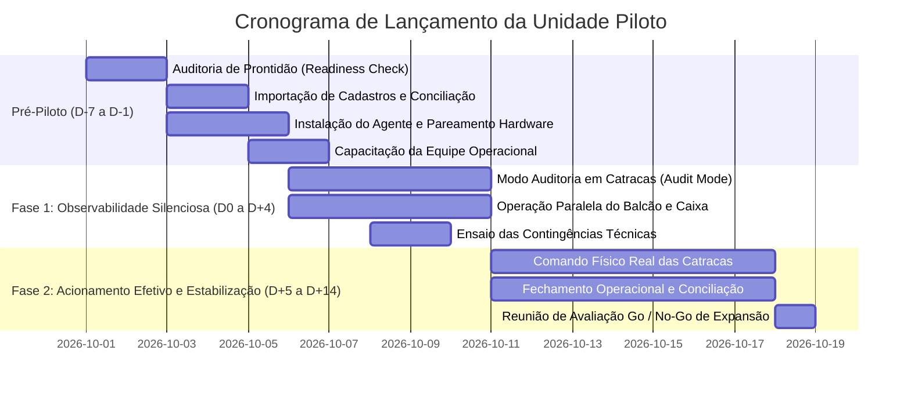

# Checklist de Implantação e Operação do Piloto Assistido (GYM-081)

Este documento estabelece o protocolo operacional, matriz de capacitação da equipe e ensaios de contingência obrigatórios para o lançamento assistido da primeira unidade física de academia no AtlasFit.

Em conformidade com a Seção 16 e 17 do [Plano Geral de Implementação (plano.md)](file:///c:/Users/gabriel/development/atlasfit/docs/gym/plano.md) e as [Regras Globais de Segurança e Escalabilidade](file:///c:/Users/gabriel/development/atlasfit/.agents/rules).

---

## 1. Cronograma de Implantação do Piloto (14 Dias)

---

## 2. Matriz de Capacitação Operacional por Papel

### 2.1 Recepção e Atendimento ao Aluno (`RECEPTIONIST`)
- [ ] **Nova Matrícula e Contratos:** Criação de matrícula, seleção de plano, cadastro de responsáveis para alunos menores de 18 anos, e envio de link de aceite contratual.
- [ ] **Recebimento Presencial no Balcão:** Registro de pagamentos via Dinheiro, Débito POS, Crédito POS e Pix Manual com vinculação estrita à sessão de caixa ativa.
- [ ] **Alçadas de Desconto:** Aplicação de desconto balcão limitada a R$ 20,00 ou 10% do valor da fatura (`maxReceptionistDiscountPercentage`), compreendendo quando é necessária a autorização gerencial.
- [ ] **Emissão de Recibos:** Fornecimento do comprovante com número amigável e ciência do aviso legal (*"Não substitui documento fiscal"*).
- [ ] **Liberação Excepcional (Override):** Criação de liberação temporária (máx 2 horas) com justificativa textual obrigatória para alunos com bloqueio financeiro em negociação.
- [ ] **Abertura e Fechamento de Caixa:** Conferência física dos valores em espécie ao abrir e fechar o turno da recepção (`GymCashDrawerSession`).

### 2.2 Financeiro e Gerência da Unidade (`FINANCE` / `MANAGER` / `OWNER`)
- [ ] **Subconta Asaas:** Acompanhamento do status de KYC, split de pagamentos e saldo liberado para saque.
- [ ] **Conciliação e Divergências:** Análise da aba de divergências financeiras (pagamentos no gateway sem fatura local, ou pagamentos em maquininha sem conciliação).
- [ ] **Gestão de Inadimplência e Carência:** Entendimento do prazo de tolerância configurado (ex: 5 dias após vencimento antes do bloqueio físico de catraca).
- [ ] **Estornos e Reversões:** Procedimento para estorno de pagamento presencial com reabertura automática do saldo devedor da fatura.

### 2.3 Instrutores e Professores de Turmas (`TRAINER`)
- [ ] **Prescrição e Fichas de Treino:** Acesso restrito e exclusivo aos alunos sob sua orientação no workspace.
- [ ] **Chamada de Turmas Coletivas:** Marcação de presença, falta (`NO_SHOW`) e reversão de presenças em sessões agendadas.
- [ ] **Regras de Lotação e Espera:** Ciência de que turmas atingindo 100% de capacidade movem automaticamente os próximos alunos para fila de espera (`GymClassWaitlist`).

### 2.4 TI Local e Infraestrutura
- [ ] **AtlasFit Local Agent:** Instalação do runtime local no computador da recepção ou micro-servidor local.
- [ ] **Configuração de Rede:** IP estático nas catracas Control iD, portas 80/443 liberadas e comunicação WebSocket/Push com o agente.

---

## 3. Ensaios Obrigatórios de Contingência e Simulação de Falhas

Antes de ativar o bloqueio físico nas catracas, a equipe do piloto DEVE executar e registrar os seguintes 6 ensaios práticos:

### Ensaio 1: Desconexão Total da Internet (Queda de Link da Operadora)
- **Ação:** Desconectar o cabo de rede/WAN do roteador da academia durante o horário de pico simulado.
- **Resultado Esperado:**
  1. Catraca continua concedendo acesso aos alunos ativos utilizando o cache biométrico offline local.
  2. Eventos de passagem são armazenados localmente na memória interna da catraca.
  3. Ao restabelecer a internet, o serviço de reconciliação offline sincroniza todos os acessos sem duplicar logs nem gerar falsos bloqueios.

### Ensaio 2: Aluno em Inadimplência e Período de Carência
- **Ação:** Testar a passagem de aluno com fatura vencida há 3 dias (dentro da carência de 5 dias) e aluno com fatura vencida há 15 dias.
- **Resultado Esperado:**
  1. Aluno com 3 dias de atraso tem acesso **LIBERADO** (`OVERDUE_WITHIN_GRACE_PERIOD`), permitindo acesso enquanto é notificado amigavelmente pela recepção.
  2. Aluno com 15 dias de atraso tem acesso **NEGADO** na catraca (`OVERDUE_PAYMENT_BLOCKED`).

### Ensaio 3: Liberação Excepcional Presencial (Override de Balcão)
- **Ação:** O aluno inadimplente solicita entrada na recepção para negociar a fatura. O atendente concede liberação temporária de 2 horas.
- **Resultado Esperado:**
  1. Catraca libera a passagem imediatamente (`VALID_OVERRIDE_ACTIVE`).
  2. O débito do aluno **NÃO É QUITADO** nem alterado no financeiro.
  3. A liberação excepcional expira pontualmente após as 2 horas concedidas.

### Ensaio 4: Proteção a Menores de Idade (Estatuto e LGPD)
- **Ação:** Tentar cadastrar biometria e conceder acesso autônomo a aluno de 15 anos cujo responsável legal ainda não assinou a autorização.
- **Resultado Esperado:**
  1. Sistema impede cadastramento biométrico sem termo assinado (`GUARDIAN_CONSENT_REQUIRED_FOR_MINOR`).
  2. Catraca mantém bloqueio preventivo até validação documental pelo gerente.

### Ensaio 5: Saída de Emergência e Pânico (Normas do Corpo de Bombeiros)
- **Ação:** Aluno com matrícula cancelada ou inadimplente tenta acionar o giro de **SAÍDA** (`direction: EXIT`).
- **Resultado Esperado:**
  1. O giro de saída física é **SEMPRE CONCEDIDO** de imediato (`EXIT_UNRESTRICTED`).
  2. Em nenhuma hipótese a catraca trava o sentido de evacuação por razões financeiras ou cadastrais.

### Ensaio 6: Fechamento de Turno de Caixa e Sangria
- **Ação:** Recepcionista encerra turno realizando sangria de valores em espécie para o cofre da gerência.
- **Resultado Esperado:**
  1. Conferência cega com apuração de eventuais divergências em centavos.
  2. Exigência de justificativa obrigatória caso haja quebra de caixa (`CASH_DRAWER_DIFFERENCE_REASON_REQUIRED`).
  3. Movimentação auditável sem afetar faturas de mensalidades.

---

## 4. Responsáveis pelo Piloto e Matriz de Escalação

| Papel | Nome | Contato de Emergência | Responsabilidade |
|---|---|---|---|
| **Líder de Operações do Piloto** | Gerente Geral da Unidade | Celular / WhatsApp | Decisões de override, atendimento a alunos e aprovação do fechamento diário |
| **Líder Técnico (Engenharia)** | Tech Lead AtlasFit | Canal Privado Slack / Telefone | Manutenção de serviços, monitoramento de jobs e logs em tempo real |
| **Responsável por Hardware** | Técnico de Infraestrutura Local | Telefone no local | Cabeamento, roteador, rede das catracas e substituição física |
| **Responsável Financeiro** | Coordenador Financeiro | E-mail / WhatsApp | Baixas no Asaas, conciliação bancária e faturamento |

---

## 5. Critérios de Aceite para Go / No-Go da Unidade Piloto

A unidade piloto somente será considerada homologada e apta para o lançamento definitivo quando cumprir integralmente os seguintes requisitos:

1. **Taxa de Decisão Correta na Catraca:** >= 99,8% de acessos deliberados corretamente (sem falsos bloqueios de alunos adimplentes).
2. **Latência de Decisão no Acesso:** Menor que 600ms entre leitura do leitor biométrico/RFID e giro da catraca.
3. **Conciliação Financeira Diária:** 100% dos pagamentos presenciais reconciliados com o extrato de faturas sem sobras/faltas não justificadas.
4. **Sem Incidentes de Retenção de Saída:** Zero ocorrências de bloqueio de saída física da academia.
5. **Zero Violações de Menores ou LGPD:** Todas as permissões de menores devidamente representadas e auditadas.
