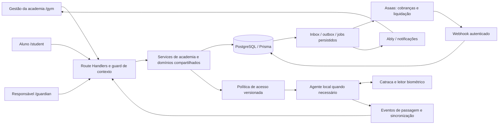

# AtlasFit — Plano de Implementação do Módulo de Academias

24/09/2026 · Proposta técnica baseada no checkout `main`, commit `56f221b`.

**Recomendação:** criar uma área `/gym` no AtlasFit, usando `Workspace` como limite da academia, com serviços compartilhados de alunos, treinos, comunicação e pagamentos. Acrescentar domínios próprios para equipe, matrículas, responsáveis, aulas, financeiro gerencial e controle de acesso físico. A aplicação atual continua atendendo personals e alunos.

O pedido confirmado compreende **uma unidade inicialmente, gestão completa, aulas, catraca biométrica e atendimento a menores**. Marca/modelo da catraca ainda são desconhecidos. Isso permite definir o contrato de integração e seus testes, mas não afirmar compatibilidade com o equipamento existente.

Documentos complementares: [diagnóstico e evidências](diagnostico.md) e [backlog executável](backlog.md).

## 1. Decisões de arquitetura

| Decisão | Proposta | Motivo |
|---|---|---|
| Aplicação | Mesmo Next.js e mesmo PostgreSQL | Reutiliza o produto e evita sincronizar cadastros entre sistemas |
| Área de gestão | `src/app/(gym)/gym` | Navegação, operação e permissões próprias da academia |
| Contexto | `Workspace.type = PERSONAL ou GYM` | A academia é um tipo de operação, não um papel global de pessoa |
| Unidade | `GymUnit` subordinada ao workspace; criar uma unidade padrão | Vagas, salas e dispositivos já precisam de localização física |
| Expansão futura | Mais unidades dentro da academia, sem tela multiunidade no piloto | Evita tratar cada unidade como empresa isolada sem necessidade |
| Login | Identidade existente e escolha de contexto/papel | A mesma pessoa pode ser personal, funcionário e aluno |
| Permissões | Papéis do vínculo + capacidades + escopo de recurso | Gerente, financeiro, recepção e profissional têm necessidades distintas |
| Licença SaaS | Assinatura da academia por workspace | Funcionário usa a licença da academia; não a assinatura pessoal dele |
| Cobrança ao aluno | Recebível interno canônico; Asaas como provedor | Pagamento em dinheiro, maquininha e online convergem sem duplicar receita |
| Catraca | Serviço de política + adaptador de equipamento + agente local se necessário | Protocolo, SDK e modo offline dependem do fabricante |
| Tempo real | Ably para atualização de telas | Não substitui banco, fila persistente ou autorização física |
| Implementação | Migrações aditivas, flags por workspace e piloto | Controla o impacto sobre os usuários atuais |

Não criar `GYM_OWNER` em `GlobalRole` como base da autorização. Esse enum mistura perfis comerciais com identidade e já limita os fluxos atuais. Preservá-lo durante a transição; novos funcionários podem ter `USER`, enquanto seus acessos vêm dos vínculos. `SUPERADMIN` continua sendo papel de plataforma, com suporte auditado e sem acesso irrestrito implícito a dados sensíveis.

## 2. Fronteiras e fontes de verdade



- `User`: identidade da pessoa e dados de autenticação. Não contém o contrato da academia.
- `WorkspaceMember`: vínculo da pessoa com uma academia/assessoria. Não representa pagamento ou matrícula por si só.
- `GymEnrollment`: contrato/matrícula, vigência e direitos adquiridos.
- `GymInvoice`: obrigação financeira. Pagamento pendente não é receita recebida.
- `GymPayment` e alocações: recebimentos efetivos e estornos; fonte do caixa gerencial.
- `StudentBilling`: tentativa/cobrança no provedor, ligada ao recebível. O gateway é a fonte do status externo e saldo da carteira.
- `GymAccessDecision`: decisão de liberar ou negar; `GymAccessEvent`: passagem observada. Autorização não prova que o aluno passou.
- `GymClassBooking` e presença: reserva e comparecimento em aula. Não se inferem automaticamente de entrada na academia.
- `WorkoutLog`: execução de treino. Não equivale a presença física.

## 3. Primeira versão comercial

### Incluído no lançamento

1. Cadastro/configuração da academia e da primeira unidade, marca, horários, contatos e regras operacionais.
2. Equipe: proprietário, gerente, recepção, financeiro, profissionais e permissões por função.
3. Alunos adultos e menores, responsáveis legais e financeiros, cadastro assistido, convites, importação e histórico.
4. Planos versionados, matrícula, renovação, troca de plano, desconto, trancamento e cancelamento.
5. Mensalidades e cobranças avulsas, pagamentos online e presenciais, baixas, estornos, inadimplência e recibos.
6. Contas a pagar, categorias, contas financeiras, caixa da recepção, fluxo de caixa e conciliação.
7. Grade de aulas, salas, professores, vagas, reservas, espera, cancelamentos e presenças.
8. Catraca biométrica existente, se a prova de integração confirmar suporte: cadastro externo, sincronização de permissão, passagem, bloqueio, contingência e diagnóstico.
9. Treinos, avaliações, arquivos e acompanhamento reutilizados com autorização da academia.
10. Portal do aluno com matrícula, agenda, reservas e pagamentos; acesso próprio do responsável aos dependentes autorizados.
11. Indicadores comerciais, financeiros e operacionais reais; exportações conforme permissão.
12. Notificações transacionais, trilha de auditoria, monitoramento e rotinas de recuperação.

### Evoluções posteriores

Consolidação de rede/franquia e compartilhamento entre unidades, folha de pagamento, ponto trabalhista, motor de comissões complexo, fiscal/NFS-e automatizada, estoque/PDV, Wellhub/TotalPass, app nativo e suporte a vários fabricantes de catraca. A folha pode ser registrada inicialmente como despesa, sem cálculo trabalhista. Recibo de pagamento não deve ser apresentado como nota fiscal.

Pix Automático é uma integração própria e não deve ser prometido como sinônimo de gerar uma cobrança Pix todo mês. Para o lançamento, prever cobrança recorrente e cartão recorrente conforme capacidades homologadas da conta. [Assinaturas no Asaas](https://docs.asaas.com/docs/assinaturas).

## 4. Acesso, perfis e autorização

### Modelo de papéis

Adicionar `WorkspaceRoleGrant(memberId, role)` com unicidade do par. Papéis iniciais: `OWNER`, `MANAGER`, `RECEPTIONIST`, `FINANCE`, `TRAINER`, `STUDENT`; manter compatibilidade com `ASSISTANT` legado com direitos limitados. Não promover ASSISTANT automaticamente a gerente.

Fazer backfill a partir de `WorkspaceMember.role`. Durante a transição, manter o campo antigo para compatibilidade, mas todas as decisões de acesso novas devem usar grants. Vínculos duplos, como profissional que também treina na academia, exigem escolha do contexto de atuação. Uma projeção legada de papel nunca pode conceder permissão adicional. As consultas da área gym identificam alunos pela existência do perfil/matrícula, não exclusivamente por `role=STUDENT`.

Responsável é autorizado pela relação com o dependente e por seus poderes verificados. Não é funcionário da academia e não ganha acesso à lista de alunos.

| Ação | Proprietário | Gerente | Recepção | Financeiro | Profissional | Aluno / responsável |
|---|---|---|---|---|---|---|
| Consultar cadastro operacional | Sim | Sim | Sim, mínimo necessário | Dados de cobrança | Alunos atribuídos | Próprio / dependente autorizado |
| Matricular e reservar aula | Sim | Sim | Sim | Consulta financeira | Consulta de suas aulas | Solicitar/reservar conforme regras |
| Alterar permissões/proprietário | Sim; transferência com fluxo próprio | Não por padrão | Não | Não | Não | Não |
| Prescrever/ver saúde | Se também tiver habilitação/permissão profissional | Só se autorizado como profissional | Não | Não | Alunos atribuídos | Escopo próprio/representação definida |
| Gerar cobrança e receber | Sim | Sim | Valor definido e baixa no próprio caixa | Sim | Não | Pagar e consultar suas cobranças |
| Desconto/estorno | Sim | Dentro de alçada | Solicitar | Dentro de alçada | Não | Solicitar |
| Saque/alterar conta recebedora | Proprietário; autenticação reforçada | Não por padrão | Não | Solicitar/consultar conforme delegação | Não | Não |
| Relatórios financeiros gerais | Sim | Sim | Fechamento do próprio caixa | Sim | Não | Não |
| Liberar entrada manual | Sim | Sim | Com motivo e prazo | Não por padrão | Não por padrão | Não |
| Configurar equipamento | Sim ou função técnica delegada | Consulta | Diagnóstico básico | Não | Não | Não |

Capacidades sugeridas: `students.read`, `students.manage`, `health.read.assigned`, `workouts.manage.assigned`, `staff.manage`, `enrollments.manage`, `invoices.issue`, `payments.record`, `refunds.approve`, `wallet.withdraw`, `classes.manage`, `bookings.manage`, `access.override`, `devices.manage`, `reports.finance`, `privacy.manage`. Tratar alçadas monetárias separadamente do papel.

### Guard obrigatório

`requireWorkspaceAccess({ workspaceId, capability, resourceId? })` deve resolver no servidor: sessão atual → usuário existente → workspace ativo → vínculo ativo → grants atuais → capacidade → recurso pertencente ao mesmo workspace → atribuição/alçada/representação, quando aplicável.

O cookie/localStorage apenas indica a seleção. Não prova autorização. Um ID inválido deve retornar erro ou solicitar escolha; não fazer fallback silencioso para outro tenant em mutações financeiras ou de acesso.

Aplicar a mesma política a APIs gym, APIs antigas usadas pela academia, Server Actions, downloads, exportações, jobs e canais de realtime. `workspaceId` do corpo nunca pode contradizer o da URL. Listas usam projeções de campos por papel, paginação no servidor e busca filtrada por tenant.

### Login e licença

- Incluir entrada “Academia” em `/auth/gym`, usando o mesmo provedor de autenticação.
- Atualizar `/dashboard`, `/select-workspace`, login, reset, setup de senha, impersonation, middleware e layouts para resolver destinos pelo contexto autorizado.
- Acrescentar um endpoint de seleção de contexto que valide associação e grave cookie apropriado; inicializar Valtio a partir do estado validado.
- Ao sair/trocar usuário, limpar store, consultas, canais e dados locais. Ao trocar workspace, descartar respostas pendentes do anterior.
- `WorkspaceSubscription` habilita a academia; funcionários não dependem de `User.subscription` próprio. Um `resolveEntitlements` unifica consultas sem migrar toda assinatura personal na primeira etapa.
- A inadimplência da academia com o AtlasFit e a do aluno com a academia são políticas distintas. Não bloquear fisicamente a saída nem negar entrada de alunos por simples expiração de licença SaaS. Prever avisos, contingência e operação assistida no contrato do serviço.

## 5. Modelo de dados proposto

Os nomes são especificação de implementação, não tabelas existentes. Usar IDs e convenções Prisma já presentes. Toda entidade operacional tem `workspaceId`; eventos físicos e aulas também têm `unitId`. Adicionar FKs compostas quando necessário para impedir referências cruzadas mesmo em caso de bug do serviço.

### Organização, pessoas e menores

| Entidade/alteração | Campos e relações centrais | Regras |
|---|---|---|
| `Workspace` | `type`, relação com configurações/licença | Default PERSONAL no backfill; `ownerId` consistente com grant OWNER |
| `GymSettings` | workspace único, timezone, políticas de cobrança/reserva/acesso, versão | Versionar regras com impacto em contratos e decisões |
| `GymUnit` | workspace, nome, endereço, timezone, status | Uma unidade padrão no piloto; não copiar workspace por unidade |
| `WorkspaceRoleGrant` | membro, papel, concedidoPor, datas | Um grant por papel; alterações auditadas |
| `WorkspaceInvitation` | workspace, e-mail, papéis propostos, hash do token, expiração, estado | Uso único; aceitar não altera conta global de terceiros |
| `GymStaffProfile` | membro único, função, CREF quando pertinente, status, início/fim | Contato profissional do vínculo; desligamento preserva autoria |
| `GymStudentProfile` | membro único, matrícula interna, contato operacional, emergência, status | Matrícula interna única por workspace; dados de saúde por finalidade e vínculo |
| `GymTrainerAssignment` | aluno-membro, profissional-membro, vigência, tipo de responsabilidade | Mesmo workspace; principal e auxiliares; histórico de substituição |
| `GymGuardianLink` | menor-membro, responsável-user, poderes, vínculo declarado/verificado, estado, vigência | Legal, financeiro e contato de emergência são poderes diferentes |
| `GymRepresentationEvidence` | vínculo, evidência mínima, verificador, resultado, datas | Não presumir tutela apenas por sobrenome, pagamento ou e-mail |
| Aceites/consentimentos | titular, ator, workspace, finalidade, documento/hash, evidência de representação | Acrescentar evento imutável; não sobrescrever histórico de concessão/revogação |
| `WorkspaceSubscription` | workspace, plano SaaS, status, período, referência externa | Limites de alunos/equipe/unidades/dispositivos; pagador empresarial explícito |

`User.email` já é opcional. Um cadastro assistido pode existir sem senha e sem e-mail próprio; não criar e-mail fictício nem reutilizar o login do responsável como se fosse o menor. O responsável tem sua conta e o menor conserva sua identidade. Vincular conta preexistente após verificação apropriada, sem revelar se um CPF/e-mail está cadastrado em outra academia.

### Planos e matrículas

| Entidade | Conteúdo | Regras |
|---|---|---|
| `GymPlan` | workspace, nome, modalidade, ativo | Catálogo comercial, independente de `Plan` SaaS |
| `GymPlanVersion` | preço em centavos, prazo, frequência de cobrança, direitos de acesso/aulas, validade | Imutável após contratação; matrícula aponta a versão |
| `GymEnrollment` | aluno-membro, versão do plano, início/fim, status, renovação, pagador, unitId | Contrato é distinto de login e de pagamento |
| `GymEnrollmentEvent` | transição, ator, motivo, data de efeito | Histórico de ativação, renovação, troca e cancelamento |
| `GymEnrollmentPause` | intervalo, motivo, política de extensão/cobrança | Evitar pausas sobrepostas; não cancelar cobrança já paga implicitamente |
| `GymContractAcceptance` | matrícula, texto/hash, signatário, representado, momento | Guardar snapshot das condições e comprovação; versão não muda após aceite |

### Financeiro

| Entidade/alteração | Conteúdo | Regras |
|---|---|---|
| `FinancialProfile` | tipo de titular USER/WORKSPACE e respectivo ID | Exatamente um titular; ator da operação é campo separado |
| `PaymentProviderAccount` | adicionar `financialProfileId` | Unicidade por perfil, provedor e ambiente; transição de `personalUserId` descrita abaixo |
| `GymBillingParty` | pessoa pagadora, vínculo opcional com User/responsável, snapshot de documento/contato necessário | Pagador pode diferir do aluno; acesso não decorre apenas de pagar |
| `GymInvoice` | workspace, matrícula opcional, pagador, competência, vencimento, total, estado | Recebível canônico; unicidade do ciclo contratual |
| `GymInvoiceItem` | descrição, categoria, quantidade, valores/descontos em centavos | Histórico de preço e finalidade; matrícula, mensalidade ou avulso |
| `GymPayment` | workspace, valor, meio, recebidoEm, conta, origem, referência, estado | Recebimento real; reversão por lançamento vinculado |
| `GymPaymentAllocation` | pagamento, fatura, valor | Suporta parcial; alocações não excedem saldo; mesmo workspace/moeda |
| `StudentBilling` | adicionar workspace, invoiceId, pagador e referência de tentativa | Cobrança externa de uma obrigação; múltiplas tentativas não duplicam dívida |
| `StudentSubscription` | ligar matrícula/versão e perfil financeiro | Execução da recorrência no provedor, não o contrato em si |
| `GatewayCustomer` | associar conta recebedora e pagador | Chave por conta/provedor/ambiente/pagador, não por nome |
| `GymFinancialAccount` | caixa, banco ou carteira gateway | Transferência entre contas não é receita nova |
| `GymPayable` | fornecedor, categoria, competência, vencimento, valor, status | Despesa prevista separada de saída efetiva |
| `GymFinancialEntry` | conta, direção, valor, data, origem, reversão, categoria | Movimentação efetiva; vínculo único de origem evita duplicação |
| `GymCashSession` | unidade, operador, abertura, saldo declarado, fechamento, diferença | Um caixa ativo por operador/terminal conforme configuração |
| `GymFinancialCategory` | workspace, nome, tipo, ativo | Categorias padronizadas, sem dependência de nome do plano |

O ledger da carteira continua específico do gateway. O livro gerencial da academia recebe projeções idempotentes de recebimentos/taxas/transferências; não soma créditos de confirmação e liquidação como duas receitas. Saldo disponível na carteira vem do gateway, com timestamp da última sincronização.

### Aulas e acesso físico

| Entidade | Conteúdo | Regras |
|---|---|---|
| `GymRoom` | unidade, capacidade, disponibilidade | Recurso físico que pode conflitar |
| `GymClassType` | modalidade, duração padrão, regras de elegibilidade | Catálogo de aulas |
| `GymClassSchedule` | recorrência local, professor, sala, capacidade, janela de validade | Gerar sessões por horizonte finito, de forma idempotente |
| `GymClassSession` | início/fim concretos, professor, sala, capacidade, estado | Snapshot; alteração em série não apaga ocorrências passadas |
| `GymClassBooking` | sessão, aluno-membro, estado, posição/horário de espera | Um registro por aluno/sessão; eventos preservam mudanças |
| `GymClassAttendance` | sessão/aluno, presente/falta/justificada, ator, horário, origem | Presença não nasce da simples reserva |
| `GymAccessDevice` | unidade, fabricante/modelo, adapter, identificador externo, saúde, configuração | Credencial por dispositivo/agente, revogável |
| `GymDeviceCredential` | pessoa/vínculo, dispositivo, ID externo, estado de cadastro/revogação | Não armazenar impressão digital crua no banco de produto |
| `GymAccessPolicy` | regras versionadas e vigência | Horário, matrícula, carência, trancamento, exceções |
| `GymAccessGrant` | pessoa, unidade, escopo, validade, policyVersion, assinatura | Projeção de permissão para equipamento/cache local |
| `GymAccessDecision` | tentativa, resultado, reasonCode, matrícula/regra usadas | Idempotente por tentativa; distingue concessão de passagem |
| `GymAccessEvent` | evento externo, entrada/saída, ocorridoEm, recebidoEm, origem | Deduplicação por dispositivo e ID externo |
| `GymAccessOverride` | pessoa/unidade, ator, motivo, validade curta | Exceção explícita, nunca altera dívida ou marca mensalidade paga |
| `IntegrationJob` / `OutboxEvent` | tipo, referência, tenant, lease, tentativa, próximo retry, erro sanitizado | Estado persistente, claim atômico e replay observável |

### Integridade e índices

- Dinheiro em `BigInt` centavos, serializado como string nos DTOs; arredondamento centralizado. Percentuais em Decimal ou unidade inteira definida.
- Índices mínimos: `(workspaceId,status)`, `(workspaceId,dueDate)`, `(workspaceId,studentMemberId)`, `(unitId,startsAt)`, `(deviceId,occurredAt)` e chaves externas compostas para vínculos críticos.
- Idempotência scoped por tenant/operação/chave, com hash da requisição. Reutilização da chave com payload diferente retorna conflito.
- Ciclo faturado único por matrícula e período; evento externo único por provedor/ambiente/conta/evento; reserva única por sessão/aluno.
- Estados financeiros, contratos e auditoria têm retenção e exclusão restrita. `onDelete: Cascade` não deve apagar histórico financeiro ao desativar pessoa/workspace.
- Calendário usa timezone IANA da unidade. Instantes em UTC; vencimentos e competência como datas de negócio com conversão explícita. Não calcular mês como 30 dias fixos.
- Concorrência usa transações curtas e locks/constraints de banco; chamadas de gateway e dispositivo ficam fora da transação.

## 6. Fluxos de alunos, equipe e menores

### Matrícula de adulto

Busca → identificação/verificação de cadastro → vínculo com academia → plano/versão → profissional responsável → condições e pagador → aceite → recebível/recorrência → ativação conforme política → permissão de entrada → convite de acesso opcional.

Estados da matrícula: `DRAFT → PENDING_ACCEPTANCE → PENDING_ACTIVATION → ACTIVE`, com `PAUSED`, `CANCELLED` e `EXPIRED` conforme transições autorizadas. A inadimplência é derivada do financeiro e da política; não sobrecarregar `WorkspaceMember.isActive` com dívida, acesso e situação do contrato.

Mudanças de plano têm data de efeito e tratamento explícito de pró-rata/crédito. Proposta inicial: mudança no próximo ciclo como padrão; mudança imediata só mediante simulação de diferença e aceite. Cancelamento interrompe novos ciclos na data acordada, sem apagar recebíveis vencidos ou promover estorno automático.

### Matrícula de menor

Identificar data de nascimento → aplicar política etária do workspace → cadastrar/verificar responsável e poderes → informar tratamento em linguagem adequada → registrar autorização/aceite pertinente → definir pagador → contratar → provisionar acesso físico autorizado → habilitar experiência digital conforme faixa etária.

Implementar `resolveAgePolicy(workspaceType, purpose, age)` e distinguir cadastro administrativo, acesso digital, contrato, saúde, marketing e biometria. Cadastro assistido na recepção e portal do responsável atendem quem não tem e-mail próprio. O app do menor só habilita funções compatíveis com a política; não deixar setup-password ou importação escaparem das mesmas regras.

O vínculo de responsável deve suportar múltiplos responsáveis, verificação, poderes distintos, revogação e revisão quando o aluno atingir maioridade. Contato de emergência não confere representação legal. Pagador de um familiar não ganha automaticamente acesso a avaliações, fotos ou biometria.

O entendimento da ANPD admite avaliar as bases dos arts. 7º e 11 para crianças e adolescentes com prevalência do melhor interesse; não é correto usar um checkbox genérico como solução para todas as finalidades. [Enunciado da ANPD](https://www.gov.br/anpd/pt-br/assuntos/noticias/anpd-divulga-enunciado-sobre-o-tratamento-de-dados-pessoais-de-criancas-e-adolescentes).

O lançamento precisa avaliar também a experiência digital sob o ECA Digital e as orientações de aferição de idade vigentes, com revisão jurídica específica do fluxo. Não se presume que autodeclaração de data de nascimento seja suficiente para todos os cenários. [Orientações da ANPD](https://www.gov.br/anpd/pt-br/assuntos/noticias/anpd-publica-orientacoes-preliminares-e-cronograma-para-afericao-de-idade-no-ambiente-digital).

### Profissionais

Convite com papéis e unidade → aceite autenticado → perfil profissional → carteira de alunos/aulas → acompanhamento. Permitir trocar responsável com data de efeito; preservar autor de treinos, avaliações e alterações. Ao desligar, revogar grants/sessões de contexto e acesso ao dispositivo, redistribuir pendências, manter registros da academia e a conta pessoal que tenha outros vínculos.

Biblioteca de treinos deve declarar visibilidade `PRIVATE`/`WORKSPACE`/`OFFICIAL`. Conteúdo particular do personal não é compartilhado com a academia apenas porque ele foi contratado. Fichas produzidas no contexto da academia pertencem à operação desse workspace, com autoria preservada.

## 7. Cobranças e financeiro profissional

### Separação dos contratos

1. **Academia paga ao AtlasFit:** licença SaaS por workspace, limites e módulos; manter a integração comercial de assinatura em caminho próprio.
2. **Aluno/responsável paga à academia:** plano/matrícula, recebível, cobrança e recibo.
3. **Academia paga fornecedores/profissionais:** contas a pagar e saídas; folha/comissionamento automático é evolução.

Não emitir cobrança de aluno na conta do funcionário logado. Resolver o perfil recebedor da academia e registrar o funcionário como ator. Onboarding financeiro coleta dados da empresa e representante conforme as exigências efetivamente homologadas do provedor.

### Titularidade da carteira

Criar `FinancialProfile`; fazer backfill USER para contas existentes. Acrescentar a relação à conta do provedor e migrar serviços de `personalUserId` para `financialProfileId/providerAccountId`. Após adaptação dos consumidores, tornar `personalUserId` opcional e manter o campo legado para personal; contas GYM usam perfil WORKSPACE. Não usar o CPF do dono como substituto silencioso do CNPJ/recebedor correto.

`PaymentService` passa a receber contexto explícito com workspace, perfil financeiro, ator e aluno/pagador. `GatewayCustomer` deve refletir pagador na conta recebedora. Campos legados `personalNet*` podem permanecer durante a transição, mas DTOs novos usam denominação neutra para valor líquido do recebedor.

### Fontes de recebimento

| Meio | Fluxo | Evidência de baixa |
|---|---|---|
| Dinheiro | Recepção registra em caixa aberto | Operador, sessão de caixa, valor, data e recibo |
| Maquininha externa | Registro manual identificado | NSU/referência quando disponível, conta e conciliação; sem supor integração TEF |
| Pix/checkout Asaas | Cobrança ligada à fatura | Evento autenticado ou reconciliação da cobrança exata |
| Boleto, se habilitado | Cobrança com vencimento | Confirmação do provedor; não liberar por simples emissão |
| Cartão recorrente | Checkout/tokenização homologada e assinatura externa | Cobranças individuais e eventos; não armazenar PAN/CVV |
| Transferência bancária externa | Baixa por usuário autorizado | Comprovante/referência e conferência |

Para recorrências, escolher um único responsável por gerar cada ciclo: `LOCAL` ou `PROVIDER`. Não permitir que cron interno e assinatura Asaas criem a mesma dívida. Na recorrência pelo provedor, o evento de nova cobrança é associado à matrícula/ciclo e faz upsert da fatura correspondente. O adaptador atual tem criação avulsa e cancelamento de assinatura; criação/alteração de assinatura ainda precisa ser implementada e homologada.

Estados da fatura: `DRAFT`, `OPEN`, `PARTIALLY_PAID`, `PAID`, `VOID`; atraso é derivado de vencimento e saldo em aberto. Estado de cobrança externa e estado de pagamento são separados. Pagamento estornado gera reversão/alocação inversa e reavalia saldo; nunca editar silenciosamente um recebimento consolidado.

Taxas do gateway, taxa AtlasFit, valor bruto e líquido devem ser discriminados. Estimativa não é taxa realizada. Saque e transferência entre contas próprias não são novas despesas ou receitas por si só. Despesas gerenciais têm competência e data de pagamento para relatórios distintos.

### Consistência, falhas e conciliação

1. Criar operação local e chave idempotente antes da chamada externa; guardar referência rastreável.
2. Se houver timeout, manter estado `UNKNOWN/PENDING_RECONCILIATION`; consultar pela referência disponível antes de tentar criar novamente. Homologar o mecanismo de deduplicação realmente oferecido pelo endpoint.
3. Receber webhook, autenticar, validar tamanho/schema, persistir evento e dados mínimos para replay; responder após persistência.
4. Worker faz claim com lease, resolve conta/tenant/cobrança, executa transição válida, aloca recebimento único e grava outbox na mesma transação.
5. Publicar atualização e sincronizar permissão física fora da transação. Repetição do evento não repete consequência.
6. Reconciliar automaticamente operações pendentes e status externo; listar divergências para financeiro/superadmin.
7. Tratar confirmação, liquidação, cancelamento, estorno parcial/total, contestação, falha e reversão de saque com tabela explícita de transições. Evento antigo não deve sobrescrever estado mais novo sem reconciliação.

Esse desenho segue a separação de recebimento e processamento recomendada pelo Asaas. [Webhooks e eventos](https://docs.asaas.com/docs/webhooks-e-eventos).

## 8. Aulas, grade e reservas

- Configurar modalidades, professor, sala, duração, dias/horários, vagas, idade elegível e planos permitidos.
- Gerar sessões em horizonte inicial sugerido de 8 semanas; job diário estende o calendário. O horizonte é configuração, não criação infinita de recorrências.
- Impedir sobreposição de professor e sala e validar capacidade. Cancelamento ou substituição preserva histórico e notifica reservas afetadas.
- Editar “esta ocorrência” ou “esta e futuras”. Não reescrever aulas passadas nem alterar vagas reservadas sem regra explícita.
- Reserva exige matrícula/direito válido, janela de agendamento, limite de aulas do plano e ausência de conflito conforme política.
- Para última vaga, usar transação e lock da sessão/controle atômico de contador; consulta prévia de quantidade no frontend não evita lotação excedida.
- Lista de espera ordenada e promoção atômica. Proposta inicial: promoção automática antes do limite de antecedência; perto da aula, oferecer vaga com expiração antes de confirmar. Valores de janelas ficam configuráveis e validados no piloto.
- Cancelamento dentro/fora do prazo tem efeitos definidos; falta pode afetar limite de reservas, nunca gerar multa implícita não contratada.
- Presença pode ser marcada pelo professor ou recepção, com correção auditada. Catraca informa que entrou na unidade, sem escolher em qual aula compareceu.
- Aluno/responsável visualiza apenas vagas e informações públicas da turma, sem nomes/lista de menores inscritos.

Estados de reserva: `BOOKED`, `WAITLISTED`, `OFFERED`, `CANCELLED`, `ATTENDED`, `NO_SHOW`; oferta expirada devolve a oportunidade à fila. Separar alteração de presença da lotação durante a janela ativa para evitar liberação indevida de vagas.

## 9. Catraca biométrica

### Descoberta obrigatória do equipamento

Obter marca/modelo do leitor e da catraca, firmware, software atual, forma de conexão, SDK/API e licença de integração, sistema operacional do computador local, rede, quantidade de dispositivos, capacidade de operar offline e forma de capturar entrada/saída. Verificar quem administra a biometria e se os cadastros podem permanecer no dispositivo. Um equipamento e seu leitor podem ter fabricantes diferentes.

Fazer prova técnica antes de fixar prazo de produção: cadastrar uma pessoa de teste autorizada, receber identificação, conceder/revogar acesso, observar passagem, reiniciar, desconectar internet e reconciliar eventos. Se não existir protocolo utilizável ou licença de integração, registrar necessidade de módulo do fabricante ou substituição do controlador. Não apresentar adaptador simulado como integração concluída.

### Interface do adaptador

Contrato conceitual `AccessControlAdapter`: `getCapabilities`, `healthCheck`, `upsertPerson`, `provisionCredentialReference`, `syncAccessGrant`, `revokeAccess`, `requestRelease`, `readEvents` e confirmação de execução. Métodos são abstrações propostas; não alegam existir no SDK desconhecido.

Se o equipamento exige SDK/LAN, criar agente local instalável como serviço, com atualização assinada, logs rotativos, credencial revogável e armazenamento local cifrado. Preferir conexão de saída autenticada ao backend. Não abrir a catraca diretamente à internet. Se houver API cloud do fabricante, adaptar o mesmo contrato e homologar suas garantias.

O agente local usa banco leve persistente para comandos/eventos e cache de concessões. Escolher linguagem/runtime após conhecer o SDK; não forçar Node.js se o fabricante exigir outro ambiente. O processo não roda dentro do browser ou de uma função HTTP efêmera.

### Política de autorização

Avaliar unidade, identificação, vínculo, vigência da matrícula, trancamento/cancelamento, faixa horária do plano, restrições operacionais e saldo vencido após carência. A regra de carência é configurável; o valor atual de cinco dias no app é apenas referência do legado, não regra confirmada da academia.

Resultados com código estável: `ALLOWED`, `UNKNOWN_PERSON`, `NO_ACTIVE_ENROLLMENT`, `PAUSED`, `EXPIRED`, `OUTSIDE_SCHEDULE`, `PAYMENT_HOLD`, `REQUIRES_STAFF_REVIEW`, `DEVICE_UNAVAILABLE`. Na recepção, motivo legível e ação correspondente; não revelar dados financeiros em tela pública da catraca.

Uma liberação manual registra autor, motivo, pessoa, unidade, prazo e comando. Não quita débito, não renova contrato e não cria acesso permanente. Retorno `ACCEPTED` do comando não significa passagem; estados `QUEUED`, `ACKNOWLEDGED`, `EXECUTED`, `FAILED` e `EXPIRED` devem permanecer distintos.

### Offline e falhas

- Sincronizar concessões versionadas com validade curta; sugestão inicial de TTL máximo de 15 minutos a validar no piloto. Revogação online deve chegar rapidamente; offline tem uma janela residual explicitamente conhecida.
- Sem internet, permitir somente concessões locais ainda válidas e capacidades efetivamente suportadas. Expirada a concessão, encaminhar à recepção; não liberar todos automaticamente.
- Se o hardware não consegue impor validade/revogação ou confirmar passagem, registrar a limitação e definir operação assistida compatível. A política não pode prometer uma garantia que o equipamento não oferece.
- Persistir eventos offline com IDs, sequência, horário local e horário de recebimento; deduplicar ao reconectar e sinalizar relógio divergente.
- Repetir uma tentativa não aciona a catraca duas vezes. Timeout de comando exige verificar estado antes de nova liberação.
- Entrada, saída e emergência são tratados separadamente. Saída e mecanismo físico de emergência nunca dependem de mensalidade, licença SaaS ou internet.
- Não mostrar “lotação atual” como medida exata se a instalação só informa entradas. Nesse caso, exibir entradas no período e informar a limitação.

### Biometria

Preferir identificação/cadastro biométrico no equipamento ou solução do fabricante; o AtlasFit guarda referência externa e estado de provisionamento. Template biométrico continua sendo dado sensível mesmo sem imagem da digital. A avaliação do fornecedor deve abranger armazenamento, eliminação, transporte e acesso de suporte.

Disponibilizar alternativa operacional de identificação/liberação para falha de leitura e situações em que a biometria não possa ser utilizada. A coleta para menores exige avaliação específica da finalidade, necessidade e representação; autorização genérica de matrícula não basta para definir toda essa política. [Referência da ANPD sobre dados biométricos](https://www.gov.br/anpd/pt-br/assuntos/noticias/anpd-abre-tomada-de-subsidios-sobre-tratamento-de-dados-biometricos).

## 10. Telas e navegação

| Rota proposta | Conteúdo principal | Reuso |
|---|---|---|
| `/gym/dashboard` | Alertas, receita, vencimentos, alunos, aulas e entradas | Cards/Chart/Recharts; cálculos novos |
| `/gym/reception` | Busca rápida, situação do aluno, entrada manual, cobrança e aula do dia | Command/Input/Table/Dialog existentes |
| `/gym/students` | Lista paginada, filtros, novo cadastro e importação | Elementos da lista atual; service/DTO novo |
| `/gym/students/[id]` | Cadastro, responsáveis, matrícula, financeiro, treino, avaliação, presença e arquivos | Seções existentes extraídas em componentes por capacidade |
| `/gym/staff` | Convites, funções, situação, alunos/aulas atribuídos | UI de membros a compor |
| `/gym/plans` | Planos e versões comerciais | Formulários locais; sem confundir com planos SaaS |
| `/gym/enrollments` | Contratos, renovações, pausas e cancelamentos | Novo domínio |
| `/gym/classes` | Grade semanal, sessões, salas e substituições | Calendar/Popover/Tabs locais |
| `/gym/classes/[id]` | Vagas, espera, lista de chamada e presença | Table/Sheet locais |
| `/gym/access` | Passagens, decisões e exceções | Lista em tempo real com consulta histórica |
| `/gym/access/devices` | Equipamentos, sincronização, saúde e credenciais | Novo fluxo técnico restrito |
| `/gym/finance` | Recebíveis, recebimentos, despesas, conciliação, contas e caixa | Charts, formatos e carteira existentes |
| `/gym/wallet` | Saldo gateway, taxas, extrato e saques autorizados | Componentes Atlas Pay parametrizados |
| `/gym/reports` | Comercial, frequência, ocupação de aulas e financeiro | Gráficos/exports do stack atual |
| `/gym/workouts`, `/gym/assessments` | Biblioteca, fichas, avaliações e acompanhamento | Domínios atuais após extração de serviços |
| `/gym/crm`, `/gym/chat` | Captação, conversão e comunicação | Reuso com escopo e política de menores |
| `/gym/settings`, `/gym/subscription` | Marca, unidade, políticas, acesso e licença | Componentes de configuração existentes |
| `/student/classes`, `/student/membership`, `/student/access` | Reserva, contrato e histórico próprio | Mesmo shell/PWA do aluno |
| `/guardian/dependents` | Dependentes verificados e ações permitidas | Shell compacto, contexto de representado explícito |

Reaproveitar a área `/student/finance` com filtros de workspace e pagador; não duplicar todo o portal em `/gym/student`. O profissional trabalha em `/gym` com menu restrito e visão “meus alunos/minhas aulas”. Responsável pode pagar/reservar conforme seus poderes sem se passar pelo aluno.

O shell gym usa `SidebarProvider`, `SidebarInset`, cabeçalho com contexto e marca, navegação móvel própria, breadcrumbs e busca adequada às permissões. A primeira unidade é implícita; não exibir seletor multiunidade vazio.

Em todas as telas: skeleton estrutural, vazio com ação, erro recuperável, feedback por operação e botões bloqueados durante envio. Ações críticas usam AlertDialog com impacto e cancelamento. Formulários preservam valores após erro. Tabelas têm paginação/busca no servidor; não baixar todos os alunos para filtrar no cliente.

## 11. Serviços, arquivos e contratos de API

Estrutura sugerida, mantendo o padrão de `modules/payments`:

```text
src/modules/workspaces/          contexto, capacidades e entitlements
src/modules/gym/
  domain/                       tipos, estados, regras, schemas
  application/                  alunos, equipe, responsáveis, matrícula
  infrastructure/               acesso Prisma e projeções
  __tests__/
src/modules/finance/             recebíveis, caixa, pagamentos, relatórios
src/modules/classes/             grade, reserva, espera, presença
src/modules/access-control/
  domain/                       política, decisões, capacidades do dispositivo
  application/                  grants, comandos, eventos
  providers/                    simulador e fabricante homologado
src/modules/jobs/                inbox/outbox, claim, retry, reconciliação
src/components/gym/              composição de componentes existentes
src/app/(gym)/gym/               layouts/páginas/loading/error
src/app/(guardian)/guardian/     acesso do responsável
src/app/api/gym/[workspaceId]/   handlers finos
src/app/api/access-agent/        máquina autenticada, sem sessão de usuário
```

Não mover todos os arquivos atuais de uma vez. Extrair serviços por fluxo, manter wrappers dos endpoints legados e fazer ambos usarem a mesma política. Preferir `fetch` como já ocorre nas páginas; não introduzir uma biblioteca de consultas ou state manager novo sem necessidade concreta.

| Contrato proposto | Regra principal |
|---|---|
| `GET/POST /api/gym/[workspaceId]/students` | Projeção por papel, paginação, cadastro idempotente |
| `GET/PATCH /.../students/[memberId]` | Recurso do tenant; alterações de identidade global controladas |
| `POST /.../students/[memberId]/guardians` | Criar vínculo pendente, não conceder poderes imediatamente |
| `POST /.../staff/invitations` | Só quem pode conceder o papel; convite de uso único |
| `POST /.../enrollments` | Contrato, versão, pagador e aceite definidos |
| `POST /.../enrollments/[id]/pause|resume|cancel|change-plan` | Comandos explícitos com motivo, data de efeito e versão |
| `POST /.../invoices/[id]/charges` | Criar tentativa externa vinculada ao recebível |
| `POST /.../payments` e `/.../payments/[id]/refunds` | Baixa/alocação e reversão com alçada; não simples PATCH de status |
| `GET/POST /.../payables` e `/.../cash-sessions` | Separar obrigação, pagamento e fechamento |
| `POST /.../class-sessions/[id]/bookings` | Capacidade transacional; idempotência por aluno/sessão |
| `POST /.../bookings/[id]/cancel` | Janela, crédito e promoção de espera |
| `POST /.../class-sessions/[id]/attendance` | Professor autorizado ou recepção |
| `POST /.../access/overrides` | Motivo, prazo e pessoa; gera comando auditado |
| `POST /api/access-agent/decisions|events|heartbeat|acks` | Credencial de máquina restringe workspace/unidade/dispositivo |
| `GET /.../reports/[report]` | Período/escopo definidos, exportação assíncrona quando grande |

Respostas novas: `{ data, meta: { requestId, nextCursor? } }` ou `{ error: { code, message, fieldErrors? }, meta: { requestId } }`. Usar 401 sem sessão, 403 sem capacidade, 404 para recurso fora do escopo, 409 para conflito/versão/chave idempotente incompatível e 422 para dados inválidos. Não expor erro bruto do gateway, token de setup, segredo ou ORM.

## 12. Métricas e relatórios

Período e timezone são visíveis. Valores sem histórico aparecem como indisponíveis, sem percentuais ou comparativos fabricados.

| Indicador | Definição para implementação |
|---|---|
| Alunos ativos | Pessoas distintas com matrícula ACTIVE vigente na data de referência; trancados em grupo separado |
| Receita recorrente contratada mensal | Valor recorrente das matrículas vigentes normalizado pelo ciclo; não usar recebimentos como MRR |
| Recebido bruto/líquido | Recebimentos efetivados pela data de recebimento, descontando reversões e taxas conforme a visão |
| Contas a receber | Soma de saldos de faturas abertas/parciais; vencidas separadas por faixa |
| Inadimplência por valor | Saldo vencido / valor exigível vencido no corte definido; publicar denominador |
| Ticket de contrato | Receita recorrente normalizada / matrículas recorrentes ativas; ticket de venda é indicador distinto |
| Cancelamento | Contratos cancelados no período / contratos ativos na abertura; segmentar expirados e pausados |
| Novas matrículas/renovações | Eventos contratuais no período, sem contar troca de plano como novo aluno |
| Frequência física | Dias distintos com entrada válida por aluno; não confundir com número de passagens |
| Alunos ausentes | Matrículas ativas sem entrada há N dias, com regra própria para plano/aulas e recém-matriculados |
| Ocupação de aulas | Reservas confirmadas / capacidade e presenças / capacidade, exibidas separadamente |
| Faltas | Ausências sobre reservas elegíveis; excluir cancelamento da aula |
| Resultado gerencial | Receitas e despesas por competência ou caixa explicitamente selecionados; não afirmar DRE contábil certificada |
| Conversão comercial | Leads convertidos em matrícula / coorte de leads definida |
| Operação da catraca | Taxa de sucesso, motivos de negação, atraso de sync, comandos sem ACK e dispositivos offline |

Relatórios por profissional só mostram alunos/aulas sob seu escopo. Reaproveitar Recharts e exportações CSV/Excel; consultas agregam no banco, com índices e limite de período. Criar agregados diários apenas quando medição justificar, garantindo reprocessamento de eventos atrasados.

## 13. Jobs, realtime e observabilidade

Implementar jobs persistentes para geração de ciclos locais, sessões de aula, replay de webhooks, conciliação, notificações, revisão de contratos, sync/revogação de credenciais e exportações. Claim atômico, lease/timeout, backoff, máximo de tentativas, fila de falhas e replay por operador autorizado. Um cron sem segredo configurado deve rejeitar execução.

Definir o executor conforme a hospedagem real: worker persistente ou serviço de jobs, com agendador autenticado. Isso permanece decisão de infraestrutura, porque a configuração de produção não foi inspecionada. A baixa latência de liberação física não depende de um cron que roda a cada vários minutos.

Outbox na transação de domínio garante recuperação de envio. Não depender de Promise solta depois de responder à requisição para entregar aviso, cobrança ou concessão.

Canais separados por finalidade: `gym:{workspaceId}:operations`, `gym:{workspaceId}:finance`, `user:{userId}` e canais de conversa autorizada. Eventos carregam ID, versão e tipo; o cliente busca dados pela API autorizada. Tokens permitem somente os canais e operações necessários, de acordo com capabilities do Ably. [Documentação oficial](https://ably.com/docs/auth/capabilities).

Revogar acesso exige atualizar a autorização no backend e expirar/revogar/reemitir tokens adequadamente; apenas esconder menu ou fechar uma aba não basta. Dados financeiros e de saúde não devem ser colocados em canais amplos do workspace.

Registrar `requestId`, workspace, ator, entidade, ação, versão, origem e resultado. Logs sem biometria, documento completo, segredo ou dados de cartão. Monitorar jobs atrasados, falhas de pagamento, divergências, dispositivo sem heartbeat, filas offline e decisões sem confirmação de passagem.

## 14. Privacidade, exclusão e governança

- Atualizar os documentos existentes em `docs/privacy` e `docs/security` para operação de academia, menores, responsáveis, aulas e controle de acesso.
- Definir bases/finalidades e períodos de retenção por categoria, sem copiar automaticamente os prazos do documento atual para biometria e presença.
- Separar consentimento opcional de marketing/IA das condições necessárias à prestação do serviço. Menores não entram automaticamente em campanhas e segmentações do Engage.
- Criar evidência de atuação do responsável por titular representado. O `LegalAcceptance.userId` atual sozinho não descreve quem assinou por quem.
- Exportação e exclusão abrangem matrículas, responsáveis, eventos e dispositivos conforme o escopo autorizado; excluir template externo exige confirmação de execução ou pendência rastreável.
- Anamnese e avaliações ficam disponíveis apenas para profissionais autorizados e pessoas com acesso legítimo ao titular. Propriedade da academia não implica acesso universal a saúde.
- Transferência de proprietário preserva a empresa e dados. Desligamento de profissional revoga vínculo. Cancelamento de aluno encerra direitos e futuras cobranças conforme contrato. Pedido de eliminação tem fluxo próprio e preserva registros cuja retenção seja aplicável.
- Contratos, despesas e pagamentos não devem desaparecer pela exclusão em cascata de workspace. Manter bloqueios de encerramento e estratégia de pseudonimização/anonimização revisada.

## 15. Migração e compatibilidade

1. **Reproduzir o ambiente:** comparar schema declarado, migrations e banco em cópia controlada. Documentar diferenças e estabelecer baseline verificável para instalação vazia e upgrade. Nunca aplicar reset no banco do cliente.
2. **Expandir schema:** novos campos opcionais e tabelas; default PERSONAL para workspaces atuais. Criar unidade padrão apenas para workspaces GYM. Adicionar índices em estratégia compatível com tamanho real.
3. **Migrar permissões:** grants a partir do papel existente, guard central, testes com perfis legados. Corrigir rotas antigas que alcançam dados gym antes de criar o primeiro workspace de produção.
4. **Migrar titularidade financeira:** perfil USER para carteiras atuais; adaptar services e consumidores; permitir perfil WORKSPACE; só então flexibilizar/remover dependência de `personalUserId`.
5. **Preservar histórico:** manter `WorkspacePayment` como legado. Relacionar IDs apenas quando houver evidência unívoca; homônimos/ambiguidade entram em revisão. Nunca gerar nova cobrança apenas porque um registro foi importado.
6. **Importar a academia:** CSV/planilhas → validação → deduplicação → prévia → revisão → commit idempotente. Importar alunos, responsáveis, matrículas, vencimentos, saldos e IDs do equipamento em etapas; biometria depende do fabricante e não passa por IA.
7. **Revisar dados sensíveis:** proteger upload e limitar IA; importação de menores usa política gym e responsável pendente quando faltar comprovação. Registro incompleto não recebe entrada automaticamente.
8. **Compatibilizar telas:** wrappers mantêm contratos antigos enquanto services novos assumem regras. Gym não deve ler os valores estimados do dashboard personal.
9. **Ativar piloto:** flags por workspace para gestão, aulas, financeiro, menores e acesso; iniciar catraca em observação, depois aplicar decisões com recepção acompanhando.
10. **Contrair depois:** remover campos/rotinas legados apenas após migração verificada, ausência de consumidores e período de estabilidade. Não há necessidade de fazer isso todo no primeiro release.

Rollback é funcional: desabilitar flags/novo provisionamento, preservar os fatos financeiros já ocorridos e voltar à operação assistida da recepção. Não reverter SQL apagando recebimentos, matrículas ou passagens. Documentar versão mínima compatível para rollback da aplicação.

## 16. Testes e critérios de aceite

Os 66 testes atuais e o TypeScript passam, mas não cobrem todos os fluxos abaixo. Incluir testes unitários de regras, integração com PostgreSQL descartável, contratos de provider, E2E e homologação física. Adicionar Playwright somente na etapa de implementação de E2E, sem trocar o Vitest existente.

### Cenários obrigatórios

1. Aluno não lista colegas, não baixa mensalidade e não chama API antiga de gerente; funcionário inativo perde acesso.
2. Profissional vê só alunos atribuídos; pode atuar em outra academia sem vazar dados; uma pessoa funciona como profissional e aluno.
3. Dois alunos homônimos têm matrículas e cobranças independentes; mudança de nome não muda histórico.
4. Pagar fatura A não quita B; confirmação, liquidação, webhook duplicado e sync simultâneo produzem um só efeito econômico.
5. Falha entre chamada externa e gravação local é recuperada sem segunda cobrança. Retry de evento falho funciona.
6. Pagamento parcial, desconto, estorno e chargeback atualizam saldo e direitos de acesso segundo regra explícita.
7. Dois pedidos da última vaga não excedem capacidade; espera/cancelamento e mudança de professor preservam consistência.
8. Matricular menor exige fluxo de responsável; representação revogada bloqueia ações; importação e setup seguem a mesma política.
9. Funcionário pagador/responsável não ganha acesso a saúde por consequência de pagar.
10. Catraca libera elegível, nega expirado, respeita pausa/horário/carência; override não quita dívida.
11. Queda de internet/energia, cache vencido, relógio errado e reinício não duplicam passagem nem acionamento; saída permanece independente.
12. Revogar credencial no sistema gera confirmação ou pendência visível no equipamento; troca de dispositivo não associa pessoa errada.
13. Dono desligado/transferido não apaga academia; cancelamento de matrícula não apaga conta em outro workspace.
14. Importação repetida não duplica matrícula ou saldo; totais de abertura batem com prévia aprovada.
15. Dashboards batem com casos de referência por competência/caixa, timezone, virada de mês e estorno.
16. Fluxos de personal, aluno e superadmin existentes permanecem válidos após refatoração compartilhada.

### Metas iniciais de homologação

Metas propostas para validar, não desempenho já medido: consultas comuns p95 abaixo de 1 segundo na carga do piloto; decisão online de acesso p95 abaixo de 1 segundo mais latência física documentada do equipamento; atualização de permissão online em até 10 segundos em condições normais. Se o hardware não permitir, redefinir a meta antes do aceite, de forma explícita.

Usar base sintética inicial de 5 mil alunos e testes concorrentes de reserva/cobrança. Ajustar carga à quantidade real de alunos, equipe e pico de entrada. Não executar ensaio de carga no ambiente do cliente sem planejamento operacional.

## 17. Sequência de entrega e dependências

| Etapa | Resultado concreto | Condição de saída |
|---|---|---|
| 0. Descoberta e baseline | Regras comerciais, fluxo de menores, catraca identificada, migrações reproduzíveis | Prova do equipamento e bases de dados verificadas |
| 1. Correções estruturais | Guards, DTOs, pagamento exato, transições e replay | Casos D01–D06 cobertos |
| 2. Fundação gym | Workspace GYM, grants, licença, contexto, unidade e shell | Dono/equipe/aluno alternam contexto sem vazamento |
| 3. Pessoas e contratos | Equipe, alunos, menores/responsáveis, planos e matrículas | Matrícula adulta e de menor completas |
| 4. Financeiro | Faturas, recorrência, pagamentos, despesas, caixa e conciliação | Homologação de um ciclo e cenários de falha |
| 5. Aulas | Grade, vagas, espera, reserva e presença | Concorrência e cancelamentos comprovados |
| 6. Controle físico | Adaptador, agente, regras, offline, provisionamento e logs | Testes no equipamento real e contingência |
| 7. Integração e relatórios | Treinos/CRM/comunicação, métricas, importação e superadmin | Indicadores reconciliados e regressões aprovadas |
| 8. Piloto e lançamento | Operação assistida, treinamento, monitoramento e rollback | Aceite de todos os fluxos do escopo inicial |

A prova de catraca começa na etapa 0. A integração final depende da matrícula e do financeiro confiáveis. Aulas e financeiro podem ser desenvolvidos em paralelo por uma equipe depois da fundação, mas ambos integram a primeira entrega solicitada.

Estimativa de planejamento: **12–20 semanas de trabalho para uma pessoa desenvolvedora experiente**, com revisão/testes e apoio operacional, supondo SDK acessível, ambiente homologável e regras resolvidas. Não é compromisso de prazo: hardware incompatível, revisão de dados legados, integração de cartão e ajustes de proteção a menores podem alterar significativamente o esforço. O backlog separa dependências e critérios para reestimar após a descoberta.

## 18. Pendências específicas para fechar a implementação

O plano técnico está definido; os itens abaixo ainda precisam ser levantados na descoberta, sem impedir o início das correções e da fundação:

| Informação | Impacto | Tratamento proposto enquanto pendente |
|---|---|---|
| Marca/modelo/firmware do leitor e catraca; SDK/licença | Adaptador, runtime local, custos e viabilidade física | Bloqueia homologação física; não escolher fabricante por suposição |
| Quantidade de alunos, funcionários, aulas e pico | Dimensionamento, limites de licença e carga | Usar carga sintética e reestimar com volume real |
| Faixas etárias atendidas e política de acesso digital | Responsáveis, idade, comunicação, representação e biometria | Cadastro assistido/representação como base; revisão jurídica do fluxo |
| Planos, fidelidade, trancamento, cancelamento e carência | Contrato, cobrança e catraca | Configuração versionada; sem multas ou pró-rata implícitos |
| CNPJ/titular recebedor, conta Asaas existente, maquininha | Onboarding e conciliação | Separar recebedor da academia e ator funcionário |
| Reservas: antecedência, espera, falta, reposição | Motor de aulas e experiência do aluno | Parâmetros configuráveis com valores aprovados no piloto |
| Sistema atual e formato de exportação | Importação e saldo inicial | Prévia com revisão; nenhuma associação ambígua por nome |
| Infraestrutura de hospedagem, cron, backup e rede local | Worker, disponibilidade e recuperação | Verificar deployment real e ensaiar restauração em staging |

**Primeiro pacote de implementação recomendado:** baseline reproduzível, autorização central, correção das baixas financeiras amplas, `Workspace.type`, contexto de acesso e grants. Esse pacote cria a fundação para entregar gestão, aulas, menores e catraca como um módulo consistente do AtlasFit.
