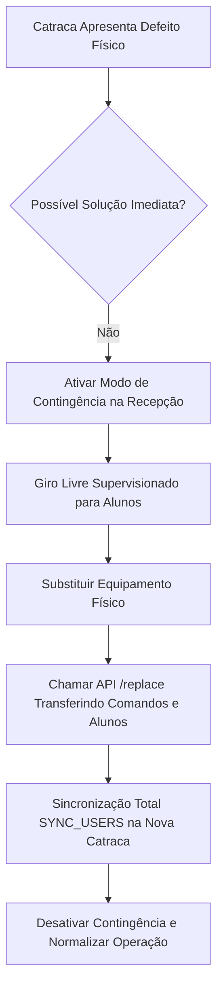

# Runbooks Operacionais e Procedimentos de Emergência (GYM-082)

Este documento estabelece os procedimentos operacionais padrão (SOPs) e runbooks de recuperação rápida para a operação do módulo de academias no AtlasFit.

Em estrita conformidade com as [Regras Globais de Segurança e Escalabilidade (RULE[user_global])](file:///c:/Users/gabriel/development/atlasfit/.agents/rules).

---

## 1. Princípio Fundamental de Recuperação

> [!IMPORTANT]
> **A integridade contábil e a segurança física dos alunos nunca devem ser violadas durante uma contingência.**
> 1. Falhas financeiras NUNCA devem ser corrigidas alterando dados diretamente no banco via SQL (`UPDATE gym_invoices SET balance = 0`). Ajustes exigem lançamentos compensatórios rastreáveis (estornos, créditos ou contrapartidas).
> 2. Falhas em catracas NUNCA devem bloquear a saída física da academia (`direction: EXIT` é incondicionalmente liberado conforme normas de pânico e incêndio).

---

## 2. Runbook 1: Falha em Catraca Física e Substituição de Hardware

### Cenário
Catraca física travada, com placa queimada, leitor biométrico avariado ou com comunicação intermitente com o AtlasFit Agent local.

### Procedimento Passo a Passo



1. **Ação Imediata (Mitigar Fila de Alunos):**
   - Ative o modo de contingência no painel da recepção ou via API:
     ```http
     POST /api/gym/devices/{deviceId}/contingency
     Content-Type: application/json
     
     {
       "workspaceId": "{workspaceId}",
       "action": "ENABLE",
       "reason": "Pane no motor da catraca #01. Liberação supervisionada pela recepção.",
       "durationMinutes": 120
     }
     ```
   - O dispositivo entra em `contingencyMode: true` com prazo máximo de segurança (até 24h), registrando a auditoria com o operador responsável.

2. **Diagnóstico Físico e de Rede:**
   - Verifique se a catraca responde a `ping` no IP local configurado (ex: `192.168.1.200`).
   - Verifique se o serviço `atlasfit-agent` local está em execução.

3. **Substituição por Novo Equipamento:**
   - Instale a catraca de reserva e configure o IP na rede da unidade.
   - Cadastre o novo dispositivo no sistema gerando o novo token de comunicação.
   - Execute a substituição atômica no sistema:
     ```http
     POST /api/gym/devices/{oldDeviceId}/replace
     Content-Type: application/json
     
     {
       "workspaceId": "{workspaceId}",
       "newDeviceId": "{newDeviceId}",
       "reason": "Substituição da Catraca #01 por defeito físico na placa Control iD"
     }
     ```
   - **O que o sistema faz automaticamente:**
     - Inativa o equipamento antigo (`status: OFFLINE`, `isActive: false`).
     - Transfere comandos pendentes para a nova catraca.
     - Enfileira comando prioritário `SYNC_USERS` (prioridade 100) para baixar todos os alunos ativos no novo hardware.
     - Registra auditoria com severidade `critical`.

4. **Finalização da Contingência:**
   - Desative o modo de contingência no equipamento antigo/novo fornecendo as notas de resolução (`resolutionNotes`).

---

## 3. Runbook 2: Replay de Comandos de Hardware com Falha

### Cenário
Comandos de provisionamento de biometria (`ADD_BIOMETRIC`), liberação remota ou bloqueio de inadimplência (`REVOKE_USER`) falharam devido a instabilidade passageira de rede local.

### Procedimento Passo a Passo
1. Localize os comandos com status `FAILED` ou `EXPIRED` na listagem de comandos do dispositivo ou pelo sumário operacional:
   ```http
   GET /api/gym/operations/health?workspaceId={workspaceId}&unitId={unitId}
   ```
2. Para reexecutar um comando específico sem duplicar o evento:
   ```http
   POST /api/gym/devices/commands/{commandId}/replay
   Content-Type: application/json
   
   {
     "workspaceId": "{workspaceId}"
   }
   ```
3. O comando tem seu status resetado para `PENDING`, a mensagem de erro é limpa, a prioridade é elevada para 10, e uma nova janela de expiração de 1 hora é concedida.

---

## 4. Runbook 3: Conciliação Financeira e Pagamentos com Falha

### Cenário A: Cobrança Paga no Asaas mas não Baixada no AtlasFit (Falha de Webhook)
1. **Identificação:** No painel Financeiro, a cobrança consta como quitada no gateway mas a fatura local permanece `OPEN`.
2. **Resolução Rápida:**
   - Acesse `Financeiro > Matrículas` e clique no botão **"Reconciliar"** da matrícula correspondente.
   - A requisição `POST /api/gym/enrollments/{id}/subscription/reconcile` consulta diretamente os pagamentos no Asaas via subconta e aplica a baixa atômica na fatura local com vinculação de alocação.

### Cenário B: Pagamento em Maquininha POS Presencial Informado com Valor Incorreto
1. **Regra de Ouro:** NUNCA editar o registro de pagamento ou a fatura diretamente no banco de dados.
2. **Procedimento de Estorno:**
   - Na aba `Pagamentos Presenciais (Balcão)`, localize o pagamento pelo número de recibo (`REC-YYYYMM-XXXXXX`).
   - Clique em **"Estornar"** e preencha a justificativa detalhada (ex: *"Valor cobrado a maior pelo atendente na maquininha"*).
   - O sistema reverte as alocações, reabre a fatura para cobrança correta e gera log de auditoria.
   - Registre o novo pagamento com os dados corretos da maquininha POS.

---

## 5. Runbook 4: Procedimento de Rollback Funcional

### Cenário
Necessidade de desativar recursos novos ou voltar ao modo de contingência em caso de anomalia grave no software.

### Diretrizes de Rollback
1. **Rollback é Funcional, não Destrutivo:**
   - Nunca realize rollback executando `DROP TABLE` ou `DELETE FROM gym_invoices`.
   - Reverta feature flags na aplicação para forçar o fallback para o modo manual assistido da recepção.
2. **Preservação de Fatos Contábeis:**
   - Faturas pagas, contratos assinados e eventos de acesso registrados são mantidos integralmente.
   - A recepção passa a operar via checagem visual e liberação manual pelo painel até a estabilização do deploy.

---

## 6. Runbook 5: Backup e Restauração em Desastre (PostgreSQL)

### Política de Cópias de Segurança
- **Snapshots Contínuos (PITR):** Point-in-time recovery habilitado no PostgreSQL com retenção de 30 dias.
- **Backups Diários Criptografados:** Dump lógico com gzip e upload para bucket seguro com KMS.

### Procedimento de Restauração em Ambiente de Homologação (Staging)
1. Provisione uma base de dados descartável.
2. Restaure o backup lógico:
   ```bash
   pg_restore -h localhost -U postgres -d atlasfit_recovery backup_atlasfit_latest.dump
   ```
3. Execute a suíte de testes de integridade:
   ```bash
   npx vitest run src/modules/workspaces/__tests__/gym-080.test.ts
   ```
4. Verifique a regra fundamental: `SUM(debits) == SUM(credits)` e confira a integridade das faturas locais vs subcontas.

---

## 7. Runbook 6: Instalação e Manutenção do AtlasFit Agent Local

### Pré-requisitos
- Sistema Operacional: Windows 10/11 Pro ou Ubuntu Server 22.04 LTS.
- Node.js 20+ LTS instalado.
- IP fixo atribuído na interface de rede da catraca e do computador do agente.

### Instalação como Serviço no Windows
1. Clone o repositório ou faça download do pacote de distribuição do agente.
2. Configure o arquivo `.env.local`:
   ```env
   ATLASFIT_API_URL=https://app.atlasfit.com.br
   ATLASFIT_DEVICE_TOKEN=dev_tok_live_xxxxxxxxxxxxxxxx
   CONTROL_ID_IP=192.168.1.200
   CONTROL_ID_PORT=80
   HEARTBEAT_INTERVAL_SEC=30
   ```
3. Instale as dependências e inicie o serviço com reinicialização automática:
   ```powershell
   npm install --production
   npm run start:service
   ```
4. Verifique a saúde da conexão no painel AtlasFit: a catraca deve exibir o badge verde `ONLINE` com heartbeat nos últimos 30 segundos.
