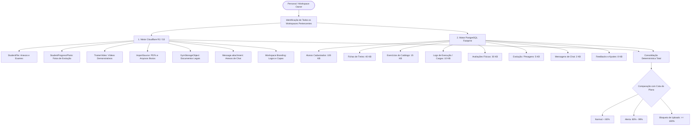

# Motor de Cálculo e Governança de Armazenamento (Storage Engine)

Este documento descreve detalhadamente a arquitetura, regras de cálculo, fórmulas matemáticas, parâmetros de configuração e pontos de aplicação do consumo de armazenamento no **AtlasFit**.

---

## 1. Visão Geral e Princípio de Consolidação Global

No AtlasFit, a cota de armazenamento contratada é um recurso atribuído à **identidade da conta/assinante** (Personal Trainer ou Gestor da Academia), e não fragmentado isoladamente por workspace.

> [!IMPORTANT]
> **Consolidação Multi-Workspace:**
> Quando um profissional possui múltiplos workspaces (por exemplo, consultoria online individual + workspace de estúdio presencial), o armazenamento consumido é a **soma unificada de todos os seus workspaces ativos**. Isso impede evasão de limites via criação de múltiplos ambientes e reflete o real consumo de infraestrutura da conta.

### Correção de Comportamento Anômalo (Bug Histórico)
Anteriormente, o endpoint de assinatura calculava o uso com base em uma simulação aritmética (`simulatedStorage = Math.min(..., limit - 0.2)`), o que gerava a anomalia onde alterar o limite de 3 GB para 8 GB saltava o consumo artificialmente de 2.8 GB para 5.8 GB. 
**Essa lógica foi integralmente extirpada.** O motor de cálculo agora é **100% determinístico**, baseado no inventário real de arquivos na nuvem e no footprint estruturado do banco de dados relacional.

---

## 2. Componentes que Compõem o Armazenamento

O armazenamento total de uma conta é a soma ponderada de duas categorias:
$$\text{Armazenamento Total (Bytes)} = \text{Mídia em Nuvem (Cloud)} + \text{Footprint Relacional (Database)}$$



---

### 2.1. Mídias e Arquivos em Nuvem (Cloudflare R2 / S3)
Os bytes reais de cada arquivo enviado para o provedor de storage em nuvem são contabilizados através dos registros de auditoria no PostgreSQL:

| Origem / Tabela | Descrição | Campo de Tamanho |
| :--- | :--- | :--- |
| `StudentFile` | Documentos, exames, laudos e atestados enviados pelo aluno ou treinador | `size` (bytes) |
| `StudentProgressPhoto` | Fotos de evolução corporal (frente, costas, lateral) em alta resolução | `fileSize` (bytes) |
| `TrainerVideo` | Vídeos de execução de exercícios gravados pelo profissional | `fileSize` (bytes) |
| `ImportSource` | Arquivos originais enviados para processamento/importação de treinos | `fileSize` (bytes) |
| `GymStorageObject` | Alvarás, regulamentos internos e arquivos institucionais | `bytes` / `fileSize` |
| `Message` (com anexo) | Áudios, imagens e arquivos trocados no chat integrado | `fileSize` (ou fallback de 500 KB) |
| `Workspace` (Branding) | Imagens de logotipo (`logo`), marca d'água (`watermarkUrl`) e avatar | 350 KB por asset ativo |

---

### 2.2. Footprint Estruturado de Banco de Dados (PostgreSQL)
Cada registro inserido na plataforma consome memória e espaço em disco no PostgreSQL (dados em tabelas, índices B-Tree e TOAST de textos longos). O AtlasFit aplica pesos realistas calibrados para cada entidade:

```typescript
export const DB_FOOTPRINT_BYTES = {
  // Aluno: perfil completo, membro de workspace, dados de onboarding e anamnese
  STUDENT: 100 * 1024, // 100 KB
  
  // Ficha de Treino: cabeçalho + WorkoutExercise (séries, repetições, tempos de descanso e cargas)
  WORKOUT: 40 * 1024, // 40 KB
  
  // Exercício próprio do catálogo (instruções, links, biomecânica e grupo muscular)
  CATALOG_EXERCISE: 15 * 1024, // 15 KB
  
  // Execução de treino (WorkoutLog: histórico de cargas reais anotadas, RPE e repetições)
  WORKOUT_LOG: 10 * 1024, // 10 KB
  
  // Avaliação física completa (Pollock, dobras cutâneas, bioimpedância e relatórios)
  PHYSICAL_EVALUATION: 30 * 1024, // 30 KB
  
  // Registro de evolução corporal (StudentProgress: pesagens, medidas e histórico)
  STUDENT_PROGRESS: 5 * 1024, // 5 KB
  
  // Mensagem de chat entre aluno e profissional (Message de texto)
  CHAT_MESSAGE: 2 * 1024, // 2 KB
  
  // Feedback diário ou solicitação de ajuste (DailyFeedback, ExerciseAdjustmentRequest)
  FEEDBACK_AND_ADJUSTMENT: 8 * 1024, // 8 KB
  
  // Imagem de branding do workspace (logo, marca d'água, capa de treino, avatar)
  WORKSPACE_BRAND_ASSET: 350 * 1024, // 350 KB
  
  // Estimativa para anexo de chat
  CHAT_ATTACHMENT_ESTIMATE: 500 * 1024, // 500 KB
} as const;
```

---

## 3. Fórmulas de Conversão e Normalização de Cotas

### 3.1. Normalização de Entrada (SuperAdmin / Banco de Dados)
No formulário de planos do SuperAdmin, o campo de armazenamento pode receber valores tanto em Gigabytes quanto em Megabytes. O sistema normaliza automaticamente através da função `normalizeStorageLimitMb`:

```typescript
export function normalizeStorageLimitMb(rawLimit: number | null | undefined): number {
  if (typeof rawLimit !== "number" || isNaN(rawLimit) || rawLimit <= 0) {
    return 1024; // 1 GB padrão de fallback seguro
  }
  // Se informado um número pequeno (<= 50), foi configurado em GB (ex: 3, 5, 8, 20)
  if (rawLimit <= 50) {
    return rawLimit * 1024;
  }
  return rawLimit; // Já está em MB (ex: 3072, 5120, 102400)
}
```

### 3.2. Formatação para Apresentação
- Para exibição em **MB**: $\text{TotalMb} = \frac{\text{TotalBytes}}{1024 \times 1024}$ (com 2 casas decimais).
- Para exibição em **GB**: $\text{TotalGb} = \frac{\text{TotalBytes}}{1024 \times 1024 \times 1024}$ (com 3 casas decimais).
- Percentual de uso: $\text{Percentual} = \left(\frac{\text{TotalMb}}{\text{LimiteMb}}\right) \times 100$ (arredondado em 1 casa decimal).

---

## 4. Onde o Armazenamento é Configurado

### 4.1. No SuperAdmin
1. **Planos Globais da Plataforma**:
   - Arquivo: [src/app/(superadmin)/superadmin/plans/page.tsx](file:///c:/Users/gabriel/development/atlasfit/src/app/(superadmin)/superadmin/plans/page.tsx)
   - Campo: `storageLimitMb`.
2. **Plano Personalizado por Workspace**:
   - Arquivo: [src/app/(superadmin)/superadmin/workspaces/[id]/page.tsx](file:///c:/Users/gabriel/development/atlasfit/src/app/(superadmin)/superadmin/workspaces/[id]/page.tsx)
   - Aba: `Plano Personalizado`.
   - O SuperAdmin pode digitar diretamente `3` (representando 3 GB) ou `3072` (em MB), e o sistema salvará `3072 MB` de forma transparente.

---

## 5. Onde o Armazenamento é Consumido e Aplicado

| Camada | Arquivo | Finalidade |
| :--- | :--- | :--- |
| **Serviço Central** | [src/lib/comprehensive-storage.service.ts](file:///c:/Users/gabriel/development/atlasfit/src/lib/comprehensive-storage.service.ts) | Orquestra todas as queries paralelas no Prisma, computa mídias e registros de todos os workspaces do usuário. |
| **Quota & Guard** | [src/lib/storage-quota.service.ts](file:///c:/Users/gabriel/development/atlasfit/src/lib/storage-quota.service.ts) | Valida permissão de upload antes de permitir upload para o Cloudflare R2 / S3. |
| **API do Personal** | [src/app/api/personal/subscription/route.ts](file:///c:/Users/gabriel/development/atlasfit/src/app/api/personal/subscription/route.ts) | Fornece métricas de uso consolidado e detalhamento para a tela de assinatura do usuário logado. |
| **UI do Personal** | [src/app/(personal)/personal/subscription/page.tsx](file:///c:/Users/gabriel/development/atlasfit/src/app/(personal)/personal/subscription/page.tsx) | Renderiza a barra de progresso, percentual, uso real e divisão entre mídias e dados do banco. |
| **API SuperAdmin** | [src/app/api/superadmin/workspaces/[id]/route.ts](file:///c:/Users/gabriel/development/atlasfit/src/app/api/superadmin/workspaces/[id]/route.ts) | Retorna o consumo individual do workspace e as cotas consolidadas da conta do proprietário. |
| **UI SuperAdmin** | [src/app/(superadmin)/superadmin/workspaces/[id]/page.tsx](file:///c:/Users/gabriel/development/atlasfit/src/app/(superadmin)/superadmin/workspaces/[id]/page.tsx) | Exibe na aba **Assinatura** o cartão de armazenamento com barra de progresso e detalhamento de dados. |

---

## 6. Governança e Resiliência

1. **Prevenção de DoS por Transações Longas**:
   As contagens e somas de armazenamento são executadas fora de blocos com locks pessimistas ou transações serializáveis concorrentes, utilizando queries otimizadas (`count` e `aggregate._sum`).
2. **Idempotência e Tolerância a Falhas**:
   Se alguma tabela secundária retornar nulo, o cálculo utiliza `COALESCE` / fallback para `0`, garantindo que o sistema nunca quebre a tela de assinatura ou de gestão do workspace.
3. **Auditoria**:
   O cálculo detalha exatamente quantos registros e bytes pertencem a mídias versus banco de dados estruturado, permitindo auditorias transparentes entre o suporte e o cliente.
